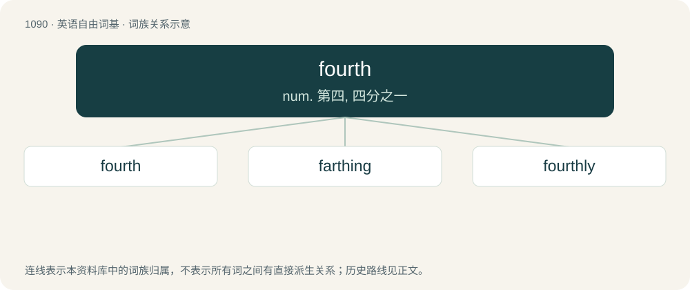

# 1167 · fourth — num. 第四, 四分之一

[总目录](../00_总目录_按常用程度.md)

**类型**：英语自由词基　｜　**来源语言**：见词源记录

## 核心含义与来源

- 核心含义：num. 第四, 四分之一
- 英文含义：The ordinal form of the number four.
- 词形：fourth

**来源记录 1**（形容词；The ordinal form of the number four.）

Inherited from Middle English fourthe, an alteration (due to four) of ferthe, from Old English fēorþa, fēowerþa, from Proto-West Germanic \*feurþō, from Proto-Germanic \*fedurþô, equivalent to four + -th (ordinal suffix). Cognates Compare West Frisian fjirde, Saterland Frisian fjädde, fjoode, Dutch vierde, German Low German feerde, feerd, German vierte, Danish fjerde, Icelandic fjórði.

## 词族图

## 单词速览（常用到不常用）

| 单词 | 音标 | 释义 |
|---|---|---|
| [fourth](#w-1) | 英 /fɔːθ/；美 /fɔɹθ/ | num. 第四, 四分之一 |
| [farthing](#w-2) | 英 /ˈfɑː(ɹ).ðɪŋ/ | n. 法寻(1/4便士), 不值钱的东西 |
| [fourthly](#w-3) | /ˈfɔːɹθ.li/ | adv. 第四(列举条目等时用) |

## 逐词详解

### 1. fourth

**词性**：形容词　｜　**音标**：英 /fɔːθ/；美 /fɔɹθ/

**中文释义**：num. 第四, 四分之一

**英文义项**：The ordinal form of the number four.

**构词拆分**：four + -th (ordinal suffix)

**词源与演化**：

Inherited from Middle English fourthe, an alteration (due to four) of ferthe, from Old English fēorþa, fēowerþa, from Proto-West Germanic \*feurþō, from Proto-Germanic \*fedurþô, equivalent to four + -th (ordinal suffix). Cognates Compare West Frisian fjirde, Saterland Frisian fjädde, fjoode, Dutch vierde, German Low German feerde, feerd, German vierte, Danish fjerde, Icelandic fjórði.

**例句**：

> My office is on the fourth floor of that gray six-story building.

### 2. farthing

**词性**：名词　｜　**音标**：英 /ˈfɑː(ɹ).ðɪŋ/

**中文释义**：n. 法寻(1/4便士), 不值钱的东西

**英文义项**：A very small quantity or value; the least possible amount.

**构词拆分**：fourth + -ing

**词源与演化**：

From Middle English ferthing, from Old English fēorþing, fēorþung (“a quarter, fourth part, farthing”), from fēorþa (“fourth”), from Proto-Germanic \*fedurþungaz (“a quarter”), probably influenced by Old Norse fjórðungr (“a fourth part, quarter”). Equivalent to fourth + -ing; compare English riding (“third part”).

### 3. fourthly

**词性**：副词　｜　**音标**：/ˈfɔːɹθ.li/

**中文释义**：adv. 第四(列举条目等时用)

**英文义项**：In the fourth place; fourth in a row.

**构词拆分**：fourth + -ly

**词源与演化**：

From fourth + -ly.

**例句**：

> Fourthly, you must pay the rent on the first of the month.

该用例对应义项：in the fourth place
