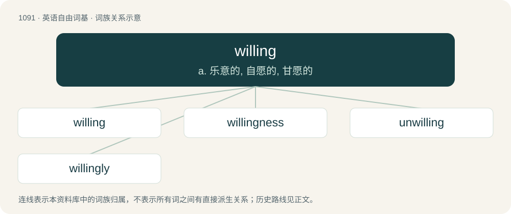

# 1168 · willing — a. 乐意的, 自愿的, 甘愿的

[总目录](../00_总目录_按常用程度.md)

**类型**：英语自由词基　｜　**来源语言**：见词源记录

## 核心含义与来源

- 核心含义：a. 乐意的, 自愿的, 甘愿的
- 英文含义：Ready to do something, particularly something that requires change or effort; not objecting.
- 词形：willing

**来源记录 1**（形容词；Ready to do something, particularly something that requires change or effort; not objecting.）

\* (adjective): Old English willende, present participle of willan \* (noun): Old English willung, from willian By surface analysis, will + -ing.

## 词族图

## 单词速览（常用到不常用）

| 单词 | 音标 | 释义 |
|---|---|---|
| [willing](#w-1) | /ˈwɪlɪŋ/ | a. 乐意的, 自愿的, 甘愿的 |
| [willingness](#w-2) | 英 /ˈwɪlɪŋnəs/ | n. 乐意, 心甘情愿, 愿意 |
| [unwilling](#w-3) | /ʌnˈwɪlɪŋ/ | a. 不愿意的, 勉强的；\[法\] 不愿意的, 勉强的, 不服从的 |
| [willingly](#w-4) | /ˈwɪlɪŋli/ | adv. 自动地, 欣然地 |

## 逐词详解

### 1. willing

**词性**：形容词　｜　**音标**：/ˈwɪlɪŋ/

**中文释义**：a. 乐意的, 自愿的, 甘愿的

**英文义项**：Ready to do something, particularly something that requires change or effort; not objecting.

**词源与演化**：

\* (adjective): Old English willende, present participle of willan \* (noun): Old English willung, from willian By surface analysis, will + -ing.

**例句**：

> If my boyfriend isn't willing to change his drinking habits, I will split up with him.

该用例对应义项：Ready to do something, particularly something that requires change or effort; not objecting.

### 2. willingness

**词性**：名词　｜　**音标**：英 /ˈwɪlɪŋnəs/

**中文释义**：n. 乐意, 心甘情愿, 愿意

**英文义项**：The state of being willing

**构词拆分**：willing + -ness

**词源与演化**：

From willing + -ness.

**例句**：

> All it takes is a willingness to learn.

该用例对应义项：The state of being willing

### 3. unwilling

**词性**：形容词　｜　**音标**：/ʌnˈwɪlɪŋ/

**中文释义**：a. 不愿意的, 勉强的；\[法\] 不愿意的, 勉强的, 不服从的

**英文义项**：Not willing; reluctant

**构词拆分**：un- + willing

**词源与演化**：

From un- + willing.

**例句**：

> We are unwilling to restore his previous privileges after his betrayal of our trust.

该用例对应义项：Not willing; reluctant

### 4. willingly

**词性**：副词　｜　**音标**：/ˈwɪlɪŋli/

**中文释义**：adv. 自动地, 欣然地

**英文义项**：Of one’s own free will; freely and spontaneously.

**构词拆分**：willing + -ly

**词源与演化**：

From Middle English willyngly, wyllyngly (“intentionally, deliverately; freely, gladly”), from Old English willendlīċe (“diligently”), equivalent to willing + -ly.

**例句**：

> Tom and Mary have willingly done everything we've asked them to do.
