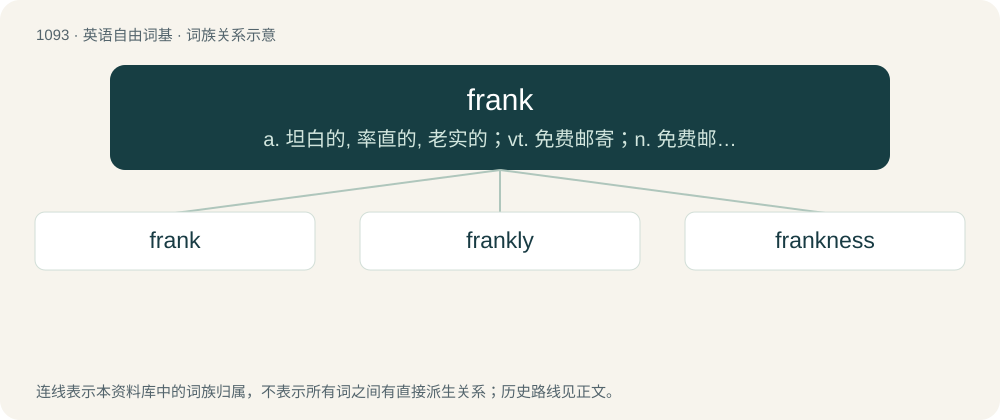

# 1169 · frank — a. 坦白的, 率直的, 老实的；vt. 免费邮寄；n. 免费邮寄特权

[总目录](../00_总目录_按常用程度.md)

**类型**：英语自由词基　｜　**来源语言**：见词源记录

## 核心含义与来源

- 核心含义：a. 坦白的, 率直的, 老实的；vt. 免费邮寄；n. 免费邮寄特权
- 英文含义：Honest, especially in a manner that seems slightly blunt; candid; not reserved or disguised.
- 词形：frank

**多个词源／构词路径**：同一拼写可能有不同来源；以下按词性和含义分别列出。

**来源记录 1**（形容词；Honest, especially in a manner that seems slightly blunt; candid; not reserved or disguised.）

From Middle English frank, from Old French franc (“free”), in turn from the name of an early Germanic confederation, the Franks, from Proto-West Germanic \*frankō (“javelin, spear”). Doublet of Frank, franc, and farang.

**来源记录 2**（名词；A hot dog or sausage.）

Clipping of frankfurter.

**来源记录 3**（名词；A pigsty.）

From Old French franc.

## 词族图

## 单词速览（常用到不常用）

| 单词 | 音标 | 释义 |
|---|---|---|
| [frank](#w-1) | 英 /fɹæŋk/；/fɹeɪ̯ŋk/ | a. 坦白的, 率直的, 老实的；vt. 免费邮寄；n. 免费邮寄特权 |
| [frankly](#w-2) | 英 /fɹæŋkli/；美 /fɹæŋkli/ | adv. 坦白地 |
| [frankness](#w-3) | /ˈfɹæŋknɛs/ | n. 率直, 坦白 |

## 逐词详解

### 1. frank

**词性**：形容词　｜　**音标**：英 /fɹæŋk/；/fɹeɪ̯ŋk/

**中文释义**：a. 坦白的, 率直的, 老实的；vt. 免费邮寄；n. 免费邮寄特权

**英文义项**：Honest, especially in a manner that seems slightly blunt; candid; not reserved or disguised. / Unmistakable, clinically obvious, self-evident.

**词源与演化**：

From Middle English frank, from Old French franc (“free”), in turn from the name of an early Germanic confederation, the Franks, from Proto-West Germanic \*frankō (“javelin, spear”). Doublet of Frank, franc, and farang.

**例句**：

> The research probes whether treating pre-diabetes with metformin can prevent progression to frank diabetes.

该用例对应义项：Unmistakable, clinically obvious, self-evident.

### 2. frankly

**词性**：副词　｜　**音标**：英 /fɹæŋkli/；美 /fɹæŋkli/

**中文释义**：adv. 坦白地

**英文义项**：In a frank or candid manner, especially in a way that may seem too open, excessively honest, or slightly blunt. / In truth, to tell the truth.

**构词拆分**：frank + -ly

**词源与演化**：

From frank + -ly.

**例句**：

> Most of what they said was, frankly, a pack of lies.

该用例对应义项：In truth, to tell the truth.

### 3. frankness

**词性**：名词　｜　**音标**：/ˈfɹæŋknɛs/

**中文释义**：n. 率直, 坦白

**英文义项**：The state of being frank; candour; honesty.

**构词拆分**：frank + -ness

**词源与演化**：

From frank + -ness.

**例句**：

> With disarming frankness, he admitted his mistakes.

该用例对应义项：The state of being frank; candour; honesty.
