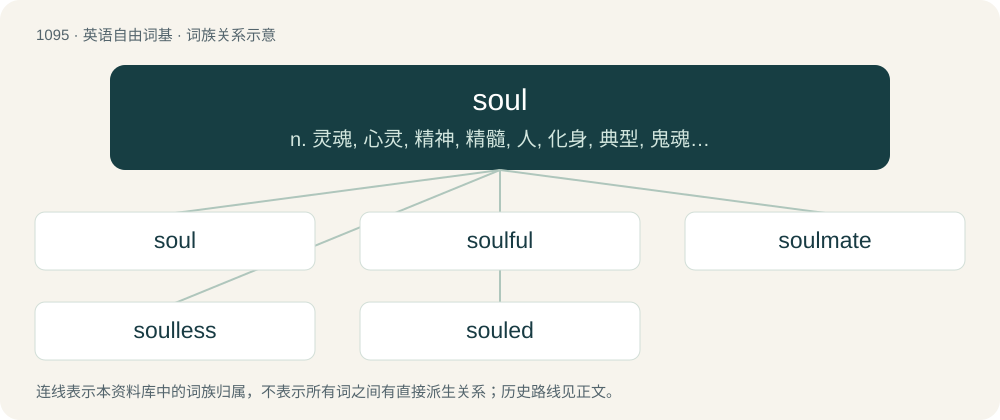

# 1171 · soul — n. 灵魂, 心灵, 精神, 精髓, 人, 化身, 典型, 鬼魂；a. 黑人的

[总目录](../00_总目录_按常用程度.md)

**类型**：英语自由词基　｜　**来源语言**：见词源记录

## 核心含义与来源

- 核心含义：n. 灵魂, 心灵, 精神, 精髓, 人, 化身, 典型, 鬼魂；a. 黑人的
- 英文含义：The spirit or essence of a person usually thought to consist of one's thoughts and personality, often believed to live on after the person's death.
- 词形：soul

**来源记录 1**（名词；The spirit or essence of a person usually thought to consist of one's thoughts and personality, often believed to live on after the person's death.）

From Middle English soule, sowle, saule, sawle, from Old English sāwol (“soul, life, spirit, being”), from Proto-West Germanic \*saiwalu, from Proto-Germanic \*saiwalō (“soul”), of an uncertain ultimate origin (see there for further information). Cognates Cognate with Scots saul, sowel (“soul”), Saterland Frisian Seele (“soul”), West Frisian siel (“soul”), Alemannic German Seel (“soul”), Central Franconian Siel (“soul”), Dutch ziel (“soul”), German Seele (“soul”), German Low German Seel (“soul”), Luxembourgish Séil (“soul, spirit”), Vilamovian zejł, zəjł, zyił (“soul”), Gothic 𐍃𐌰𐌹𐍅𐌰𐌻𐌰 (saiwala, “soul”). Scandinavian homonyms seem to have been borrowed from Old Saxon sēola. Modern Danish sjæl (“soul”), Icelandic sál (“soul”), Norwegian Bokmål sjel (“soul”), Norwegian Nynorsk sjel, sål (“soul”), Swedish själ (“soul”), Finnish sielu (“soul”) may have come from Old English sāwol.

## 词族图

## 单词速览（常用到不常用）

| 单词 | 音标 | 释义 |
|---|---|---|
| [soul](#w-1) | 英 /səʊl/；美 /soʊl/ | n. 灵魂, 心灵, 精神, 精髓, 人, 化身, 典型, 鬼魂；a. 黑人的 |
| [soulful](#w-2) | /ˈsoʊlfəl/ | a. 充满精神的, 感情上的, 高尚的 |
| [soulmate](#w-3) | /ˈsəʊlmeɪt/ | n. 心灵伴侣, 知音, 梦中情人 |
| [soulless](#w-4) | 英 /ˈsəʊl.ləs/；美 /ˈsoʊl.ləs/ | a. 没有精神的, 没有灵魂的, 泄气的 |
| [souled](#w-5) |  | a. 有灵魂的, 灵魂...的, 有感情的 |

## 逐词详解

### 1. soul

**词性**：名词　｜　**音标**：英 /səʊl/；美 /soʊl/

**中文释义**：n. 灵魂, 心灵, 精神, 精髓, 人, 化身, 典型, 鬼魂；a. 黑人的

**英文义项**：The spirit or essence of a person usually thought to consist of one's thoughts and personality, often believed to live on after the person's death. / The spirit or essence of anything.

**词源与演化**：

From Middle English soule, sowle, saule, sawle, from Old English sāwol (“soul, life, spirit, being”), from Proto-West Germanic \*saiwalu, from Proto-Germanic \*saiwalō (“soul”), of an uncertain ultimate origin (see there for further information). Cognates Cognate with Scots saul, sowel (“soul”), Saterland Frisian Seele (“soul”), West Frisian siel (“soul”), Alemannic German Seel (“soul”), Central Franconian Siel (“soul”), Dutch ziel (“soul”), German Seele (“soul”), German Low German Seel (“soul”), Luxembourgish Séil (“soul, spirit”), Vilamovian zejł, zəjł, zyił (“soul”), Gothic 𐍃𐌰𐌹𐍅𐌰𐌻𐌰 (saiwala, “soul”). Scandinavian homonyms seem to have been borrowed from Old Saxon sēola. Modern Danish sjæl (“soul”), Icelandic sál (“soul”), Norwegian Bokmål sjel (“soul”), Norwegian Nynorsk sjel, sål (“soul”), Swedish själ (“soul”), Finnish sielu (“soul”) may have come from Old English sāwol.

**例句**：

> Fifty souls were lost when the ship sank.

该用例对应义项：An individual life.

### 2. soulful

**词性**：形容词　｜　**音标**：/ˈsoʊlfəl/

**中文释义**：a. 充满精神的, 感情上的, 高尚的

**英文义项**：Full of emotion and vigor. / Full of soul.

**构词拆分**：soul + -ful (adjective suffix)

**词源与演化**：

From soul + -ful (adjective suffix).

**例句**：

> These girls have soulful voices and, man, they're hot.

### 3. soulmate

**词性**：名词　｜　**音标**：/ˈsəʊlmeɪt/

**中文释义**：n. 心灵伴侣, 知音, 梦中情人

**英文义项**：Someone, especially a romantic partner, with whom one is exceptionally or uniquely compatible or has a special, almost spiritual connection.

**构词拆分**：soul + mate

**词源与演化**：

From soul + mate. First attested as soul-mate in an 1822 letter by Samuel Taylor Coleridge. Not in common usage before the 1980s.

**例句**：

> Tom has a sham marriage with Mary, but John is his real soulmate.

### 4. soulless

**词性**：形容词　｜　**音标**：英 /ˈsəʊl.ləs/；美 /ˈsoʊl.ləs/

**中文释义**：a. 没有精神的, 没有灵魂的, 泄气的

**英文义项**：As if without a soul; insensitive, unfeeling.

**构词拆分**：soul + -less

**词源与演化**：

From Middle English soulelez; equivalent to soul + -less. Compare Old English sāwollēas; the Middle English word likely is a re-formation.

**例句**：

> Whether male or female, humans are nothing more than soulless meat puppets.

### 5. souled

**词性**：形容词

**中文释义**：a. 有灵魂的, 灵魂...的, 有感情的

**英文义项**：Furnished with a soul / Possessing soul and feeling.

**构词拆分**：From soul + -ed.

**词源与演化**：

From soul + -ed.
