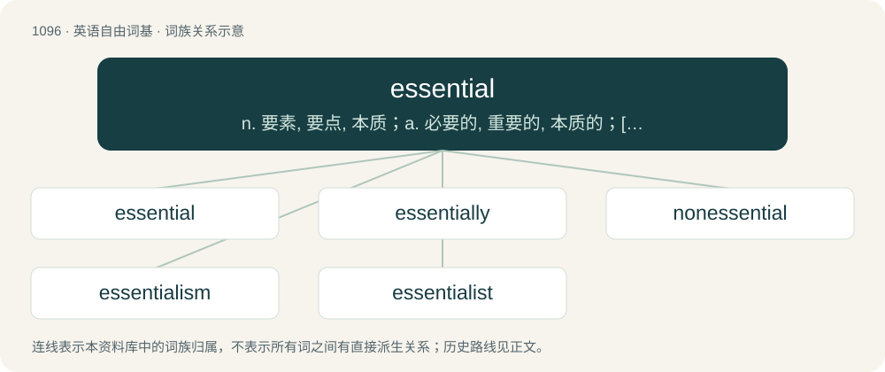

# 1172 · essential — n. 要素, 要点, 本质；a. 必要的, 重要的, 本质的；\[计\] 本质冒险

[总目录](../00_总目录_按常用程度.md)

**类型**：英语自由词基　｜　**来源语言**：见词源记录

## 核心含义与来源

- 核心含义：n. 要素, 要点, 本质；a. 必要的, 重要的, 本质的；\[计\] 本质冒险
- 英文含义：Necessary.
- 词形：essential

**来源记录 1**（形容词；Necessary.）

From Late Latin essentiālis, from Latin essentia (“being, essence”).

## 词族图

## 单词速览（常用到不常用）

| 单词 | 音标 | 释义 |
|---|---|---|
| [essential](#w-1) | 英 /ɪˈsɛn.ʃəl/；美 /ɪˈsɛn.ʃəl/ | n. 要素, 要点, 本质；a. 必要的, 重要的, 本质的；\[计\] 本质冒险 |
| [essentially](#w-2) | /ɪˈsɛnʃəli/ | adv. 本质上, 本来 |
| [nonessential](#w-3) | /.nɒniˈsenʃəl/ | a. 非本质的；n. 不重要的人 |
| [essentialism](#w-4) | 英 /ɪˈsɛnʃəlɪz(ə)m/；美 /əˈsɛn(t)ʃəˌlɪzəm/ | n. 基本教育论, 本质先于存在论 |
| [essentialist](#w-5) | /ˌɪˈsenʃəlɪst/ | n. 基本教育说, 实在说 |

## 逐词详解

### 1. essential

**词性**：形容词　｜　**音标**：英 /ɪˈsɛn.ʃəl/；美 /ɪˈsɛn.ʃəl/

**中文释义**：n. 要素, 要点, 本质；a. 必要的, 重要的, 本质的；\[计\] 本质冒险

**英文义项**：Necessary. / Very important; of high importance.

**词源与演化**：

From Late Latin essentiālis, from Latin essentia (“being, essence”).

**例句**：

> I see it as essential that there should be somewhere to park.

该用例对应义项：Very important; of high importance.

### 2. essentially

**词性**：副词　｜　**音标**：/ɪˈsɛnʃəli/

**中文释义**：adv. 本质上, 本来

**英文义项**：In essence: by nature. / In essence: in most ways that matter; in all ways that matter.

**构词拆分**：essential + -ly

**词源与演化**：

From essential + -ly.

**例句**：

> A: So you're saying, in other words, that he's greedy? B: Essentially, yes, that's what I'm saying.

该用例对应义项：In essence: in most ways that matter; in all ways that matter.

### 3. nonessential

**词性**：形容词　｜　**音标**：/.nɒniˈsenʃəl/

**中文释义**：a. 非本质的；n. 不重要的人

**英文义项**：Not required; not essential.

**构词拆分**：non- + essential

**词源与演化**：

From non- + essential.

**例句**：

> Nonessential to the integral meanings of poetry.

该用例对应义项：not of prime or central importance

### 4. essentialism

**词性**：名词　｜　**音标**：英 /ɪˈsɛnʃəlɪz(ə)m/；美 /əˈsɛn(t)ʃəˌlɪzəm/

**中文释义**：n. 基本教育论, 本质先于存在论

**英文义项**：The view that objects have properties that are essential to them. / The view that all members of certain groups of people (such as those with the same race, gender, age, or sexual orientation) have common, essential traits inherent to the defining feature of the group; (also) behavior or statement(s) that reflect such a view.

**构词拆分**：essential + -ism

**词源与演化**：

From essential + -ism.

### 5. essentialist

**词性**：名词　｜　**音标**：/ˌɪˈsenʃəlɪst/

**中文释义**：n. 基本教育说, 实在说

**英文义项**：An advocate of essentialism.

**构词拆分**：essential + -ist

**词源与演化**：

From essential + -ist.
