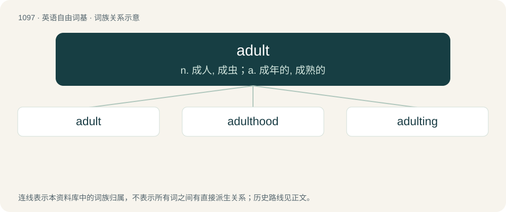

# 1173 · adult — n. 成人, 成虫；a. 成年的, 成熟的

[总目录](../00_总目录_按常用程度.md)

**类型**：英语自由词基　｜　**来源语言**：见词源记录

## 核心含义与来源

- 核心含义：n. 成人, 成虫；a. 成年的, 成熟的
- 英文含义：An animal that is full-grown.
- 词形：adult

**来源记录 1**（名词；An animal that is full-grown.）

From French adulte, from Latin adultus (“grown up”), perfect passive participle of adolescō (“to grow up”). Compare adolescent.

## 词族图

## 单词速览（常用到不常用）

| 单词 | 音标 | 释义 |
|---|---|---|
| [adult](#w-1) | 英 /ˈæd.ʌlt/；/əˈdʌlt/ | n. 成人, 成虫；a. 成年的, 成熟的 |
| [adulthood](#w-2) | /əˈdʌlthud/ | n. 成年；\[医\] 成人期 |
| [adulting](#w-3) |  | 【英文】Activities typically associated with adulthood. |

## 逐词详解

### 1. adult

**词性**：形容词　｜　**音标**：英 /ˈæd.ʌlt/；/əˈdʌlt/

**中文释义**：n. 成人, 成虫；a. 成年的, 成熟的

**英文义项**：Fully grown. / Intended for or restricted to adults rather than children due to size, maturity, knowledge level, judgement, etc.

**词源与演化**：

From French adulte, from Latin adultus (“grown up”), perfect passive participle of adolescō (“to grow up”). Compare adolescent.

**例句**：

> Children go free, but for those 12 and up, you must purchase an adult ticket.

该用例对应义项：Intended for, or restricted to, those who are not young children.

### 2. adulthood

**词性**：名词　｜　**音标**：/əˈdʌlthud/

**中文释义**：n. 成年；\[医\] 成人期

**英文义项**：The state or condition, for humans and other animals, of physical and psychological maturity: being an adult. / The time period of a person's majority, following puberty and lasting until death.

**构词拆分**：adult + -hood

**词源与演化**：

From adult + -hood.

**例句**：

> The things learned in childhood affect us throughout our adulthood.

该用例对应义项：The time period of a person's majority, following puberty and lasting until death.

### 3. adulting

**词性**：名词

**英文义项**：Activities typically associated with adulthood.

**构词拆分**：adult + -ing

**词源与演化**：

From adult + -ing.

**例句**：

> I need to log out for a bit and do some adulting.
