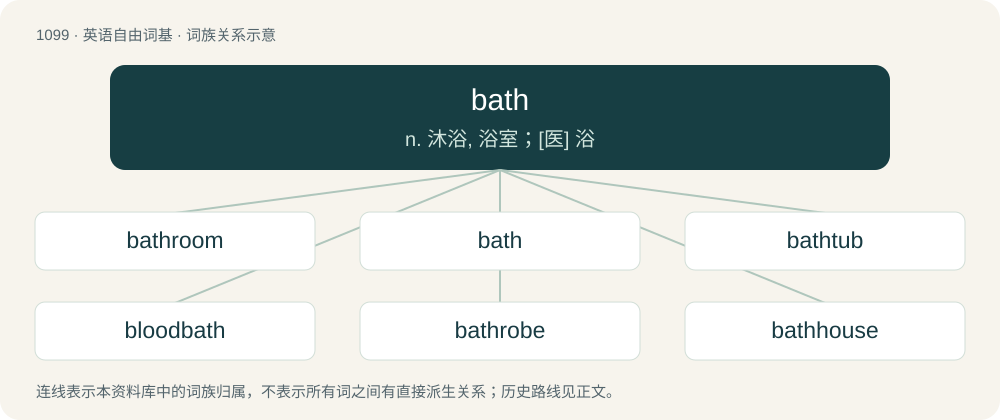

# 1177 · bath — n. 沐浴, 浴室；\[医\] 浴

[总目录](../00_总目录_按常用程度.md)

**类型**：英语自由词基　｜　**来源语言**：见词源记录

## 核心含义与来源

- 核心含义：n. 沐浴, 浴室；\[医\] 浴
- 英文含义：A tub or pool which is used for bathing: bathtub.
- 词形：bath

**来源记录 1**（名词；A tub or pool which is used for bathing: bathtub.）

From Middle English bath, baþ, from Old English bæþ (“bath”), from Proto-West Germanic \*baþ, from Proto-Germanic \*baþą (“bath”), from Proto-Indo-European \*bʰeh₁- (“to warm”). Corresponding inherited verbs are beath and bathe. Cognate with Danish, Dutch, Norwegian, and Swedish bad (“bath”), Faroese and Icelandic bað (“bath”), German Bad (“bath”).

## 词族图

## 单词速览（常用到不常用）

| 单词 | 音标 | 释义 |
|---|---|---|
| [bathroom](#w-1) | 英 /ˈbɑːθɹʊm/；美 /ˈbæθˌɹum/ | n. 浴室, 厕所 |
| [bath](#w-2) | /bɑːθ/ | n. 沐浴, 浴室；\[医\] 浴 |
| [bathtub](#w-3) | 英 /ˈbɑːθtʌb/；美 /ˈbæθtʌb/ | n. 浴缸 |
| [bloodbath](#w-4) | 英 /ˈblʌdˌbɑːθ/；美 /ˈblʌdˌbæθ/ | n. 大屠杀 |
| [bathrobe](#w-5) | 英 /ˈbɑːθ.ɹəʊb/；美 /ˈbæθ.ɹoʊb/ | n. 浴衣 |
| [bathhouse](#w-6) | 美 /ˈbæθˌhaʊs/ | n. 公共浴室, 澡堂, 更衣室 |
| [bathwater](#w-7) | 英 /ˈbɑːθwɔːtə(ɹ)/；美 /ˈbæθwɔtɚ/ | n. 浴缸里的水 |

## 逐词详解

### 1. bathroom

**词性**：名词　｜　**音标**：英 /ˈbɑːθɹʊm/；美 /ˈbæθˌɹum/

**中文释义**：n. 浴室, 厕所

**英文义项**：A room containing a shower or bathtub, and (typically but not necessarily) a toilet. / A lavatory: a room containing a toilet and (typically but not necessarily) a bathtub.

**构词拆分**：bath + room

**词源与演化**：

From bath + room. Compare Dutch badkamer (“bathroom”), German Badezimmer (“bathroom”), Swedish badrum (“bathroom”), Faroese baðrúm (“bathroom”).

**例句**：

> Most Americans don't know 'WC' and many Brits mock 'bathroom' but almost everyone understands 'toilet' or 'lavatory'.

该用例对应义项：A lavatory: a room containing a toilet and (typically but not necessarily) a bathtub.

### 2. bath

**词性**：名词　｜　**音标**：/bɑːθ/

**中文释义**：n. 沐浴, 浴室；\[医\] 浴

**英文义项**：A tub or pool which is used for bathing: bathtub. / A building or area where bathing occurs.

**词源与演化**：

From Middle English bath, baþ, from Old English bæþ (“bath”), from Proto-West Germanic \*baþ, from Proto-Germanic \*baþą (“bath”), from Proto-Indo-European \*bʰeh₁- (“to warm”). Corresponding inherited verbs are beath and bathe. Cognate with Danish, Dutch, Norwegian, and Swedish bad (“bath”), Faroese and Icelandic bað (“bath”), German Bad (“bath”).

**例句**：

> Do you prefer baths or showers?

该用例对应义项：Specifically, bathing by immersing the body in water, rather than through other means, or an instance of this.

### 3. bathtub

**词性**：名词　｜　**音标**：英 /ˈbɑːθtʌb/；美 /ˈbæθtʌb/

**中文释义**：n. 浴缸

**英文义项**：A large container for holding water in which a person may bathe (take a bath).

**构词拆分**：bath + tub

**词源与演化**：

From bath + tub.

**例句**：

> I had a long, leisurely soak in the bathtub.

该用例对应义项：A large container for holding water in which a person may bathe (take a bath).

### 4. bloodbath

**词性**：名词　｜　**音标**：英 /ˈblʌdˌbɑːθ/；美 /ˈblʌdˌbæθ/

**中文释义**：n. 大屠杀

**英文义项**：Indiscriminate killing or slaughter; a massacre. / An aggressive or very violent contest or confrontation.

**构词拆分**：blood + bath

**词源与演化**：

From blood + bath, the latter used referring to a metaphorical deluge. Compare West Frisian bloedbad (“bloodbath”), Dutch bloedbad (“bloodbath”), German Blutbad (“bloodbath”), Danish blodbad (“bloodbath”), Norwegian Bokmål blodbad (“bloodbath”), Swedish blodbad (“bloodbath”), Icelandic blóðbad (“bloodbath”).

**例句**：

> A bloodbath took place when the leaders of the plot surrendered.

该用例对应义项：indiscriminate slaughter

### 5. bathrobe

**词性**：名词　｜　**音标**：英 /ˈbɑːθ.ɹəʊb/；美 /ˈbæθ.ɹoʊb/

**中文释义**：n. 浴衣

**英文义项**：A robe usually made of terrycloth intended to be worn when one is still damp from bathing or when there is no immediate need to dress fully.

**构词拆分**：bath + robe

**词源与演化**：

From bath + robe.

**例句**：

> I put on my bathrobe after getting out of the shower.

### 6. bathhouse

**词性**：名词　｜　**音标**：美 /ˈbæθˌhaʊs/

**中文释义**：n. 公共浴室, 澡堂, 更衣室

**英文义项**：A building with baths for communal use. / A building where swimmers can change clothes.

**构词拆分**：bath + house

**词源与演化**：

Inherited from Middle English bathhous, bathous, from Old English bæþhūs (“bathhouse”), equivalent to bath + house. Cognate with Dutch badhuis (“bathhouse”), German Badehaus (“bathhouse”), German Low German Baadhuus, Boodhuus (“bathhouse”), Danish badehus (“bathhouse”), Norwegian Bokmål badehus (“bathhouse”), Norwegian Nynorsk badehus (“bathhouse”), Swedish badhus (“bathhouse”).

**例句**：

> Luckily for Neo, there is a bubble tea vendor near the bathhouse.

### 7. bathwater

**词性**：名词　｜　**音标**：英 /ˈbɑːθwɔːtə(ɹ)/；美 /ˈbæθwɔtɚ/

**中文释义**：n. 浴缸里的水

**英文义项**：The water used in a bath (bathtub).

**构词拆分**：bath + water

**词源与演化**：

From bath + water. Compare Dutch badwater (“bathwater”), German Badewasser (“bathwater”), Swedish badvatten (“bathwater”).

**例句**：

> Some people reuse their bathwater for washing their cars.
