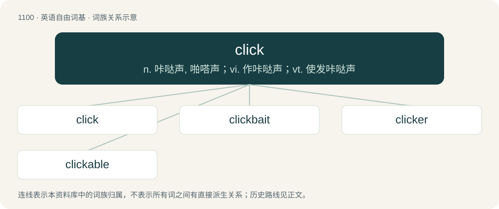

# 1179 · click — n. 咔哒声, 啪嗒声；vi. 作咔哒声；vt. 使发咔哒声

[总目录](../00_总目录_按常用程度.md)

**类型**：英语自由词基　｜　**来源语言**：见词源记录

## 核心含义与来源

- 核心含义：n. 咔哒声, 啪嗒声；vi. 作咔哒声；vt. 使发咔哒声
- 英文含义：A brief, sharp, not particularly loud, relatively high-pitched sound produced by the impact of something small and hard against something hard, such as by the operation of a switch, a lock, or a latch.
- 词形：click

**多个词源／构词路径**：同一拼写可能有不同来源；以下按词性和含义分别列出。

**来源记录 1**（名词；A brief, sharp, not particularly loud, relatively high-pitched sound produced by the impact of something small and hard against something hard, such as by the operation of a switch, a lock, or a latch.）

Imitative of the "click" sound; first recorded in the 1500s. Compare Saterland Frisian klikke (“to click”), Middle Dutch clicken (Modern Dutch: klikken (“to click”)), Old High German klecchen (Modern German: klecken, klicken (“to click”)), Danish klikke (“to click”), Swedish klicka (“to click”), Norwegian klikke (“to click”), Norwegian klekke (“to hatch”).

**来源记录 2**（名词；A detent, pawl, or ratchet, such as that which catches the cogs of a ratchet wheel to prevent backward motion.）

From Middle English clike, from Old French clique (“latch”).

**来源记录 3**（名词；A kind of throw.）

From Middle English cleken, a variant of clechen (“to grab”), perhaps from Old English \*clēċan, \*clǣċan, a byform of clyċċan (“to clutch”). More at clutch.

## 词族图

## 单词速览（常用到不常用）

| 单词 | 音标 | 释义 |
|---|---|---|
| [click](#w-1) | /klɪk/ | n. 咔哒声, 啪嗒声；vi. 作咔哒声；vt. 使发咔哒声 |
| [clickbait](#w-2) | 英 /ˈklɪkbeɪt/ | 【英文】Website content that is aimed at generating advertising revenue, especially at the expense of quality or accuracy, relying on sensationalist headlines to attract click-throughs; such headlines. |
| [clicker](#w-3) | 英 /ˈklɪkə/；美 /ˈklɪkɚ/ | n. 鞋匠工头, (英)排字工头 |
| [clickable](#w-4) | /ˈklɪkəbəl/ | a. 可以点击的；可以打开的 |

## 逐词详解

### 1. click

**词性**：名词　｜　**音标**：/klɪk/

**中文释义**：n. 咔哒声, 啪嗒声；vi. 作咔哒声；vt. 使发咔哒声

**英文义项**：A brief, sharp, not particularly loud, relatively high-pitched sound produced by the impact of something small and hard against something hard, such as by the operation of a switch, a lock, or a latch. / The act of snapping one's fingers.

**词源与演化**：

Imitative of the "click" sound; first recorded in the 1500s. Compare Saterland Frisian klikke (“to click”), Middle Dutch clicken (Modern Dutch: klikken (“to click”)), Old High German klecchen (Modern German: klecken, klicken (“to click”)), Danish klikke (“to click”), Swedish klicka (“to click”), Norwegian klikke (“to click”), Norwegian klekke (“to hatch”).

**例句**：

> As I turned the key, the lock gave a click and the door opened.

该用例对应义项：A brief, sharp, not particularly loud, relatively high-pitched sound produced by the impact of something small and hard against something hard, such as by the operation of a switch, a lock, or a latch.

### 2. clickbait

**词性**：名词　｜　**音标**：英 /ˈklɪkbeɪt/

**英文义项**：Website content that is aimed at generating advertising revenue, especially at the expense of quality or accuracy, relying on sensationalist headlines to attract click-throughs; such headlines.

**构词拆分**：click + -bait

**词源与演化**：

From click + -bait (“manipulation to elicit a particular response”).

**例句**：

> After falling victim to clickbait, my computer caught a virus.

### 3. clicker

**词性**：名词　｜　**音标**：英 /ˈklɪkə/；美 /ˈklɪkɚ/

**中文释义**：n. 鞋匠工头, (英)排字工头

**英文义项**：The remote-control device used to change settings on a television set, VCR, or other electronic equipment. / An electronic device used by individual students in the classroom to respond to multiple-choice questions, etc.

**构词拆分**：click + -er

**词源与演化**：

From click + -er.

**例句**：

> We have a clicker for the TV, one for the VCR, one for the DVD player and another one that does it all.

该用例对应义项：The remote-control device used to change settings on a television set, VCR, or other electronic equipment.

### 4. clickable

**词性**：形容词　｜　**音标**：/ˈklɪkəbəl/

**中文释义**：a. 可以点击的；可以打开的

**英文义项**：That establishes rapport with an audience. / That retains its shape after being cut by a blade or punched by a die.

**构词拆分**：click + -able

**词源与演化**：

c. 1943 (entertainment), c. 1965 (manufacturing), c. 1985 (computing) click + -able

**例句**：

> Putting a clickable link in your post is easy.

该用例对应义项：Causing some action to occur when clicked with a mouse or other pointing device.
