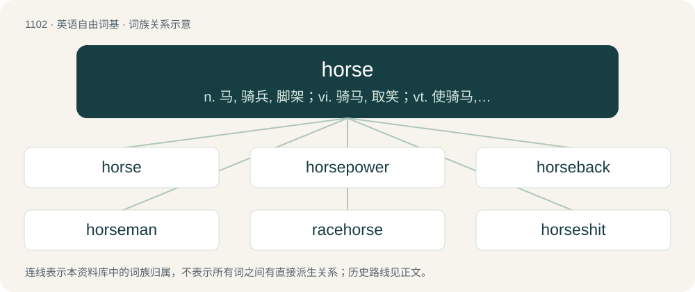

# 1181 · horse — n. 马, 骑兵, 脚架；vi. 骑马, 取笑；vt. 使骑马, 系马于

[总目录](../00_总目录_按常用程度.md)

**类型**：英语自由词基　｜　**来源语言**：见词源记录

## 核心含义与来源

- 核心含义：n. 马, 骑兵, 脚架；vi. 骑马, 取笑；vt. 使骑马, 系马于
- 英文含义：A hoofed mammal, Equus ferus caballus, often used throughout history for riding and draft work.
- 词形：horse

**多个词源／构词路径**：同一拼写可能有不同来源；以下按词性和含义分别列出。

**来源记录 1**（名词；A hoofed mammal, Equus ferus caballus, often used throughout history for riding and draft work.）

From Middle English hors, horse, ors, from Old English hors (“horse”), from Proto-West Germanic \*hors, \*hross, from Proto-Germanic \*hrussą (“horse”), from Proto-Indo-European \*ḱr̥sós (“vehicle”), from Proto-Indo-European \*ḱers- (“to run”). Doublet of car and carrus. Cognates Cognate with Scots horse (“horse”), West Frisian hoars (“horse”), Cimbrian ross (“horse”), Dutch hors, ros (“horse”), German Ross, Roß (“horse”), Danish and Norwegian Nynorsk hors (“horse, mare”), Faroese hors, ross (“horse”), Icelandic hross (“horse”), Swedish russ (“horse”); also Cornish karr (“car”), Welsh car (“car; cart, wagon”), Latin currus (“car, chariot; wagon, wain”), Ancient Greek ἐπίκουρος (epíkouros, “aiding, assisting; defending; ally, helper; hireling”), Tocharian A kursär (“vehicle; mile”), Tocharian B kwarsär (“course; path”).

**来源记录 2**（动词；Synonym of horse around.）

From Middle English horsen, from Old English horsian (“to horse, provide with horses”) and ġehorsian (“to horse, set or mount on a horse, supply with horses”), from the noun (see above).

**来源记录 3**（名词；Heroin (drug).）

Unknown; probably originally criminals' cant based on the initial letter of heroin and horse.

## 词族图

## 单词速览（常用到不常用）

| 单词 | 音标 | 释义 |
|---|---|---|
| [horse](#w-1) | 英 /hɔːs/；美 /hoɹs/ | n. 马, 骑兵, 脚架；vi. 骑马, 取笑；vt. 使骑马, 系马于 |
| [horsepower](#w-2) | 英 /ˈhɔːsˌpaʊə/；美 /ˈhɔɹsˌpaʊɚ/ | n. 马力；\[电\] 马力 |
| [horseback](#w-3) | 英 /ˈhɔːsˌbæk/；美 /ˈhɔɹsˌbæk/ | n. 马背；adv. 在马背上, 骑在马上 |
| [horseman](#w-4) | 英 /ˈhɔːsmən/；美 /ˈhɔɹsmən/ | n. 骑马者, 马术师, 养马者 |
| [racehorse](#w-5) | /ˈreishɒːs/ | n. (赛马用的)马 |
| [horseshit](#w-6) | /ˈhɔːsʃit,ˈhɔːʃ-/ | n. 胡说, 谎话 |
| [workhorse](#w-7) | 英 /ˈwɜːkˌhɔːs/；美 /ˈwɝkˌhoɹs/ | n. 载重马, 做重活的人 |
| [horseradish](#w-8) | 英 /ˈhɔːsɹædɪʃ/；美 /ˈhɔɹsɹædɪʃ/ | n. 辣根, 辣根所制调味剂 |
| [warhorse](#w-9) | /ˈwɔːhɔːs/ | n. 军马, &lt;口&gt;老兵, 老练的人 |
| [horsehair](#w-10) | /ˈhɔːsheə(r)/ | n. 马毛, 马鬃；\[医\] 马鬃 |

## 逐词详解

### 1. horse

**词性**：名词　｜　**音标**：英 /hɔːs/；美 /hoɹs/

**中文释义**：n. 马, 骑兵, 脚架；vi. 骑马, 取笑；vt. 使骑马, 系马于

**英文义项**：A hoofed mammal, Equus ferus caballus, often used throughout history for riding and draft work. / Any member of the species Equus ferus, including the Przewalski's horse and the extinct Equus ferus ferus.

**词源与演化**：

From Middle English hors, horse, ors, from Old English hors (“horse”), from Proto-West Germanic \*hors, \*hross, from Proto-Germanic \*hrussą (“horse”), from Proto-Indo-European \*ḱr̥sós (“vehicle”), from Proto-Indo-European \*ḱers- (“to run”). Doublet of car and carrus. Cognates Cognate with Scots horse (“horse”), West Frisian hoars (“horse”), Cimbrian ross (“horse”), Dutch hors, ros (“horse”), German Ross, Roß (“horse”), Danish and Norwegian Nynorsk hors (“horse, mare”), Faroese hors, ross (“horse”), Icelandic hross (“horse”), Swedish russ (“horse”); also Cornish karr (“car”), Welsh car (“car; cart, wagon”), Latin currus (“car, chariot; wagon, wain”), Ancient Greek ἐπίκουρος (epíkouros, “aiding, assisting; defending; ally, helper; hireling”), Tocharian A kursär (“vehicle; mile”), Tocharian B kwarsär (“course; path”).

**例句**：

> She's scored very highly with the parallel bars; let's see how she does with the horse.

该用例对应义项：In gymnastics, a piece of equipment with a body on two or four legs, approximately four feet high, sometimes (pommel horse) with two handles on top.

### 2. horsepower

**词性**：名词　｜　**音标**：英 /ˈhɔːsˌpaʊə/；美 /ˈhɔɹsˌpaʊɚ/

**中文释义**：n. 马力；\[电\] 马力

**英文义项**：Power derived from the motion of a horse. / A nonmetric unit of power with various definitions, commonly the mechanical horsepower, approximately equal to 745.7 watts.

**构词拆分**：horse + power

**词源与演化**：

From horse + power: the unit was originally defined as the amount of power that a horse could provide. Both non-metric and metric units of power were derived from effectively identical measurements of the power a draught horse could sustain over several hours, with the difference in watts solely due to different rounding errors to express that power in round numbers in the original non-SI units (ft·lbf/min and kgf⋅m/s respectively).

**用法示例／搭配（非完整句）**：

> political horsepower

该用例对应义项：Strength, performance capability, specs, or similar.

### 3. horseback

**词性**：名词　｜　**音标**：英 /ˈhɔːsˌbæk/；美 /ˈhɔɹsˌbæk/

**中文释义**：n. 马背；adv. 在马背上, 骑在马上

**英文义项**：The back of a horse. / A ridge of sand, gravel, and boulders.

**构词拆分**：horse + back

**词源与演化**：

From Middle English horsebacke, horsebak, horsbak, equivalent to horse + back.

**例句**：

> They came on horseback across the plains.

该用例对应义项：The back of a horse.

### 4. horseman

**词性**：名词　｜　**音标**：英 /ˈhɔːsmən/；美 /ˈhɔɹsmən/

**中文释义**：n. 骑马者, 马术师, 养马者

**英文义项**：A man who rides a horse. / A soldier on horseback, especially a cavalryman.

**构词拆分**：horse + man

**词源与演化**：

From Middle English horsman, equivalent to horse + man.

**例句**：

> The horse of the fourth horseman of the Apocalypse was actually green.

### 5. racehorse

**词性**：名词　｜　**音标**：/ˈreishɒːs/

**中文释义**：n. (赛马用的)马

**英文义项**：A horse that competes in races. / Any member of certain species of genus Congiopodus.

**构词拆分**：race + horse

**词源与演化**：

From race + horse.

**例句**：

> An investigation established that the racehorse had been doped.

### 6. horseshit

**词性**：名词　｜　**音标**：/ˈhɔːsʃit,ˈhɔːʃ-/

**中文释义**：n. 胡说, 谎话

**英文义项**：Serious harassment or abuse. / Blatant nonsense, more likely stemming from ignorance than any intent to deceive.

**构词拆分**：horse + shit

**词源与演化**：

From horse + shit.

**例句**：

> He claims that he wasn't at that meeting? Don't you realize that's horseshit?

该用例对应义项：Deliberate falsehoods (lies); manipulations or cons (fraud).

### 7. workhorse

**词性**：名词　｜　**音标**：英 /ˈwɜːkˌhɔːs/；美 /ˈwɝkˌhoɹs/

**中文释义**：n. 载重马, 做重活的人

**英文义项**：A horse used primarily for manual labor; a draft/draught horse. / A person or piece of equipment that performs a lot of work, especially one heavily relied upon to perform consistently and regularly.

**构词拆分**：work + horse

**词源与演化**：

From Middle English werkehorse, equivalent to work + horse.

**例句**：

> Those old machines are not very glamorous, but even 20 years after their introduction, they are still the workhorses of the industry.

该用例对应义项：A person or piece of equipment that performs a lot of work, especially one heavily relied upon to perform consistently and regularly.

### 8. horseradish

**词性**：名词　｜　**音标**：英 /ˈhɔːsɹædɪʃ/；美 /ˈhɔɹsɹædɪʃ/

**中文释义**：n. 辣根, 辣根所制调味剂

**英文义项**：A plant of the mustard family, Armoracia rusticana, cultivated for its edible root. / A pungent condiment made from the root of the plant.

**构词拆分**：horse + radish

**词源与演化**：

From horse + radish.

**例句**：

> This cheddar cheese is made from Welsh brown ale, horseradish, and mustard seeds.

### 9. warhorse

**词性**：名词　｜　**音标**：/ˈwɔːhɔːs/

**中文释义**：n. 军马, &lt;口&gt;老兵, 老练的人

**英文义项**：An experienced person who has been through many battles, situations or contests; someone who has given long service. / A regularly revived theatrical or musical work, as with Hamlet or a Beethoven symphony, or as excerpts thereto. May imply that the work in question has become hackneyed.

**构词拆分**：war + horse

**词源与演化**：

From war + horse.

**用法示例／搭配（非完整句）**：

> a Wagner warhorse

该用例对应义项：A regularly revived theatrical or musical work, as with Hamlet or a Beethoven symphony, or as excerpts thereto. May imply that the work in question has become hackneyed.

### 10. horsehair

**词性**：名词　｜　**音标**：/ˈhɔːsheə(r)/

**中文释义**：n. 马毛, 马鬃；\[医\] 马鬃

**英文义项**：The hair of a horse, especially from the mane and tail, used for upholstery. / A fabric made from this.

**构词拆分**：horse + hair

**词源与演化**：

From Middle English hors her, horshere, hors-here, hors heer (also hors-hore), equivalent to horse + hair. Compare Old Norse hross-hár (“horsehair”).

**例句**：

> This antique horsehair sofa smells like old cigars.
