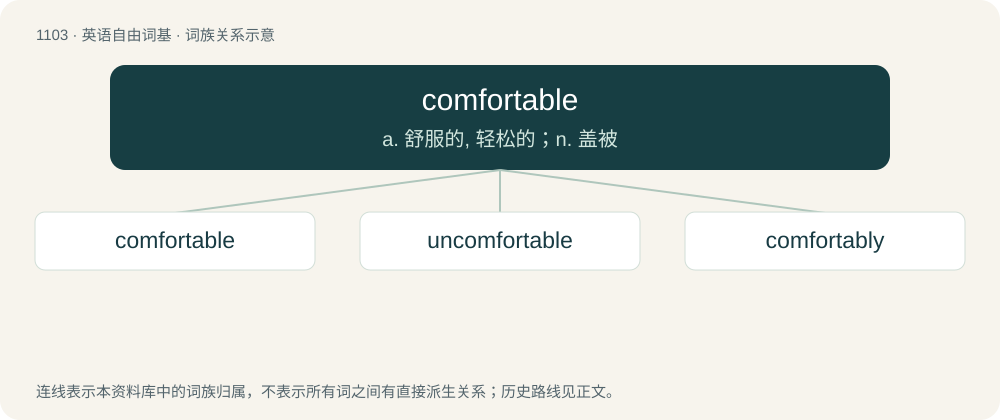

# 1182 · comfortable — a. 舒服的, 轻松的；n. 盖被

[总目录](../00_总目录_按常用程度.md)

**类型**：英语自由词基　｜　**来源语言**：见词源记录

## 核心含义与来源

- 核心含义：a. 舒服的, 轻松的；n. 盖被
- 英文含义：Providing physical comfort and ease; agreeable.
- 词形：comfortable

**来源记录 1**（形容词；Providing physical comfort and ease; agreeable.）

From Middle English comfortable, from Old French confortable, from conforter. By surface analysis, comfort + -able.

## 词族图

## 单词速览（常用到不常用）

| 单词 | 音标 | 释义 |
|---|---|---|
| [comfortable](#w-1) | /ˈkʌm(p)f.tə.bəl/ | a. 舒服的, 轻松的；n. 盖被 |
| [uncomfortable](#w-2) | 英 /ʌnˈkʌmf.tə.bl̩/；美 /ʌnˈkʌm.fɚ.tə.bl̩/ | a. 不舒服的, 不自在的, 不安的 |
| [comfortably](#w-3) | 英 /ˈkʌmf(ə)təbli/；美 /ˈkʌmftɚbli/ | adv. 安乐地, 舒服地, 宽裕地 |

## 逐词详解

### 1. comfortable

**词性**：形容词　｜　**音标**：/ˈkʌm(p)f.tə.bəl/

**中文释义**：a. 舒服的, 轻松的；n. 盖被

**英文义项**：Providing physical comfort and ease; agreeable. / In a state of comfort and content.

**词源与演化**：

From Middle English comfortable, from Old French confortable, from conforter. By surface analysis, comfort + -able.

**例句**：

> A comfortable income should suffice to consider oneself rich.

该用例对应义项：Amply sufficient, satisfactory.

### 2. uncomfortable

**词性**：形容词　｜　**音标**：英 /ʌnˈkʌmf.tə.bl̩/；美 /ʌnˈkʌm.fɚ.tə.bl̩/

**中文释义**：a. 不舒服的, 不自在的, 不安的

**英文义项**：Not comfortable; causing discomfort. / Experiencing discomfort physically.

**构词拆分**：un- + comfortable

**词源与演化**：

From un- + comfortable.

**例句**：

> It was clear that the film's apparent celebration of psychopathy made many audience members uncomfortable.

该用例对应义项：Put off or disgusted.

### 3. comfortably

**词性**：副词　｜　**音标**：英 /ˈkʌmf(ə)təbli/；美 /ˈkʌmftɚbli/

**中文释义**：adv. 安乐地, 舒服地, 宽裕地

**英文义项**：In a comfortable manner. / Easily; without effort or difficulty.

**构词拆分**：comfortable + -ly

**词源与演化**：

From comfortable + -ly.

**例句**：

> I snuggled comfortably into the blankets.

该用例对应义项：In a comfortable manner.
