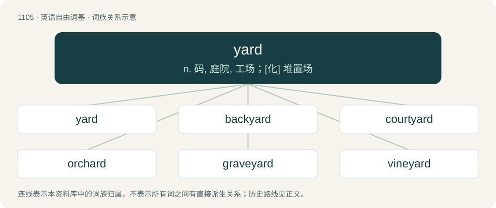

# 1183 · yard — n. 码, 庭院, 工场；\[化\] 堆置场

[总目录](../00_总目录_按常用程度.md)

**类型**：英语自由词基　｜　**来源语言**：见词源记录

## 核心含义与来源

- 核心含义：n. 码, 庭院, 工场；\[化\] 堆置场
- 英文含义：A small, usually uncultivated area adjoining or (now especially) within the precincts of a house or other building.
- 词形：yard

**多个词源／构词路径**：同一拼写可能有不同来源；以下按词性和含义分别列出。

**来源记录 1**（名词；A small, usually uncultivated area adjoining or (now especially) within the precincts of a house or other building.）

From Middle English yerd, yard, ȝerd, ȝeard, from Old English ġeard (“yard, garden, fence, enclosure”), from Proto-West Germanic \*gard, from Proto-Germanic \*gardaz (“enclosure, yard”), from Proto-Indo-European \*gʰórdʰos, from Proto-Indo-European \*gʰerdʰ- (“to enclose”). See also North Frisian guard, Guart (“garden, yard”), Dutch gaard, gaarde (“garden, yard”), German Garten (“garden, yard”), Danish, Swedish gård (“farm, estate, land; court, yard”), Faroese, Icelandic garður (“garden; fence”), Norn gart (“farm”), Norwegian Bokmål, Norwegian Nynorsk gard, gård (“farm; townhouse”), Gothic 𐌲𐌰𐍂𐌳𐍃 (gards, “court, yard; house”), Lithuanian gardas (“pen, enclosure”), Russian го́род (górod, “town”), Serbo-Croatian grad (“town”), Slovene grad (“castle”), Albanian gardh (“fence”), Romanian gard (“fence”), Avestan 𐬔𐬆𐬭𐬆𐬛𐬵𐬀 (gərədha, “dev's cave”), Sanskrit गृह (gṛha, “house, habitation, home, dwelling”)), Medieval Latin gardinus, jardinus (“garden, yard”). Doublet of garden, garth, and gord.

**来源记录 2**（名词；A unit of length equal to 3 feet in the US customary and British imperial systems of measurement, equal to precisely 0.9144 m since 1959 (US) or 1963 (UK).）

From Middle English yerde, yerd, ȝerde, from Old English ġierd (“branch; rod, staff; measuring stick; yardland”), from Proto-West Germanic \*gaʀd, from Proto-Germanic \*gazdaz. Cognate with Dutch gard (“twig”), German Gerte and probably related to Latin hasta (“spear”).

**来源记录 3**（名词；10⁹, A short scale billion; a long scale thousand millions or milliard.）

Clipping of milliard.

## 词族图

## 单词速览（常用到不常用）

| 单词 | 音标 | 释义 |
|---|---|---|
| [yard](#w-1) | 英 /ˈjɑːd/；美 /ˈjɑɹd/ | n. 码, 庭院, 工场；\[化\] 堆置场 |
| [backyard](#w-2) | 英 /bækˈjɑːd/ | n. 后院, 后庭 |
| [courtyard](#w-3) | 英 /ˈkɔːt.jɑːd/；美 /ˈkɔɹt.jɑɹd/ | n. 庭院, 天井 |
| [orchard](#w-4) | 英 /ˈɔː.tʃəd/；美 /ˈɔɹ.t͡ʃɚd/ | n. 果园, 果树林 |
| [graveyard](#w-5) | 美 /ˈɡɹeɪvˌjɑɹd/ | n. 墓地 |
| [vineyard](#w-6) | 英 /ˈvɪn.jəd/；美 /ˈvɪn.jɚd/ | n. 葡萄园 |
| [shipyard](#w-7) | 美 /ˈʃɪpˌjɑɹd/ | n. 造船厂；\[经\] 船坞, 造船厂, 修船厂 |
| [churchyard](#w-8) | 英 /ˈt͡ʃɜːt͡ʃ.jɑːd/；美 /ˈt͡ʃɝt͡ʃ.jɑɹd/ | n. 教堂墓地, 教堂庭院 |
| [yardage](#w-9) | /ˈjɑːdidʒ/ | n. 车站旁牲畜栏的使用, 牲畜栏使用费；\[法\] 站内栏舍的使用权, 使用站内栏舍的费用 |
| [junkyard](#w-10) | 美 /ˈd͡ʒʌŋkˌjɑɹd/ | n. 废品旧货栈 |
| [dockyard](#w-11) | /ˈdɒkjɑːd/ | n. 造船厂, 海军工厂 |
| [yardstick](#w-12) | 英 /ˈjɑːdˌstɪk/；美 /ˈjɑɹdˌstɪk/ | n. 码尺, 计算标准, 准绳；\[法\] 尺度, 衡量标准, 任何评判或比较的标准 |
| [schoolyard](#w-13) | /ˈskuːljɑːd/ | n. 校园, 运动场 |
| [barnyard](#w-14) | 美 /ˈbɑɹnˌjɑɹd/ | n. 谷仓前的场地 |
| [yarder](#w-15) | /ˈjɑːdə/ | 蒸汽集材机, 集材绞盘机 |
| [farmyard](#w-16) | 美 /ˈfɑɹmˌjɑɹd/ | n. 农家庭院 |
| [brickyard](#w-17) | 美 /ˈbɹɪkˌjɑɹd/ | n. 砖厂 |
| [scrapyard](#w-18) | /ˈskræpjɑːd/ | n. 废品堆放场 |
| [boneyard](#w-19) | 美 /ˈboʊnˌjɑɹd/ | n. 墓地, (非正式)动物尸骨堆放地 |
| [boatyard](#w-20) | /ˈbəut.jɑːd/ | n. 船坞；造船厂 |
| [lumberyard](#w-21) | 美 /ˈlʌmbɚˌjɑɹd/ | n. 木材堆置场, 木场 |

## 逐词详解

### 1. yard

**词性**：名词　｜　**音标**：英 /ˈjɑːd/；美 /ˈjɑɹd/

**中文释义**：n. 码, 庭院, 工场；\[化\] 堆置场

**英文义项**：A small, usually uncultivated area adjoining or (now especially) within the precincts of a house or other building. / The property surrounding one's house, typically dominated by one's lawn.

**词源与演化**：

From Middle English yerd, yard, ȝerd, ȝeard, from Old English ġeard (“yard, garden, fence, enclosure”), from Proto-West Germanic \*gard, from Proto-Germanic \*gardaz (“enclosure, yard”), from Proto-Indo-European \*gʰórdʰos, from Proto-Indo-European \*gʰerdʰ- (“to enclose”). See also North Frisian guard, Guart (“garden, yard”), Dutch gaard, gaarde (“garden, yard”), German Garten (“garden, yard”), Danish, Swedish gård (“farm, estate, land; court, yard”), Faroese, Icelandic garður (“garden; fence”), Norn gart (“farm”), Norwegian Bokmål, Norwegian Nynorsk gard, gård (“farm; townhouse”), Gothic 𐌲𐌰𐍂𐌳𐍃 (gards, “court, yard; house”), Lithuanian gardas (“pen, enclosure”), Russian го́род (górod, “town”), Serbo-Croatian grad (“town”), Slovene grad (“castle”), Albanian gardh (“fence”), Romanian gard (“fence”), Avestan 𐬔𐬆𐬭𐬆𐬛𐬵𐬀 (gərədha, “dev's cave”), Sanskrit गृह (gṛha, “house, habitation, home, dwelling”)), Medieval Latin gardinus, jardinus (“garden, yard”). Doublet of garden, garth, and gord.

**例句**：

> It was a small house with almost no yard.

该用例对应义项：the enclosed land around a house or other building

### 2. backyard

**词性**：名词　｜　**音标**：英 /bækˈjɑːd/

**中文释义**：n. 后院, 后庭

**英文义项**：A yard to the rear of a house or similar residence. / A person's neighborhood, or an area nearby to a person's usual residence or place of work and where the person is likely to go.

**构词拆分**：back + yard

**词源与演化**：

From back + yard.

**例句**：

> Tom got lost in the woods and ended up in someone's backyard.

### 3. courtyard

**词性**：名词　｜　**音标**：英 /ˈkɔːt.jɑːd/；美 /ˈkɔɹt.jɑɹd/

**中文释义**：n. 庭院, 天井

**英文义项**：An area, open to the sky, partially or wholly surrounded by walls or buildings.

**构词拆分**：court + yard

**词源与演化**：

From court + yard.

**例句**：

> There comes a fairy in the courtyard, bearing a handful of gifts.

该用例对应义项：An area, open to the sky, partially or wholly surrounded by walls or buildings.

### 4. orchard

**词性**：名词　｜　**音标**：英 /ˈɔː.tʃəd/；美 /ˈɔɹ.t͡ʃɚd/

**中文释义**：n. 果园, 果树林

**英文义项**：A garden or an area of land for the cultivation of fruit or nut trees. / The trees themselves cultivated in such an area.

**构词拆分**：wort + yard

**词源与演化**：

From Middle English orchard, orcherd, from Old English orċeard, ortġeard, a compound of \*ort (probably from Proto-Germanic \*urtiz, a dissimilated variant of Proto-Germanic \*wurt- (“wort (plant)”), later incorrectly associated with unrelated Latin hortus (“garden”)) + ġeard (see hortyard and yard, which ironically is etymologically linked with hortus). Cognate with Swedish örtagård (“herb garden”), Gothic 𐌰𐌿𐍂𐍄𐌹𐌲𐌰𐍂𐌳𐍃 (aurtigards, “orchard”), Old High German orzōn (“to cultivate a field”). Equivalent to wort + yard. More at root.

**例句**：

> Tom got a casual job as a fruit picker at an orchard.

### 5. graveyard

**词性**：名词　｜　**音标**：美 /ˈɡɹeɪvˌjɑɹd/

**中文释义**：n. 墓地

**英文义项**：A tract of land in which the dead are buried. / A final storage place for collections of things that are no longer useful or useable.

**构词拆分**：grave + yard

**词源与演化**：

From grave + yard. Compare West Frisian begraafplak (“graveyard”), Dutch begraafplaats (“graveyard”), Norwegian gravplass (“graveyard”).

**用法示例／搭配（非完整句）**：

> graveyard shift, graveyard slot, graveyard watch

该用例对应义项：A period very early in the morning in which there is very little activity.

### 6. vineyard

**词性**：名词　｜　**音标**：英 /ˈvɪn.jəd/；美 /ˈvɪn.jɚd/

**中文释义**：n. 葡萄园

**英文义项**：A grape plantation, especially one used in the production of wine.

**构词拆分**：vine + yard

**词源与演化**：

Equivalent to vine + yard; from Middle English vyneȝerd (circa 1300), following earlier Old English wīnġeard (“wine yard, vine yard”), with vine (from Old French vigne (“vine, vineyard”), from Latin vīnea) replacing native Old English wīn (“wine, vine”). The earlier wīnġeard may have had the sense of “vine” already, with /w/ → /v/ facilitated by common v-/w- interchange. Compare Dutch wijngaard (literally “wine garden”) and German Weingarten alongside contracted Wingert. (Dutch gaard, German Garten are cognate to English yard.)

**例句**：

> The vineyard of Château Margaux stands as the producer of one of the world's greatest and most sought-after red wines.

该用例对应义项：A grape plantation, especially one used in the production of wine.

### 7. shipyard

**词性**：名词　｜　**音标**：美 /ˈʃɪpˌjɑɹd/

**中文释义**：n. 造船厂；\[经\] 船坞, 造船厂, 修船厂

**英文义项**：A place where ships are built and repaired.

**构词拆分**：ship + yard

**词源与演化**：

From ship + yard.

**例句**：

> The shipyard has about 20,000 workers. Three-thousand of them attended the apprentice school.

### 8. churchyard

**词性**：名词　｜　**音标**：英 /ˈt͡ʃɜːt͡ʃ.jɑːd/；美 /ˈt͡ʃɝt͡ʃ.jɑɹd/

**中文释义**：n. 教堂墓地, 教堂庭院

**英文义项**：A patch of land adjoining a church, often used as a graveyard.

**构词拆分**：church + yard

**词源与演化**：

Inherited from Middle English chircheyerd (also kirkeyerd &gt; English kirkyard), equivalent to church + yard. Compare also Middle English kurk-garth, kyrkgarth, kirrkegærd, from Old Norse kirkjugarðr (“churchyard; graveyard”). Replaced Middle English chirchetoun from Old English ċirictūn (churchtown).

**例句**：

> The faster the mouse, the bigger the churchyard.

### 9. yardage

**词性**：名词　｜　**音标**：/ˈjɑːdidʒ/

**中文释义**：n. 车站旁牲畜栏的使用, 牲畜栏使用费；\[法\] 站内栏舍的使用权, 使用站内栏舍的费用

**英文义项**：An amount or length measured in yards. / The use of a yard, or the fee charged for it.

**构词拆分**：yard + -age

**词源与演化**：

From yard + -age.

**例句**：

> What is the yardage of this golf course?

该用例对应义项：distance measured in the aggregate number of yards

### 10. junkyard

**词性**：名词　｜　**音标**：美 /ˈd͡ʒʌŋkˌjɑɹd/

**中文释义**：n. 废品旧货栈

**英文义项**：A place where rubbish is discarded. / A business that sells used metal or items.

**构词拆分**：From junk + yard.

**词源与演化**：

From junk + yard.

**例句**：

> Janos allowed the kids to come into the junkyard and look for scraps.

### 11. dockyard

**词性**：名词　｜　**音标**：/ˈdɒkjɑːd/

**中文释义**：n. 造船厂, 海军工厂

**英文义项**：A place where ships are repaired or outfitted.

**构词拆分**：dock + yard

**词源与演化**：

From dock + yard.

**例句**：

> When it closed in 1984, thousands were put out of work and the dockyard fell into disuse.

### 12. yardstick

**词性**：名词　｜　**音标**：英 /ˈjɑːdˌstɪk/；美 /ˈjɑɹdˌstɪk/

**中文释义**：n. 码尺, 计算标准, 准绳；\[法\] 尺度, 衡量标准, 任何评判或比较的标准

**英文义项**：A measuring rod thirty-six inches (one yard) long. / A standard to which other measurements or comparisons are judged.

**构词拆分**：yard + stick

**词源与演化**：

From yard + stick.

**例句**：

> On what kind of yardstick is he basing his judgment?

该用例对应义项：a measure or standard used for comparison

### 13. schoolyard

**词性**：名词　｜　**音标**：/ˈskuːljɑːd/

**中文释义**：n. 校园, 运动场

**英文义项**：The grounds around a school. / An open field near a school used for recreation by the students.

**构词拆分**：school + yard

**词源与演化**：

From school + yard.

**例句**：

> I am standing in the middle of the schoolyard.

### 14. barnyard

**词性**：名词　｜　**音标**：美 /ˈbɑɹnˌjɑɹd/

**中文释义**：n. 谷仓前的场地

**英文义项**：The yard associated with or surrounding a barn.

**构词拆分**：barn + yard

**词源与演化**：

From barn + yard.

**例句**：

> It smells like a barnyard in here.

### 15. yarder

**词性**：名词　｜　**音标**：/ˈjɑːdə/

**中文释义**：蒸汽集材机, 集材绞盘机

**英文义项**：A motor-driven logging machine which transports logs by means of a system of cables and winches.

**构词拆分**：yard (verb) + -er

**词源与演化**：

From yard (verb) + -er.

### 16. farmyard

**词性**：名词　｜　**音标**：美 /ˈfɑɹmˌjɑɹd/

**中文释义**：n. 农家庭院

**英文义项**：The area of a farm, excluding the fields, usually surrounded by or adjacent to farm buildings.

**构词拆分**：farm + yard

**词源与演化**：

From farm + yard.

**例句**：

> Tony and his mother arrived at the farmhouse and walked through the farmyard.

### 17. brickyard

**词性**：名词　｜　**音标**：美 /ˈbɹɪkˌjɑɹd/

**中文释义**：n. 砖厂

**英文义项**：A place where bricks are, or once were, produced or distributed.

**构词拆分**：brick + yard

**词源与演化**：

From brick + yard.

### 18. scrapyard

**词性**：名词　｜　**音标**：/ˈskræpjɑːd/

**中文释义**：n. 废品堆放场

**英文义项**：A junkyard; a place where scrap is stored, discarded or resold.

**构词拆分**：scrap + yard

**词源与演化**：

From scrap + yard.

**例句**：

> There's a lot of interesting stuff you can find if you scavenge in the scrapyard.

### 19. boneyard

**词性**：名词　｜　**音标**：美 /ˈboʊnˌjɑɹd/

**中文释义**：n. 墓地, (非正式)动物尸骨堆放地

**英文义项**：A graveyard. / In the game of dominoes, the pile of upside-down pieces that have yet to be used.

**构词拆分**：bone + yard

**词源与演化**：

From bone + yard.

**用法示例／搭配（非完整句）**：

> a 440 V-8 from the boneyard

该用例对应义项：A dumpsite for obsolete or unusable aircraft etc; a junkyard.

### 20. boatyard

**词性**：名词　｜　**音标**：/ˈbəut.jɑːd/

**中文释义**：n. 船坞；造船厂

**英文义项**：A place where boats are built and repaired. / A shipyard.

**构词拆分**：boat + yard

**词源与演化**：

From boat + yard.

**例句**：

> Her dad took his rowing boat to the boatyard to be mended.

### 21. lumberyard

**词性**：名词　｜　**音标**：美 /ˈlʌmbɚˌjɑɹd/

**中文释义**：n. 木材堆置场, 木场

**英文义项**：A facility dedicated to the preparation and sale of lumber.

**构词拆分**：lumber + yard

**词源与演化**：

From lumber + yard.

**例句**：

> I'll just go to the lumberyard and buy some more two by fours so we can finish building this.

该用例对应义项：A facility dedicated to the preparation and sale of lumber.
