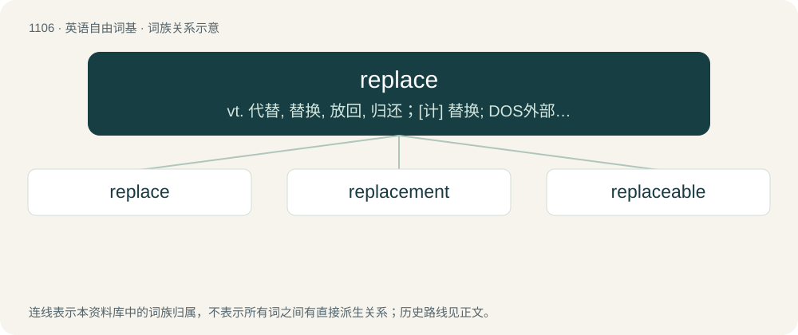

# 1185 · replace — vt. 代替, 替换, 放回, 归还；\[计\] 替换; DOS外部命令:取代或更新文件

[总目录](../00_总目录_按常用程度.md)

**类型**：英语自由词基　｜　**来源语言**：见词源记录

## 核心含义与来源

- 核心含义：vt. 代替, 替换, 放回, 归还；\[计\] 替换; DOS外部命令:取代或更新文件
- 英文含义：To restore to a former place, position, condition, etc.; to put back.
- 词形：replace

**来源记录 1**（动词；To restore to a former place, position, condition, etc.; to put back.）

From re- + place.

## 词族图

## 单词速览（常用到不常用）

| 单词 | 音标 | 释义 |
|---|---|---|
| [replace](#w-1) | /ɹɪˈpleɪs/ | vt. 代替, 替换, 放回, 归还；\[计\] 替换; DOS外部命令:取代或更新文件 |
| [replacement](#w-2) | /ɹɪˈpleɪsmənt/ | n. 归还, 更换, 代替者；\[医\] 复位, 置换 |
| [replaceable](#w-3) | /ɹɪˈpleɪsəbəl/ | a. 可替换的, 可代替的, 可放在原处的；\[法\] 可归原处的, 可替换的, 可撤换的 |

## 逐词详解

### 1. replace

**词性**：动词　｜　**音标**：/ɹɪˈpleɪs/

**中文释义**：vt. 代替, 替换, 放回, 归还；\[计\] 替换; DOS外部命令:取代或更新文件

**英文义项**：To restore to a former place, position, condition, etc.; to put back. / To refund; to repay; to pay back.

**构词拆分**：re- + place

**词源与演化**：

From re- + place.

**例句**：

> You can take what you need from the petty cash, but you must replace it tomorrow morning.

该用例对应义项：To refund; to repay; to pay back.

### 2. replacement

**词性**：名词　｜　**音标**：/ɹɪˈpleɪsmənt/

**中文释义**：n. 归还, 更换, 代替者；\[医\] 复位, 置换

**英文义项**：A person or thing that takes the place of another; a substitute. / The act of replacing something.

**构词拆分**：replace + -ment

**词源与演化**：

From replace + -ment.

**例句**：

> The replacement of that broken light-bulb will have to wait until I can buy a new one.

该用例对应义项：The act of replacing something.

### 3. replaceable

**词性**：形容词　｜　**音标**：/ɹɪˈpleɪsəbəl/

**中文释义**：a. 可替换的, 可代替的, 可放在原处的；\[法\] 可归原处的, 可替换的, 可撤换的

**英文义项**：Capable of being replaced.

**构词拆分**：replace + -able

**词源与演化**：

From replace + -able.

**例句**：

> He knew he was not easily replaceable at work.

该用例对应义项：Capable of being replaced.
