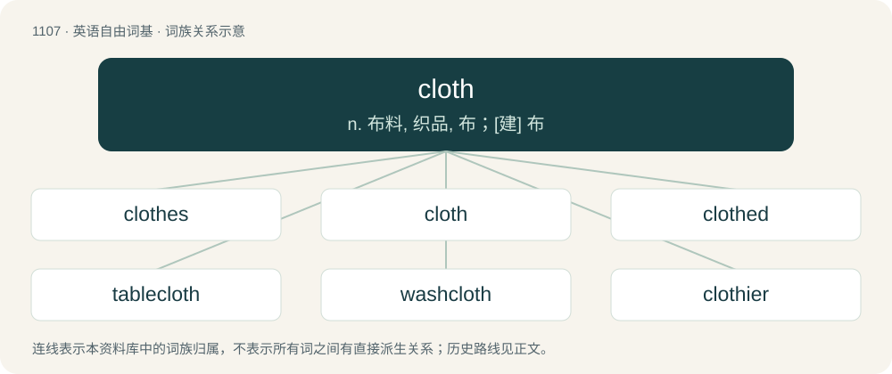

# 1186 · cloth — n. 布料, 织品, 布；\[建\] 布

[总目录](../00_总目录_按常用程度.md)

**类型**：英语自由词基　｜　**来源语言**：见词源记录

## 核心含义与来源

- 核心含义：n. 布料, 织品, 布；\[建\] 布
- 英文含义：A fabric, usually made of woven, knitted, or felted fibres or filaments, such as used in dressing, decorating, cleaning or other practical use. Sometimes, woven fabric specifically.
- 词形：cloth

**来源记录 1**（名词；A fabric, usually made of woven, knitted, or felted fibres or filaments, such as used in dressing, decorating, cleaning or other practical use. Sometimes, woven fabric specifically.）

From Middle English cloth, clath, from Old English clāþ (“cloth, clothes, covering, sail”), from Proto-West Germanic \*klaiþ, from Proto-Germanic \*klaiþą (“garment”), perhaps from Proto-Indo-European \*gleyt- (“to cling to, cleave, stick”) (compare Albanian ngjit (“to stick, attach, glue”)), a form of \*gleh₁y- (“to smear; to stick”). Cognate with Scots clath (“cloth”), North Frisian klaid (“dress, garment”), Saterland Frisian Klood (“dress, apparel”), West Frisian klaad, kleed (“cloth, article of clothing”), Dutch kleed (“robe, dress”), Low German kleed (“dress, garment”), German Kleid (“gown, dress”), Danish klæde (“cloth, dress”), Norwegian Bokmål and Norwegian Nynorsk klede, Swedish kläde (“cloth”), Icelandic klæði (“cloth, dressing”), Old English clīþan (“to adhere, stick”).

## 词族图

## 单词速览（常用到不常用）

| 单词 | 音标 | 释义 |
|---|---|---|
| [clothes](#w-1) | 英 /kləʊ(ð)z/；美 /kloʊ(ð)z/ | n. 衣服 |
| [cloth](#w-2) | 英 /klɒθ/；/klɔθ/ | n. 布料, 织品, 布；\[建\] 布 |
| [clothed](#w-3) | 英 /klɒθt/；美 /klɔθt/ | 【英文】Covered with a cloth. |
| [tablecloth](#w-4) | /ˈteiblklɒθ/ | n. 台布 |
| [washcloth](#w-5) | 英 /ˈwɒʃ.klɒθ/；美 /ˈwɔʃ.klɔθ/ | n. 毛巾, 浴巾 |
| [clothier](#w-6) | /ˈkloʊðiə(ɹ)/ | n. 布商, 衣商 |
| [loincloth](#w-7) | /ˈlɒinklɒθ/ | n. 腰布, 缠腰带 |
| [cheesecloth](#w-8) | /ˈtʃiːzklɒːθ/ | n. 干酪包布 |

## 逐词详解

### 1. clothes

**词性**：名词　｜　**音标**：英 /kləʊ(ð)z/；美 /kloʊ(ð)z/

**中文释义**：n. 衣服

**英文义项**：Items of clothing; apparel. / The covering of a bed; bedclothes.

**构词拆分**：cloth + -es

**词源与演化**：

From Middle English clothes, cloþes (plural of cloth, cloþ (“cloth, garment”)), from Old English clāþas (“clothes”, plural of clāþ (“cloth”)), equivalent to cloth + -es. Cognate with Scots clathes, claes (“clothes”), Dutch klederen, kleren (“clothes”), German Kleider (“clothes”), Danish klæder (“clothes”), Swedish kläder (“clothes”), Norwegian Bokmål klær (“clothes”), Norwegian Nynorsk klede (“clothes”), Faroese klæði, klæðir (“clothes”).

**例句**：

> He always bought his clothes at the same store.

该用例对应义项：clothing in general

### 2. cloth

**词性**：名词　｜　**音标**：英 /klɒθ/；/klɔθ/

**中文释义**：n. 布料, 织品, 布；\[建\] 布

**英文义项**：A fabric, usually made of woven, knitted, or felted fibres or filaments, such as used in dressing, decorating, cleaning or other practical use. Sometimes, woven fabric specifically. / Specifically, a tablecloth, especially as spread before a meal or removed afterwards.

**词源与演化**：

From Middle English cloth, clath, from Old English clāþ (“cloth, clothes, covering, sail”), from Proto-West Germanic \*klaiþ, from Proto-Germanic \*klaiþą (“garment”), perhaps from Proto-Indo-European \*gleyt- (“to cling to, cleave, stick”) (compare Albanian ngjit (“to stick, attach, glue”)), a form of \*gleh₁y- (“to smear; to stick”). Cognate with Scots clath (“cloth”), North Frisian klaid (“dress, garment”), Saterland Frisian Klood (“dress, apparel”), West Frisian klaad, kleed (“cloth, article of clothing”), Dutch kleed (“robe, dress”), Low German kleed (“dress, garment”), German Kleid (“gown, dress”), Danish klæde (“cloth, dress”), Norwegian Bokmål and Norwegian Nynorsk klede, Swedish kläde (“cloth”), Icelandic klæði (“cloth, dressing”), Old English clīþan (“to adhere, stick”).

**例句**：

> He is a respected man of the cloth.

该用例对应义项：The priesthood.

### 3. clothed

**词性**：形容词　｜　**音标**：英 /klɒθt/；美 /klɔθt/

**英文义项**：Covered with a cloth.

**构词拆分**：cloth + -ed

**词源与演化**：

From cloth + -ed.

**用法示例／搭配（非完整句）**：

> a white-clothed table

该用例对应义项：Covered with a cloth.

### 4. tablecloth

**词性**：名词　｜　**音标**：/ˈteiblklɒθ/

**中文释义**：n. 台布

**英文义项**：A cloth used to cover and protect a table, especially for a dining table.

**构词拆分**：table + cloth

**词源与演化**：

From Middle English tabyllcloth, table cloth, tabylle clothe, a partial translation of earlier Middle English bord cloth, bordcloth (“tablecloth”), from Old English bordclāþ, equivalent to table + cloth.

**例句**：

> Tom put the new tablecloth he had just bought on the table.

### 5. washcloth

**词性**：名词　｜　**音标**：英 /ˈwɒʃ.klɒθ/；美 /ˈwɔʃ.klɔθ/

**中文释义**：n. 毛巾, 浴巾

**英文义项**：A small cloth used to wash the face and body.

**构词拆分**：wash + cloth

**词源与演化**：

From wash + cloth.

**例句**：

> Mary always liked to use a blue washcloth in the shower.

### 6. clothier

**词性**：名词　｜　**音标**：/ˈkloʊðiə(ɹ)/

**中文释义**：n. 布商, 衣商

**英文义项**：A person who makes or sells cloth or clothing.

**构词拆分**：cloth + -ier

**词源与演化**：

From Middle English clothyer, an alteration of earlier clother, clothere (“a maker or seller of cloth”); equivalent to cloth + -ier.

### 7. loincloth

**词性**：名词　｜　**音标**：/ˈlɒinklɒθ/

**中文释义**：n. 腰布, 缠腰带

**英文义项**：A garment worn about the loins and covering the crotch.

**构词拆分**：loin + cloth

**词源与演化**：

From loin + cloth. Compare Dutch lendenkleed (“loincloth”), German Lendenkleid (“loincloth”), Danish lændeklæde (“loincloth”), Norwegian lendeklede (“loincloth”), Icelandic lendarklæði (“loincloth”).

**例句**：

> Tom was naked except for a loincloth.

### 8. cheesecloth

**词性**：名词　｜　**音标**：/ˈtʃiːzklɒːθ/

**中文释义**：n. 干酪包布

**英文义项**：A loosely woven cotton gauze, originally used to wrap cheese, but now used for various culinary tasks and by farmers to shade crops and keep birds off.

**构词拆分**：cheese + cloth

**词源与演化**：

From cheese + cloth.

**例句**：

> Cheesecloth is probably cheaper at hardware stores than culinary specialty stores.
