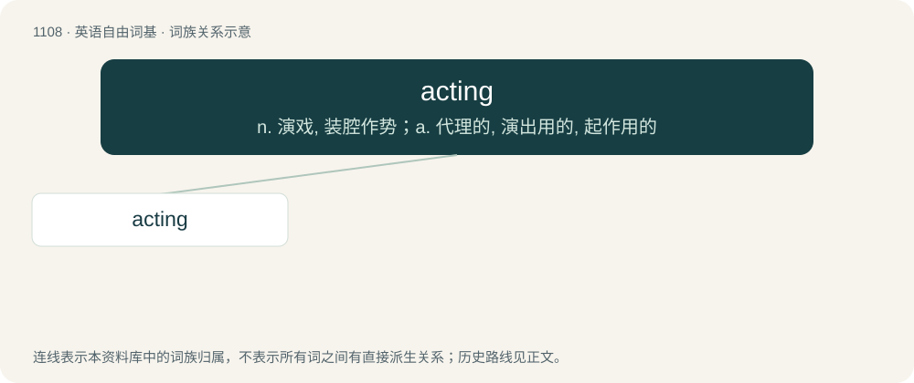

# 1187 · acting — n. 演戏, 装腔作势；a. 代理的, 演出用的, 起作用的

[总目录](../00_总目录_按常用程度.md)

**类型**：英语自由词基　｜　**来源语言**：见词源记录

## 核心含义与来源

- 核心含义：n. 演戏, 装腔作势；a. 代理的, 演出用的, 起作用的
- 英文含义：Temporarily assuming the duties or authority of another person when they are unable to do their job.
- 词形：acting

**来源记录 1**（形容词；Temporarily assuming the duties or authority of another person when they are unable to do their job.）

From act + -ing.

## 词族图

## 单词速览（常用到不常用）

| 单词 | 音标 | 释义 |
|---|---|---|
| [acting](#w-1) | /ˈæk.tɪŋ/ | n. 演戏, 装腔作势；a. 代理的, 演出用的, 起作用的 |

## 逐词详解

### 1. acting

**词性**：形容词　｜　**音标**：/ˈæk.tɪŋ/

**中文释义**：n. 演戏, 装腔作势；a. 代理的, 演出用的, 起作用的

**英文义项**：Temporarily assuming the duties or authority of another person when they are unable to do their job.

**构词拆分**：act + -ing

**词源与演化**：

From act + -ing.

**例句**：

> The Acting Minister must sign Executive Council documents in a Minister's absence.

该用例对应义项：Temporarily assuming the duties or authority of another person when they are unable to do their job.
