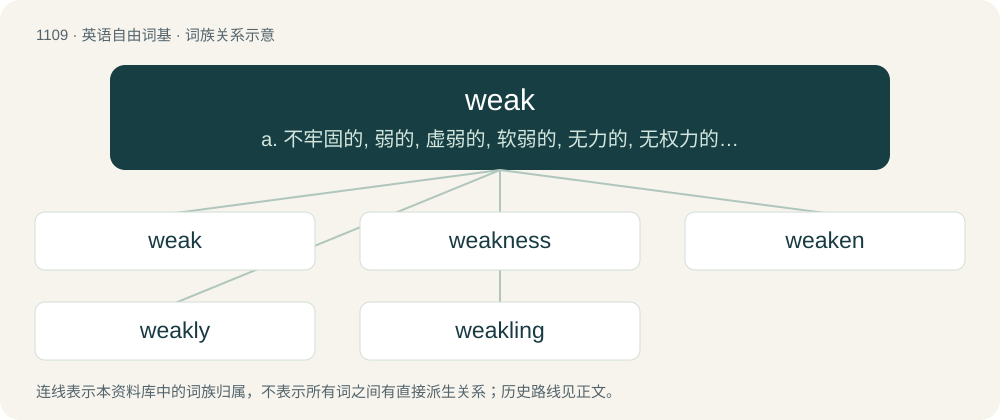

# 1188 · weak — a. 不牢固的, 弱的, 虚弱的, 软弱的, 无力的, 无权力的, (论据等)不充分的；\[经\] 疲软的

[总目录](../00_总目录_按常用程度.md)

**类型**：英语自由词基　｜　**来源语言**：见词源记录

## 核心含义与来源

- 核心含义：a. 不牢固的, 弱的, 虚弱的, 软弱的, 无力的, 无权力的, (论据等)不充分的；\[经\] 疲软的
- 英文含义：Lacking in force (usually strength) or ability.
- 词形：weak

**来源记录 1**（形容词；Lacking in force (usually strength) or ability.）

From Middle English waik, wayk, wayke, weik, weyk, borrowed from Old Norse veikr (“weak”), from Proto-Germanic \*waikwaz (“weak, yielded, pliant, bendsome”), from \*wīkwaną (“to cease, fold, yield; to retreat”), from Proto-Indo-European \*weyg- (“to bend, turn, wind”), from \*weh₁y- (“to plait, twist, weave, wind; to cover, enclose, wrap”). Cognates Cognate with Old English wāc (“bendsome, weak”), Saterland Frisian wook (“soft, gentle, tender”), West Frisian weak (“soft”), Dutch week (“soft, weak”), German weich (“soft, weak”), Luxembourgish weech (“weak”), Yiddish ווייך (veykh, “soft”), Danish veg (“weak”), Faroese and Icelandic veikur (“weak”), Norwegian Bokmål veik, vek (“weak; pliant”), Norwegian Nynorsk veik (“weak”), Swedish vek (“weak, pliant”), Estonian vaik, vaikne (“quiet”), Finnish vaieta (“to fall silent; to be silent; to keep silent; to suppress by not discussing”), Ingrian vaiketa (“quiet down”); also Cornish gwigh (“winkles”), Irish faocha, faochóg (“periwinkle”), Latin vicis (“change; time; season; succession; lot; place, room, stead”), vieo (“to bend”), Ancient Greek οἴγω (oígō, “to open”), Albanian vig (“bier, litter, stretcher”), Lithuanian vyti (“to twist, wind”), Belarusian віць (vicʹ, “to twist, weave”), Bulgarian ви́я (víja, “to bend, twist; to roam; to swirl”), Czech vít (“to weave, wind; to wrap”), Polish and Upper Sorbian wić (“to plait, weave; to wriggle, writhe”), Russian вить (vitʹ, “to wind; to twist, weave”), Serbo-Croatian ви̏ти, vȉti (“to twist”), Slovene viti (“to twist”), Ukrainian ви́ти (výty, “to twist, wind; to plait; to build a nest; to curl”), Northern Kurdish avêtin, avitin, avîtin, havêtin, havîtin (“to cast, throw”), Persian آویختن (âvixtan, “to hang, suspend”), بیختن (bēxtan / bixtan, “to sift”), Sanskrit वेग (vega, “speed, impetus; stream; agitation; impetuosity; strength; haste; the flight of an arrow; love; delight; expulsion; semen; attack; constipation”). Related to Old English wīcan (“to yield”). Related to week and wick. The grammar sense is a calque of German schwach.

## 词族图

## 单词速览（常用到不常用）

| 单词 | 音标 | 释义 |
|---|---|---|
| [weak](#w-1) | /wi(ː)k/ | a. 不牢固的, 弱的, 虚弱的, 软弱的, 无力的, 无权力的, (论据等)不充分的；\[经\] 疲软的 |
| [weakness](#w-2) | 英 /ˈwiːk.nɪs/；美 /ˈwik.nɪs/ | n. 虚弱, 薄弱, 弱点；\[经\] 欲振乏力 |
| [weaken](#w-3) | 美 /ˈwikən/ | vt. 削弱, 减弱, 使虚弱；vi. 变弱, 变软弱 |
| [weakly](#w-4) | /ˈwiːkli/ | a. 弱的, 虚弱的；adv. 微弱地, 虚弱地 |
| [weakling](#w-5) | /ˈwiːkˈlɪŋɡ/ | n. 虚弱的人, 弱小的动物, 低能儿；a. 虚弱的, 懦弱的 |

## 逐词详解

### 1. weak

**词性**：形容词　｜　**音标**：/wi(ː)k/

**中文释义**：a. 不牢固的, 弱的, 虚弱的, 软弱的, 无力的, 无权力的, (论据等)不充分的；\[经\] 疲软的

**英文义项**：Lacking in force (usually strength) or ability. / Unable to sustain a great weight, pressure, or strain.

**词源与演化**：

From Middle English waik, wayk, wayke, weik, weyk, borrowed from Old Norse veikr (“weak”), from Proto-Germanic \*waikwaz (“weak, yielded, pliant, bendsome”), from \*wīkwaną (“to cease, fold, yield; to retreat”), from Proto-Indo-European \*weyg- (“to bend, turn, wind”), from \*weh₁y- (“to plait, twist, weave, wind; to cover, enclose, wrap”). Cognates Cognate with Old English wāc (“bendsome, weak”), Saterland Frisian wook (“soft, gentle, tender”), West Frisian weak (“soft”), Dutch week (“soft, weak”), German weich (“soft, weak”), Luxembourgish weech (“weak”), Yiddish ווייך (veykh, “soft”), Danish veg (“weak”), Faroese and Icelandic veikur (“weak”), Norwegian Bokmål veik, vek (“weak; pliant”), Norwegian Nynorsk veik (“weak”), Swedish vek (“weak, pliant”), Estonian vaik, vaikne (“quiet”), Finnish vaieta (“to fall silent; to be silent; to keep silent; to suppress by not discussing”), Ingrian vaiketa (“quiet down”); also Cornish gwigh (“winkles”), Irish faocha, faochóg (“periwinkle”), Latin vicis (“change; time; season; succession; lot; place, room, stead”), vieo (“to bend”), Ancient Greek οἴγω (oígō, “to open”), Albanian vig (“bier, litter, stretcher”), Lithuanian vyti (“to twist, wind”), Belarusian віць (vicʹ, “to twist, weave”), Bulgarian ви́я (víja, “to bend, twist; to roam; to swirl”), Czech vít (“to weave, wind; to wrap”), Polish and Upper Sorbian wić (“to plait, weave; to wriggle, writhe”), Russian вить (vitʹ, “to wind; to twist, weave”), Serbo-Croatian ви̏ти, vȉti (“to twist”), Slovene viti (“to twist”), Ukrainian ви́ти (výty, “to twist, wind; to plait; to build a nest; to curl”), Northern Kurdish avêtin, avitin, avîtin, havêtin, havîtin (“to cast, throw”), Persian آویختن (âvixtan, “to hang, suspend”), بیختن (bēxtan / bixtan, “to sift”), Sanskrit वेग (vega, “speed, impetus; stream; agitation; impetuosity; strength; haste; the flight of an arrow; love; delight; expulsion; semen; attack; constipation”). Related to Old English wīcan (“to yield”). Related to week and wick. The grammar sense is a calque of German schwach.

**例句**：

> The verb to run is strong, not weak, because the past tense is ran.

该用例对应义项：Regular in inflection, lacking vowel changes and having a past tense marked by /-d-/, /-t-/, or /-ð-/.

### 2. weakness

**词性**：名词　｜　**音标**：英 /ˈwiːk.nɪs/；美 /ˈwik.nɪs/

**中文释义**：n. 虚弱, 薄弱, 弱点；\[经\] 欲振乏力

**英文义项**：The condition of being weak. / An inadequate quality; fault.

**构词拆分**：weak + -ness

**词源与演化**：

From Middle English weyknesse, replacing earlier Middle English wocnesse, wakenes, wacnesse (“weakness”), from Old English wācnes (“weakness”). Equivalent to weak + -ness.

**例句**：

> The only weakness in her plan was its reliance on the electricity being up and running.

该用例对应义项：An inadequate quality; fault.

### 3. weaken

**词性**：动词　｜　**音标**：美 /ˈwikən/

**中文释义**：vt. 削弱, 减弱, 使虚弱；vi. 变弱, 变软弱

**英文义项**：To make weaker or less strong. / To become weaker or less strong.

**构词拆分**：From weak + -en.

**词源与演化**：

From weak + -en.

**例句**：

> Over the years my enthusiasm for the job has weakened.

该用例对应义项：To become weaker or less strong.

### 4. weakly

**词性**：形容词　｜　**音标**：/ˈwiːkli/

**中文释义**：a. 弱的, 虚弱的；adv. 微弱地, 虚弱地

**英文义项**：Frail, sickly or of a delicate constitution; weak.

**构词拆分**：weak + -ly (adjectival suffix)

**词源与演化**：

From Old English wāclīċe (“weakly”), equivalent to weak + -ly (adjectival suffix); compare Old English wāclīċ (“weak; ignoble; mean”), and Old Norse veikligr (“weakly; sick”); both ultimately from Proto-Germanic \*waikalīkaz (“weakly; weak”).

**例句**：

> Miroslav asked Anna if she could eat and she nodded very weakly.

### 5. weakling

**词性**：名词　｜　**音标**：/ˈwiːkˈlɪŋɡ/

**中文释义**：n. 虚弱的人, 弱小的动物, 低能儿；a. 虚弱的, 懦弱的

**英文义项**：A person of weak or even sickly physical constitution. / A person of weak character, lacking in courage and/or moral strength.

**构词拆分**：From weak + -ling.

**词源与演化**：

From weak + -ling.

**例句**：

> "What is that weakling that you put on the picture?" replied Ssinistri.
