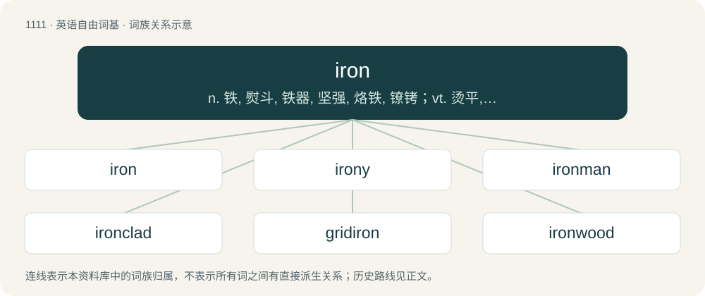

# 1189 · iron — n. 铁, 熨斗, 铁器, 坚强, 烙铁, 镣铐；vt. 烫平, 熨, 用铁包；vi. 烫平

[总目录](../00_总目录_按常用程度.md)

**类型**：英语自由词基　｜　**来源语言**：见词源记录

## 核心含义与来源

- 核心含义：n. 铁, 熨斗, 铁器, 坚强, 烙铁, 镣铐；vt. 烫平, 熨, 用铁包；vi. 烫平
- 英文含义：A common, inexpensive metal, silvery grey when untarnished, that rusts, is attracted by magnets, and is used in making steel: a chemical element having atomic number 26 and symbol Fe.
- 词形：iron

**来源记录 1**（名词；A common, inexpensive metal, silvery grey when untarnished, that rusts, is attracted by magnets, and is used in making steel: a chemical element having atomic number 26 and symbol Fe.）

From Middle English iren, from Old English īsern, īsærn, īren, īsen, from Proto-West Germanic \*īsarn, from Proto-Germanic \*īsarną (“iron”), from Proto-Celtic \*īsarnom (“iron”), possibly a derivation from Proto-Indo-European \*h₁ésh₂r̥ (“blood”). Cognates Cognate with Scots airn, ern (“iron”), Yola eeren (“iron”), Saterland Frisian Iersen (“iron”), West Frisian izer (“iron”), Bavarian Eisn (“iron”), Cimbrian aizarn (“iron”), Dutch ijzer (“iron”), German, Luxembourgish Eisen (“iron”), German Low German Isen (“iron”), Alemannic German Ise (“iron”), Limburgish iezer (“iron”), Mòcheno aisn (“iron”), Vilamovian ȧjza (“iron”), West Flemish yzer (“iron”), Yiddish אײַזן (ayzn, “iron”), Danish jern, jærn (“iron”), Faroese jarn (“iron”), Icelandic járn (“iron”), Jamtish járn, jáðn (“iron”), Norwegian Bokmål jern (“iron”), Norwegian Nynorsk jarn, jern, jønn (“iron”), Swedish jern, jaͤrn, järn (“iron”), Gothic 𐌴𐌹𐍃𐌰𐍂𐌽 (eisarn, “iron”).

## 词族图

## 单词速览（常用到不常用）

| 单词 | 音标 | 释义 |
|---|---|---|
| [iron](#w-1) | 英 /ˈaɪ.ən/；美 /ˈaɪ.ɚn/ | n. 铁, 熨斗, 铁器, 坚强, 烙铁, 镣铐；vt. 烫平, 熨, 用铁包；vi. 烫平 |
| [irony](#w-2) | 英 /ˈaɪə.ni/；美 /ˈaɪ.ɚ.ni/ | 【英文】Of or pertaining to the metal iron. |
| [ironman](#w-3) | /ˈaɪənmæn/ | 钢铁人；钢铁侠 |
| [ironclad](#w-4) | /ˈaiənclæd/ | a. 装甲的, 铁定的；\[法\] 打不破, 装甲的, 镶铁的 |
| [gridiron](#w-5) | 英 /ˈɡɹɪdaɪən/ | n. 烤架, 格状物 |
| [ironwood](#w-6) | /ˈaiənwud/ | n. 铁木 |
| [flatiron](#w-7) | /ˈflæt.aiən/ | n. 熨斗 |
| [ironstone](#w-8) | /ˈaiənstwəjn/ | n. 铁石, 含铁矿石 |
| [ironwork](#w-9) | /ˈaiənwəːk/ | n. 铁制品 |

## 逐词详解

### 1. iron

**词性**：名词　｜　**音标**：英 /ˈaɪ.ən/；美 /ˈaɪ.ɚn/

**中文释义**：n. 铁, 熨斗, 铁器, 坚强, 烙铁, 镣铐；vt. 烫平, 熨, 用铁包；vi. 烫平

**英文义项**：A common, inexpensive metal, silvery grey when untarnished, that rusts, is attracted by magnets, and is used in making steel: a chemical element having atomic number 26 and symbol Fe. / Any material, not a steel, predominantly made of elemental iron.

**词源与演化**：

From Middle English iren, from Old English īsern, īsærn, īren, īsen, from Proto-West Germanic \*īsarn, from Proto-Germanic \*īsarną (“iron”), from Proto-Celtic \*īsarnom (“iron”), possibly a derivation from Proto-Indo-European \*h₁ésh₂r̥ (“blood”). Cognates Cognate with Scots airn, ern (“iron”), Yola eeren (“iron”), Saterland Frisian Iersen (“iron”), West Frisian izer (“iron”), Bavarian Eisn (“iron”), Cimbrian aizarn (“iron”), Dutch ijzer (“iron”), German, Luxembourgish Eisen (“iron”), German Low German Isen (“iron”), Alemannic German Ise (“iron”), Limburgish iezer (“iron”), Mòcheno aisn (“iron”), Vilamovian ȧjza (“iron”), West Flemish yzer (“iron”), Yiddish אײַזן (ayzn, “iron”), Danish jern, jærn (“iron”), Faroese jarn (“iron”), Icelandic járn (“iron”), Jamtish járn, jáðn (“iron”), Norwegian Bokmål jern (“iron”), Norwegian Nynorsk jarn, jern, jønn (“iron”), Swedish jern, jaͤrn, järn (“iron”), Gothic 𐌴𐌹𐍃𐌰𐍂𐌽 (eisarn, “iron”).

**例句**：

> Today we studied about metals — including iron — at school.

该用例对应义项：A common, inexpensive metal, silvery grey when untarnished, that rusts, is attracted by magnets, and is used in making steel: a chemical element having atomic number 26 and symbol Fe.

### 2. irony

**词性**：形容词　｜　**音标**：英 /ˈaɪə.ni/；美 /ˈaɪ.ɚ.ni/

**英文义项**：Of or pertaining to the metal iron.

**构词拆分**：iron + -y

**词源与演化**：

From Middle English hyrony, yreny, yrony, yrunny, equivalent to iron + -y.

**例句**：

> The scrap yard had bins marked for irony aluminum, such as aluminum engine blocks not wholly cleaned of bolts, studs, brackets, and so on.

该用例对应义项：Of or pertaining to the metal iron.

### 3. ironman

**词性**：名词　｜　**音标**：/ˈaɪənmæn/

**中文释义**：钢铁人；钢铁侠

**英文义项**：An extremely tough and strong athlete, especially one who competes in extreme athletic competitions or in a large number of games consecutively. / A form of surf lifesaving competition which combines swimming, board paddling, ski paddling and running.

**构词拆分**：iron + man

**词源与演化**：

From iron + man. First applied to Joe McGinnity, a baseball player who pitched 48 complete games in one season and worked in an iron foundry during the offseason.

**例句**：

> Carlos's birthday party was themed after his favorite superhero, Ironman.

### 4. ironclad

**词性**：形容词　｜　**音标**：/ˈaiənclæd/

**中文释义**：a. 装甲的, 铁定的；\[法\] 打不破, 装甲的, 镶铁的

**英文义项**：Covered with iron, steel, or (loosely) any other tough metal; armor-plated. / Solid or certain; not able to be disputed or questioned; irrefutable.

**构词拆分**：iron + clad

**词源与演化**：

From iron + clad.

**例句**：

> Unlike the average vehicle, cash delivery vans are ironclad and almost unstoppable.

该用例对应义项：Covered with iron, steel, or (loosely) any other tough metal; armor-plated.

### 5. gridiron

**词性**：名词　｜　**音标**：英 /ˈɡɹɪdaɪən/

**中文释义**：n. 烤架, 格状物

**英文义项**：An instrument of torture on which people were secured before being burned by fire. / An iron rack or grate used for broiling meat and fish over coals.

**构词拆分**：grid + iron

**词源与演化**：

From Middle English gridirne, gredirne, gredyron, gredeyron, grydern, grydyryne, girdirin, girderen, variants of Middle English gredire, gredyre, itself an alteration of Middle English gridel (“griddle”). The ending was assimilated to iron, as if from grid + iron, whence grid was later derived.

**例句**：

> Why do gridiron football players wear pads?

### 6. ironwood

**词性**：名词　｜　**音标**：/ˈaiənwud/

**中文释义**：n. 铁木

**英文义项**：Acacia esthrophiolata, Acacia excelsa, Acacia melanoxylon, Acacia stenophylla, or Erythrophleum chlorostachys. / Aegiphilia martinicensis

**构词拆分**：iron + wood

**词源与演化**：

From iron + wood, because of its toughness.

### 7. flatiron

**词性**：名词　｜　**音标**：/ˈflæt.aiən/

**中文释义**：n. 熨斗

**英文义项**：A simple iron (for pressing laundry) which is heated on a stove. / A pair of metal tongs with heated ceramic plates used for straightening hair.

**构词拆分**：flat + iron

**词源与演化**：

From flat + iron.

**例句**：

> Layla burned Salima on the scalp with a flatiron.

### 8. ironstone

**词性**：名词　｜　**音标**：/ˈaiənstwəjn/

**中文释义**：n. 铁石, 含铁矿石

**英文义项**：Any ore of iron which is impure through the admixture of silica or clay. / A type of vitreous pottery similar to stoneware.

**构词拆分**：iron + stone

**词源与演化**：

From iron + stone.

### 9. ironwork

**词性**：名词　｜　**音标**：/ˈaiənwəːk/

**中文释义**：n. 铁制品

**英文义项**：Anything made wholly or largely of iron, especially when used for decoration. / An ironworks.

**构词拆分**：iron + -work

**词源与演化**：

From Middle English ironwerk, irynwerk, equivalent to iron + -work.

**例句**：

> The houses had much ornamental ironwork.

该用例对应义项：work made of iron (gratings or rails or railings etc)
