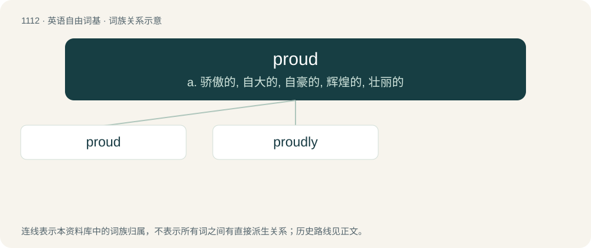

# 1190 · proud — a. 骄傲的, 自大的, 自豪的, 辉煌的, 壮丽的

[总目录](../00_总目录_按常用程度.md)

**类型**：英语自由词基　｜　**来源语言**：见词源记录

## 核心含义与来源

- 核心含义：a. 骄傲的, 自大的, 自豪的, 辉煌的, 壮丽的
- 英文含义：Feeling honoured (by something); feeling happy or satisfied about an event or fact; gratified.
- 词形：proud

**来源记录 1**（形容词；Feeling honoured (by something); feeling happy or satisfied about an event or fact; gratified.）

From Middle English proud, prout, prut, from Old English prūd, prūt (“proud, arrogant, haughty”) (compare Old English prȳtung (“pride”); prȳde, prȳte (“pride”), see also Old English deal), probably from Old French prod, prut (“brave, gallant”) (modern French preux), from Late Latin prōde (“useful”), derived from Latin prōdesse (“to be of value”); however, the Old English umlaut derivatives prȳte, prȳtian, etc. suggest the word may be older and possibly native. Compare Old Norse prýði (“ornament; gallantry, bravery”). See also pride. Cognate with German Low German praud, Old Norse prúðr (“gallant, brave, magnificent, stately, handsome, fine”) (Icelandic prúður, Middle Swedish prudh, Danish prud).

## 词族图

## 单词速览（常用到不常用）

| 单词 | 音标 | 释义 |
|---|---|---|
| [proud](#w-1) | 英 /ˈpɹaʊ̯d/；/ˈpɹæʊ̯d/ | a. 骄傲的, 自大的, 自豪的, 辉煌的, 壮丽的 |
| [proudly](#w-2) | /ˈpɹaʊdli/ | adv. 傲慢地, 自大地, 得意洋洋地 |

## 逐词详解

### 1. proud

**词性**：形容词　｜　**音标**：英 /ˈpɹaʊ̯d/；/ˈpɹæʊ̯d/

**中文释义**：a. 骄傲的, 自大的, 自豪的, 辉煌的, 壮丽的

**英文义项**：Feeling honoured (by something); feeling happy or satisfied about an event or fact; gratified. / That makes one feel proud (of something one did)

**词源与演化**：

From Middle English proud, prout, prut, from Old English prūd, prūt (“proud, arrogant, haughty”) (compare Old English prȳtung (“pride”); prȳde, prȳte (“pride”), see also Old English deal), probably from Old French prod, prut (“brave, gallant”) (modern French preux), from Late Latin prōde (“useful”), derived from Latin prōdesse (“to be of value”); however, the Old English umlaut derivatives prȳte, prȳtian, etc. suggest the word may be older and possibly native. Compare Old Norse prýði (“ornament; gallantry, bravery”). See also pride. Cognate with German Low German praud, Old Norse prúðr (“gallant, brave, magnificent, stately, handsome, fine”) (Icelandic prúður, Middle Swedish prudh, Danish prud).

**例句**：

> The weld was still a bit proud of the panel, so she ground it down flush.

该用例对应义项：Standing out or raised; swollen.

### 2. proudly

**词性**：副词　｜　**音标**：/ˈpɹaʊdli/

**中文释义**：adv. 傲慢地, 自大地, 得意洋洋地

**英文义项**：In a proud manner.

**构词拆分**：proud + -ly

**词源与演化**：

From Middle English proutly, proudliche, prudeliche, prudliche, prouteliche, from Old English prūtlīċe, equivalent to proud + -ly.

**例句**：

> He walked proudly into town.

该用例对应义项：with pride; in a proud manner
