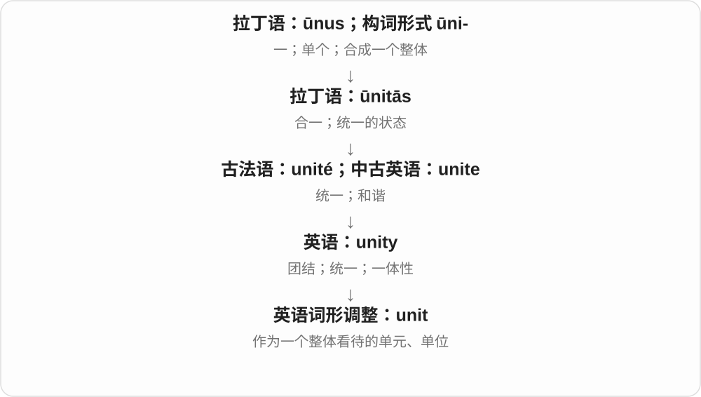
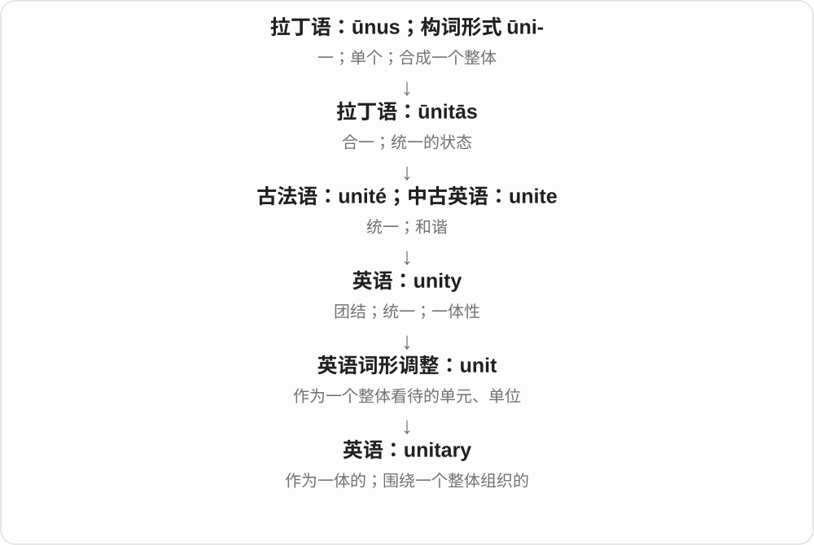

# 1190 · unit — 单位；单元；一个整体

[逐词精讲目录](../00_逐词精讲目录.md) · [总目录](../00_总目录_按常用程度.md)

## 核心词根与来源

unit 的形成联系拉丁 unus 一的命名传统。unitary 表示单一整体或统一体制的，subunit 表示较大单位中的组成单元。

**UNIT：把一个东西作为计数或组织的基本份**

一组积木可以看成一个单元，单元内部又有小单元。

- **计数与整体**：unit · unitary
- **内部组成**：subunit

## 词形与演化规律

unit 是名词，unitary 是形容词；sub- 在 subunit 中表示下一级，不必指空间下面。

## 单词速览（按词族由简到繁）

同一基础词的相关扩展放在一起，先读基础形式，再读扩展；各组之间优先读常用的。具体词源关系见各词讲解。

| 单词 | 音标 | 核心意思 |
|---|---|---|
| [unit](#w-1) | /ˈjuːnɪt/ | 单位；单元；一件；小组 |
| [unitary](#w-2) | 英 /ˈjuːnɪtəri/；美 /ˈjuːnəteri/ | 单一的；一体的；单一制的；酉的（数学） |
| [subunit](#w-3) | 英 /sʌbˈjuːnɪt/；美 /ˈsʌbˌjuːnɪt/ | 亚单位；子单元 |

## 逐词讲解

### 1. unit — 单位；单元；一件；小组

**音标**：/ˈjuːnɪt/

**先抓住这个画面**

unit 是先画一个框，把某样东西当作“一个完整单位”来数：一台机器、一套住房、一个工作小组，都可以成为一个 unit。

**怎么拆**

英语 unity 的词形调整，形成 unit；不是把动词 unite 按现代读音截短。

**怎么变成今天的意思**

“一”可以成为测量基准，也可以成为大系统里的一块完整部分。数 units 时，要先知道每个框里装的是什么。

**常见搭配与例句**

a unit of measurement；a housing unit；unit cost；a teaching unit。

> Always write the unit next to the measurement.

在测量数值旁边始终写明单位。

> The team works as a single unit.

这个团队作为一个整体协同工作。

**别混淆**

piece 只说一件、一块；unit 往往有明确的计量、功能或组织边界。

### 2. unitary — 单一的；一体的；单一制的；酉的（数学）

**音标**：英 /ˈjuːnɪtəri/；美 /ˈjuːnəteri/

**先抓住这个画面**

unitary 像把一套制度看作一个整体，权力或结构围绕一个统一中心组织。

**怎么拆**

unit + -ary，表示与单一单位、整体有关。

**怎么变成今天的意思**

普通学术用法突出一体性。政治中的 unitary state 是单一制国家；数学中的 unitary matrix 是酉矩阵：共轭转置等于逆矩阵，其变换保持向量的长度。这个专义不能只凭“一个”猜出来。

**常见搭配与例句**

a unitary state；a unitary system；a unitary matrix。

> The book compares unitary and federal systems.

这本书比较了单一制与联邦制体系。

> The proposal replaces several separate bodies with one unitary authority.

提案用一个统一的管理机构替代几个独立机构。

> A unitary transformation preserves the length of the vector.

酉变换保持向量的长度不变。

**别混淆**

united 是各方联合；unitary 强调整体组织形式。政治里的 unitary 常与 federal 对照，不等于所有事务都由同一人处理。

### 3. subunit — 亚单位；子单元

**音标**：英 /sʌbˈjuːnɪt/；美 /ˈsʌbˌjuːnɪt/

**先抓住这个画面**

一台大装置由几个能辨认的小块拼起来，每个小块就是一个 subunit。

**怎么拆**

sub- + unit“单元”，在英语中构词；sub- 表示组成整体的下一级。

**怎么变成今天的意思**

**拉丁语：sub**  
在下面；从下向上；靠近

↓

**英语前缀：sub-**  
下方；下一级；低于某个标准

↓

**英语：sub- + unit → subunit**  
更大单元里的组成单位

可以说组织内的分单位，也可说蛋白质复合体的亚基。它是否能够独立工作，由具体对象决定。

**常见搭配与例句**

a protein subunit；a functional subunit。

> The complex contains four protein subunits.

这个复合体含有四个蛋白质亚基。

> Each subunit reports to the central office.

每个下属单位都向总部汇报。

**别混淆**

component 强调组成部分；subunit 更容易暗示其中一个可识别的单位。

## 这一组要分清什么

unit 是一个单位，unity 是统一、团结或整体性；unitary 在政治和数学中各有专业用法。

## 串起来练习

The unit contains several smaller subunits.

这个单元包含几个较小的子单元。
