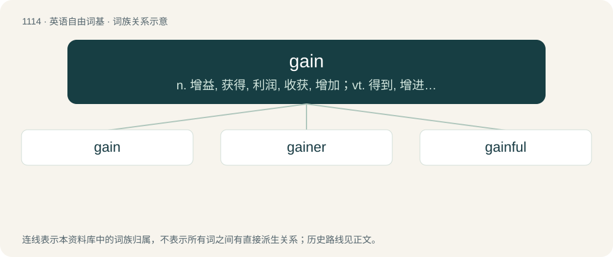

# 1191 · gain — n. 增益, 获得, 利润, 收获, 增加；vt. 得到, 增进, 赚到；vi. 获利, 增加

[总目录](../00_总目录_按常用程度.md)

**类型**：英语自由词基　｜　**来源语言**：见词源记录

## 核心含义与来源

- 核心含义：n. 增益, 获得, 利润, 收获, 增加；vt. 得到, 增进, 赚到；vi. 获利, 增加
- 英文含义：To acquire possession of.
- 词形：gain

**多个词源／构词路径**：同一拼写可能有不同来源；以下按词性和含义分别列出。

**来源记录 1**（动词；To acquire possession of.）

From Middle English gayn, gain, gein (“profit, advantage”), from Old Norse gagn (“benefit, advantage, use”), from Proto-Germanic \*gagną, \*gaganą (“gain, profit", literally "return”), from Proto-Germanic \*gagana (“back, against, in return”), a reduplication of Proto-Germanic \*ga- (“with, together”), from Proto-Indo-European \*ḱóm (“next to, at, with, along”). Cognate with Icelandic gagn (“gain, advantage, use”), Swedish gagn (“benefit, profit”), Danish gavn (“gain, profit, success”), Gothic 𐌲𐌰𐌲𐌴𐌹𐌲𐌰𐌽 (gageigan, “to gain, profit”), Old Norse gegn (“ready”), dialectal Swedish gen (“useful, noteful”), Latin cum (“with”); see gain-, again, against. Compare also Middle English gaynen, geinen (“to be of use, profit, avail”), Icelandic and Swedish gagna (“to avail, help”), Danish gavne (“to benefit”). The Middle English word was reinforced by Middle French gain (“gain, profit, advancement, cultivation”), from Old French gaaing, gaaigne, gaigne, a noun derivative of gaaignier, gaigner (“to till, earn, win”), from Frankish \*waiþanōn (“to pasture, graze, hunt for food”), ultimately from Proto-Germanic \*waiþiz, \*waiþō, \*waiþijō (“pasture, field, hunting ground”); compare Old High German weidōn, weidanōn (“to hunt, forage for food”) (Modern German Weide (“pasture”)), Old Norse veiða (“to catch, hunt”), Old English wǣþan (“to hunt, chase, pursue”). Related to wide.

**来源记录 2**（形容词；Easy; tolerable; handy, dexterous.）

From Middle English gayn, gein, geyn (“straight, direct, short, fit, good”), from Old Norse gegn (“straight, direct, short, ready, serviceable, kindly”), from gegn (“opposite, against”, adverb) (whence gagna (“to go against, meet, suit, be meet”)); see above. Adverb from Middle English gayn, gayne (“fitly, quickly”), from the adjective.

**来源记录 3**（名词；A square or bevelled notch cut out of a girder, binding joist, or other timber which supports a floor beam, so as to receive the end of the floor beam.）

Compare Welsh gan (“a mortise”).

## 词族图

## 单词速览（常用到不常用）

| 单词 | 音标 | 释义 |
|---|---|---|
| [gain](#w-1) | /ɡeɪn/ | n. 增益, 获得, 利润, 收获, 增加；vt. 得到, 增进, 赚到；vi. 获利, 增加 |
| [gainer](#w-2) | 英 /ˈɡeɪnə/；美 /ˈɡeɪnɚ/ | n. 获得者, 得利者, 胜利者；\[经\] 获利者 |
| [gainful](#w-3) | /ˈgeinful/ | a. 有利益的, 唯利是图的 |

## 逐词详解

### 1. gain

**词性**：动词　｜　**音标**：/ɡeɪn/

**中文释义**：n. 增益, 获得, 利润, 收获, 增加；vt. 得到, 增进, 赚到；vi. 获利, 增加

**英文义项**：To acquire possession of. / To have or receive advantage or profit; to acquire gain; to grow rich; to advance in interest, health, or happiness; to make progress.

**词源与演化**：

From Middle English gayn, gain, gein (“profit, advantage”), from Old Norse gagn (“benefit, advantage, use”), from Proto-Germanic \*gagną, \*gaganą (“gain, profit", literally "return”), from Proto-Germanic \*gagana (“back, against, in return”), a reduplication of Proto-Germanic \*ga- (“with, together”), from Proto-Indo-European \*ḱóm (“next to, at, with, along”). Cognate with Icelandic gagn (“gain, advantage, use”), Swedish gagn (“benefit, profit”), Danish gavn (“gain, profit, success”), Gothic 𐌲𐌰𐌲𐌴𐌹𐌲𐌰𐌽 (gageigan, “to gain, profit”), Old Norse gegn (“ready”), dialectal Swedish gen (“useful, noteful”), Latin cum (“with”); see gain-, again, against. Compare also Middle English gaynen, geinen (“to be of use, profit, avail”), Icelandic and Swedish gagna (“to avail, help”), Danish gavne (“to benefit”). The Middle English word was reinforced by Middle French gain (“gain, profit, advancement, cultivation”), from Old French gaaing, gaaigne, gaigne, a noun derivative of gaaignier, gaigner (“to till, earn, win”), from Frankish \*waiþanōn (“to pasture, graze, hunt for food”), ultimately from Proto-Germanic \*waiþiz, \*waiþō, \*waiþijō (“pasture, field, hunting ground”); compare Old High German weidōn, weidanōn (“to hunt, forage for food”) (Modern German Weide (“pasture”)), Old Norse veiða (“to catch, hunt”), Old English wǣþan (“to hunt, chase, pursue”). Related to wide.

**例句**：

> Looks like you’ve gained a new friend.

该用例对应义项：To acquire possession of.

### 2. gainer

**词性**：名词　｜　**音标**：英 /ˈɡeɪnə/；美 /ˈɡeɪnɚ/

**中文释义**：n. 获得者, 得利者, 胜利者；\[经\] 获利者

**英文义项**：One who gains a profit or advantage. / One who puts on weight.

**构词拆分**：gain + -er

**词源与演化**：

From gain + -er. Compare German Gegner (“opponent, adversary”).

**例句**：

> She was clearly the gainer in that exchange.

该用例对应义项：a person who gains (gains an advantage or gains profits)

### 3. gainful

**词性**：形容词　｜　**音标**：/ˈgeinful/

**中文释义**：a. 有利益的, 唯利是图的

**英文义项**：Contrary. / Disposed to taking advantage of.

**构词拆分**：gain (“against, contrary”) + -ful

**词源与演化**：

From gain (“against, contrary”) + -ful.
