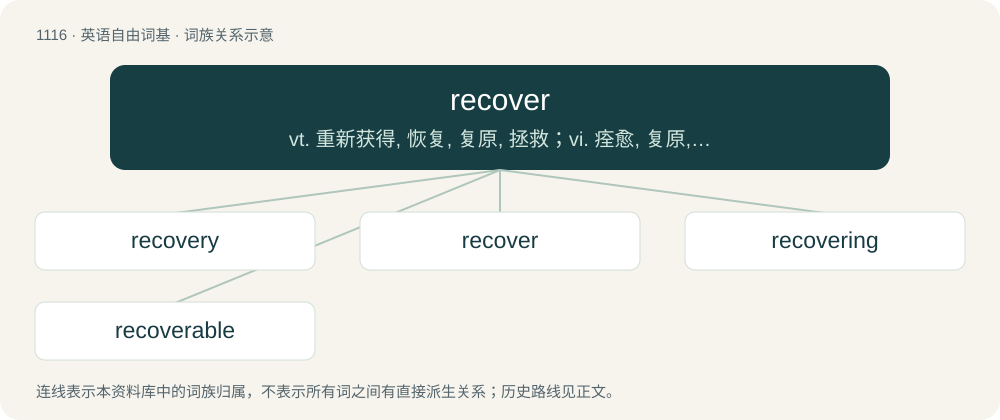

# 1193 · recover — vt. 重新获得, 恢复, 复原, 拯救；vi. 痊愈, 复原, 胜诉；\[计\] 恢复

[总目录](../00_总目录_按常用程度.md)

**类型**：英语自由词基　｜　**来源语言**：见词源记录

## 核心含义与来源

- 核心含义：vt. 重新获得, 恢复, 复原, 拯救；vi. 痊愈, 复原, 胜诉；\[计\] 恢复
- 英文含义：To get back, to regain (a physical thing; in astronomy and navigation, sight of a thing or a signal).
- 词形：recover

**多个词源／构词路径**：同一拼写可能有不同来源；以下按词性和含义分别列出。

**来源记录 1**（动词；To get back, to regain (a physical thing; in astronomy and navigation, sight of a thing or a signal).）

From Middle English recoveren, rekeveren, from Anglo-Norman recoverer and Old French recovrer, from Latin recuperāre, alternative form of reciperāre. Doublet of recuperate. The noun is from Middle English recover, from the verb.

**来源记录 2**（动词；To cover again.）

From re- + cover.

## 词族图

## 单词速览（常用到不常用）

| 单词 | 音标 | 释义 |
|---|---|---|
| [recovery](#w-1) | /ɹɪˈkʌvəɹi/ | n. 恢复, 复原, 痊愈, 重获；\[计\] 恢复 |
| [recover](#w-2) | 英 /ɹɪˈkʌvə/；美 /ɹɪˈkʌvɚ/ | vt. 重新获得, 恢复, 复原, 拯救；vi. 痊愈, 复原, 胜诉；\[计\] 恢复 |
| [recovering](#w-3) |  | n. 恢复；补偿；再生 |
| [recoverable](#w-4) | 美 /ɹɪˈkʌvɚəb(ə)l/ | a. 可回复的, 可痊愈的, 可收回的；\[经\] 可收回的, 可补偿的 |

## 逐词详解

### 1. recovery

**词性**：名词　｜　**音标**：/ɹɪˈkʌvəɹi/

**中文释义**：n. 恢复, 复原, 痊愈, 重获；\[计\] 恢复

**英文义项**：The act or process of regaining or repossession of something lost. / A clever verbal solution to an embarrassing verbal mistake.

**构词拆分**：recover + -y

**词源与演化**：

From recover + -y, from Middle English recoveree, from Old French recovree, from recovrer (“recover”).

**例句**：

> When I realized I'd called my teacher "Mom" again, I made a quick recovery saying that she loves me so much that she reminds me of my mother.

该用例对应义项：A clever verbal solution to an embarrassing verbal mistake.

### 2. recover

**词性**：动词　｜　**音标**：英 /ɹɪˈkʌvə/；美 /ɹɪˈkʌvɚ/

**中文释义**：vt. 重新获得, 恢复, 复原, 拯救；vi. 痊愈, 复原, 胜诉；\[计\] 恢复

**英文义项**：To get back, to regain (a physical thing; in astronomy and navigation, sight of a thing or a signal). / To salvage, to extricate, to rescue (a thing or person).

**词源与演化**：

From Middle English recoveren, rekeveren, from Anglo-Norman recoverer and Old French recovrer, from Latin recuperāre, alternative form of reciperāre. Doublet of recuperate. The noun is from Middle English recover, from the verb.

**例句**：

> The plaintiff recovered in his suit, being awarded declaratory relief and a clearing of his name.

该用例对应义项：To obtain a positive judgement; to win in a lawsuit.

### 3. recovering

**词性**：名词

**中文释义**：n. 恢复；补偿；再生

**英文义项**：The process or the instance of recovery.

**构词拆分**：recover + -ing

**词源与演化**：

From Middle English recoveryng; equivalent to recover + -ing.

**例句**：

> The opera singer tested her voice gingerly after recovering from throat surgery.

### 4. recoverable

**词性**：形容词　｜　**音标**：美 /ɹɪˈkʌvɚəb(ə)l/

**中文释义**：a. 可回复的, 可痊愈的, 可收回的；\[经\] 可收回的, 可补偿的

**英文义项**：Capable of being regained or recovered. / Restorable from sickness, faintness, danger, etc.

**构词拆分**：recover + -able

**词源与演化**：

From Middle English recoverabille, recoverable, recovererabyll (error), equivalent to recover + -able.

**用法示例／搭配（非完整句）**：

> a recoverable error

该用例对应义项：Capable of being brought back to a former condition, or recovered from.
