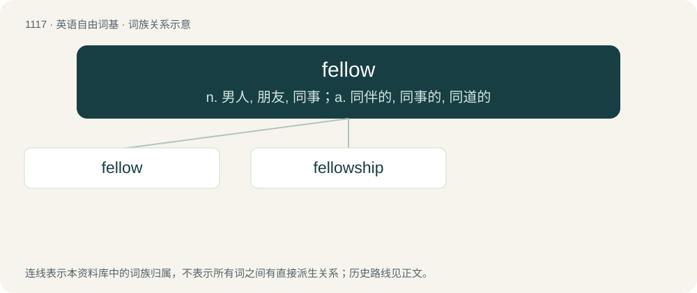

# 1195 · fellow — n. 男人, 朋友, 同事；a. 同伴的, 同事的, 同道的

[总目录](../00_总目录_按常用程度.md)

**类型**：英语自由词基　｜　**来源语言**：见词源记录

## 核心含义与来源

- 核心含义：n. 男人, 朋友, 同事；a. 同伴的, 同事的, 同道的
- 英文含义：A companion; a comrade.
- 词形：fellow

**来源记录 1**（名词；A companion; a comrade.）

From Middle English felawe, felowe (“companion, good friend”) from Old English fēolaga, from Old Norse félagi, derived from félag (“joint venture; partnership”, literally “a laying together of property”), from fé (“livestock, property; money”) (ultimately from Proto-Indo-European \*peḱ- (“livestock; wealth”)) + lag (“something laid down; right position; arrangement; companionship, fellowship; partnership”) (ultimately from Proto-Indo-European \*legʰ- (“to lie down”)). Cognates \* Old Norse filaga, felaka (“partner”, accusative singular), from which the other terms are derived: \* Danish fælle (“companion”) \* Faroese felagi (“member; partner”) \* Icelandic félagi (“companion, comrade, fellow; member; partner”) \* Norwegian felle (“companion”) \* Old Swedish fälaghi (modern Swedish felaga, felaha (“partner”, accusative singular)) \* Scots falow, fallow, follow (“associate, companion, comrade”)

## 词族图

## 单词速览（常用到不常用）

| 单词 | 音标 | 释义 |
|---|---|---|
| [fellow](#w-1) | 英 /ˈfɛ.ləʊ/；美 /ˈfɛ.loʊ/ | n. 男人, 朋友, 同事；a. 同伴的, 同事的, 同道的 |
| [fellowship](#w-2) | 英 /ˈfɛl.ə(ʊ).ʃɪp/；美 /ˈfɛl.ə.ʃɪp/ | n. 伙伴关系, 共同参与, 团体, 奖学金, 友谊；\[经\] 合伙关系, 研究员薪金, 研究员基金 |

## 逐词详解

### 1. fellow

**词性**：名词　｜　**音标**：英 /ˈfɛ.ləʊ/；美 /ˈfɛ.loʊ/

**中文释义**：n. 男人, 朋友, 同事；a. 同伴的, 同事的, 同道的

**英文义项**：A companion; a comrade. / An animal which is a member of a breed or species, or a flock, herd, etc.

**词源与演化**：

From Middle English felawe, felowe (“companion, good friend”) from Old English fēolaga, from Old Norse félagi, derived from félag (“joint venture; partnership”, literally “a laying together of property”), from fé (“livestock, property; money”) (ultimately from Proto-Indo-European \*peḱ- (“livestock; wealth”)) + lag (“something laid down; right position; arrangement; companionship, fellowship; partnership”) (ultimately from Proto-Indo-European \*legʰ- (“to lie down”)). Cognates \* Old Norse filaga, felaka (“partner”, accusative singular), from which the other terms are derived: \* Danish fælle (“companion”) \* Faroese felagi (“member; partner”) \* Icelandic félagi (“companion, comrade, fellow; member; partner”) \* Norwegian felle (“companion”) \* Old Swedish fälaghi (modern Swedish felaga, felaha (“partner”, accusative singular)) \* Scots falow, fallow, follow (“associate, companion, comrade”)

**例句**：

> Rebecca and her fellow workers are to go on strike.

该用例对应义项：One comparable in characteristics with another; especially, as belonging to the same class or group.

### 2. fellowship

**词性**：名词　｜　**音标**：英 /ˈfɛl.ə(ʊ).ʃɪp/；美 /ˈfɛl.ə.ʃɪp/

**中文释义**：n. 伙伴关系, 共同参与, 团体, 奖学金, 友谊；\[经\] 合伙关系, 研究员薪金, 研究员基金

**英文义项**：A company of people that share the same interest or aim. / Company, companions; a group of people or things following another.

**构词拆分**：fellow + -ship

**词源与演化**：

From Middle English felowschipe, felawshipe, felaȝschyp, equivalent to fellow + -ship; or perhaps adapted from Old Norse félagskapr, félagsskapr (“fellowship”). Compare Icelandic félagsskapur (“companionship, company, community”), Danish fællesskab (“fellowship”), Norwegian fellesskap (“fellowship”), and Old Swedish fælaghskap (“fellowship”)

**例句**：

> The grace of the Lord Jesus Christ and the love of God and the fellowship of the Holy Spirit be with you all.

该用例对应义项：A feeling of friendship, relatedness or connection between people.
