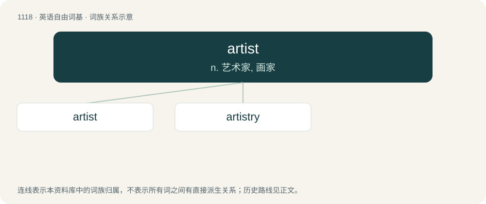

# 1197 · artist — n. 艺术家, 画家

[总目录](../00_总目录_按常用程度.md)

**类型**：英语自由词基　｜　**来源语言**：见词源记录

## 核心含义与来源

- 核心含义：n. 艺术家, 画家
- 英文含义：A person who creates art.
- 词形：artist

**来源记录 1**（名词；A person who creates art.）

From French artiste, from Late Latin artista, from ars (“art”). Doublet of artiste. Displaced native Old English cræftiga. By surface analysis, art + -ist.

## 词族图

## 单词速览（常用到不常用）

| 单词 | 音标 | 释义 |
|---|---|---|
| [artist](#w-1) | 英 /ˈɑːtɪst/；美 /ˈɑɹ.tɪst/ | n. 艺术家, 画家 |
| [artistry](#w-2) | /ˈɑː(ɹ)tɪstɹi/ | n. 艺术性 |

## 逐词详解

### 1. artist

**词性**：名词　｜　**音标**：英 /ˈɑːtɪst/；美 /ˈɑɹ.tɪst/

**中文释义**：n. 艺术家, 画家

**英文义项**：A person who creates art. / A person who creates art as an occupation.

**词源与演化**：

From French artiste, from Late Latin artista, from ars (“art”). Doublet of artiste. Displaced native Old English cræftiga. By surface analysis, art + -ist.

**例句**：

> I am not an artist. I never had the knack for it.

### 2. artistry

**词性**：名词　｜　**音标**：/ˈɑː(ɹ)tɪstɹi/

**中文释义**：n. 艺术性

**英文义项**：Significant artistic skill.

**构词拆分**：artist + -ry

**词源与演化**：

From artist + -ry.

**例句**：

> I had no idea how much artistry could go into a sandwich.
