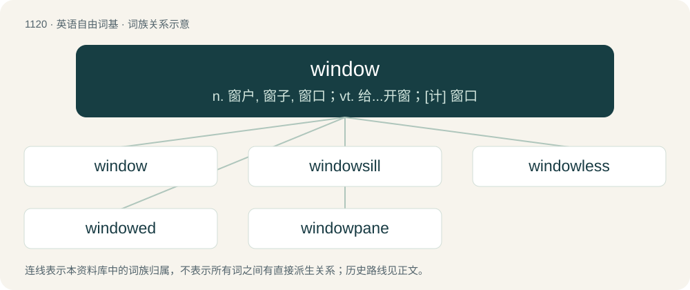

# 1201 · window — n. 窗户, 窗子, 窗口；vt. 给...开窗；\[计\] 窗口

[总目录](../00_总目录_按常用程度.md)

**类型**：英语自由词基　｜　**来源语言**：见词源记录

## 核心含义与来源

- 核心含义：n. 窗户, 窗子, 窗口；vt. 给...开窗；\[计\] 窗口
- 英文含义：An opening, usually covered by one or more panes of clear glass, to allow light and air from outside to enter a building or vehicle.
- 词形：window

**来源记录 1**（名词；An opening, usually covered by one or more panes of clear glass, to allow light and air from outside to enter a building or vehicle.）

From Middle English wyndowe, wyndown, from Old Norse vindauga (“window”, literally “wind-eye; wind-hole”), equivalent to wind + eye. Cognate with Scots windae and windock, Faroese vindeyga, Norwegian Bokmål vindu, Norwegian Nynorsk vindauge, Danish vindue, archaic Swedish vindöga, Elfdalian windog. Displaced native Old English ēagþȳrel (literally “eye hole”) (the rare direct descendant is eyethurl (“window, pupil, etc.”)). The “windows” among early Germanic peoples were just unglazed holes (eyes) in the wall or roof that permitted wind to pass through .

## 词族图

## 单词速览（常用到不常用）

| 单词 | 音标 | 释义 |
|---|---|---|
| [window](#w-1) | 英 /ˈwɪndəʊ/；美 /ˈwɪndoʊ/ | n. 窗户, 窗子, 窗口；vt. 给...开窗；\[计\] 窗口 |
| [windowsill](#w-2) | 英 /ˈwɪndəʊˌsɪl/；美 /ˈwɪndoʊˌsɪl/ | n. 窗台 |
| [windowless](#w-3) |  | a. 无窗的 |
| [windowed](#w-4) |  | a. 有窗的；\[计\] 窗口的 |
| [windowpane](#w-5) | 英 /ˈwɪndəʊˌpeɪn/；美 /ˈwɪndoʊˌpeɪn/ | n. 窗玻璃 |

## 逐词详解

### 1. window

**词性**：名词　｜　**音标**：英 /ˈwɪndəʊ/；美 /ˈwɪndoʊ/

**中文释义**：n. 窗户, 窗子, 窗口；vt. 给...开窗；\[计\] 窗口

**英文义项**：An opening, usually covered by one or more panes of clear glass, to allow light and air from outside to enter a building or vehicle. / An opening, usually covered by glass, in a shop which allows people to view the shop and its products from outside; a shop window.

**构词拆分**：wind + eye

**词源与演化**：

From Middle English wyndowe, wyndown, from Old Norse vindauga (“window”, literally “wind-eye; wind-hole”), equivalent to wind + eye. Cognate with Scots windae and windock, Faroese vindeyga, Norwegian Bokmål vindu, Norwegian Nynorsk vindauge, Danish vindue, archaic Swedish vindöga, Elfdalian windog. Displaced native Old English ēagþȳrel (literally “eye hole”) (the rare direct descendant is eyethurl (“window, pupil, etc.”)). The “windows” among early Germanic peoples were just unglazed holes (eyes) in the wall or roof that permitted wind to pass through .

**例句**：

> You have a two-hour window of clear weather to finish working on the lawn.

该用例对应义项：A period of time when something is available or possible; a limited opportunity.

### 2. windowsill

**词性**：名词　｜　**音标**：英 /ˈwɪndəʊˌsɪl/；美 /ˈwɪndoʊˌsɪl/

**中文释义**：n. 窗台

**英文义项**：The horizontal member protruding from the base of a window frame.

**构词拆分**：window + sill

**词源与演化**：

From window + sill.

**例句**：

> Every Sunday the cat sits on the windowsill and watches the birds.

### 3. windowless

**词性**：形容词

**中文释义**：a. 无窗的

**英文义项**：Having no windows, especially no external windows.

**构词拆分**：window + -less

**词源与演化**：

From Middle English wyndowles, equivalent to window + -less.

**例句**：

> When he came to he found himself lying in a small, windowless cell.

### 4. windowed

**词性**：形容词

**中文释义**：a. 有窗的；\[计\] 窗口的

**英文义项**：Fitted with windows, often of a particular kind or, in (heraldry), of a specified colour. / Occupying only a part of the screen (in a window.)

**构词拆分**：window + -ed

**词源与演化**：

From Middle English wyndowed, wyndowid, equivalent to window + -ed.

**例句**：

> This game can be played both in windowed mode and in full-screen mode.

该用例对应义项：Occupying only a part of the screen (in a window.)

### 5. windowpane

**词性**：名词　｜　**音标**：英 /ˈwɪndəʊˌpeɪn/；美 /ˈwɪndoʊˌpeɪn/

**中文释义**：n. 窗玻璃

**英文义项**：A piece of glass filling a window or a section of a window. / A fabric pattern of widely-spaced intersecting vertical and horizontal lines forming large squares.

**构词拆分**：window + pane

**词源与演化**：

From window + pane.

**例句**：

> A snail is moving up the inside of the windowpane.
