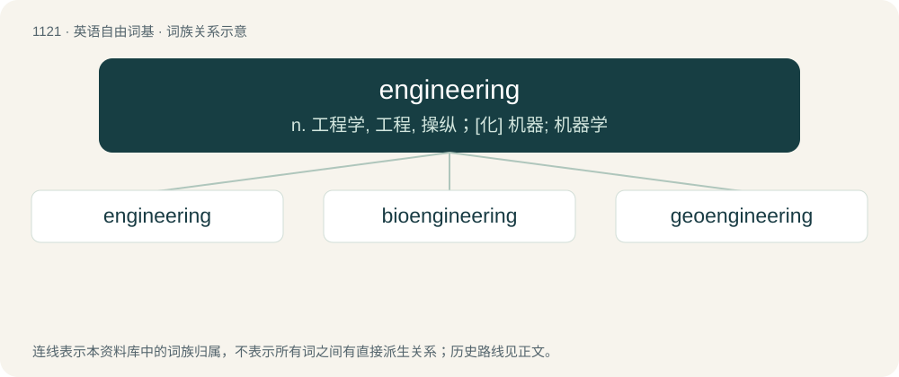

# 1202 · engineering — n. 工程学, 工程, 操纵；\[化\] 机器; 机器学

[总目录](../00_总目录_按常用程度.md)

**类型**：英语自由词基　｜　**来源语言**：见词源记录

## 核心含义与来源

- 核心含义：n. 工程学, 工程, 操纵；\[化\] 机器; 机器学
- 英文含义：The application of mathematics and the physical sciences to the needs of humanity and the development of technology.
- 词形：engineering

**来源记录 1**（名词；The application of mathematics and the physical sciences to the needs of humanity and the development of technology.）

From engineer + -ing.

## 词族图

## 单词速览（常用到不常用）

| 单词 | 音标 | 释义 |
|---|---|---|
| [engineering](#w-1) | 英 /ˌɛn(d)ʒɪˈnɪə.ɹɪŋ/；美 /ˌɛn.d͡ʒɪˈnɪ(ə)ɹ.ɪŋ/ | n. 工程学, 工程, 操纵；\[化\] 机器; 机器学 |
| [bioengineering](#w-2) | /baiəu,endʒiˈniəriŋ/ | \[计\] 生物工程；\[化\] 生物工程 |
| [geoengineering](#w-3) |  | 地质工程；岩土工程 |

## 逐词详解

### 1. engineering

**词性**：名词　｜　**音标**：英 /ˌɛn(d)ʒɪˈnɪə.ɹɪŋ/；美 /ˌɛn.d͡ʒɪˈnɪ(ə)ɹ.ɪŋ/

**中文释义**：n. 工程学, 工程, 操纵；\[化\] 机器; 机器学

**英文义项**：The application of mathematics and the physical sciences to the needs of humanity and the development of technology. / The area aboard a ship where the engine is located.

**构词拆分**：From engineer + -ing.

**词源与演化**：

From engineer + -ing.

**例句**：

> Thanks to genetic engineering, there are now penguins that swim in lava.

### 2. bioengineering

**词性**：名词　｜　**音标**：/baiəu,endʒiˈniəriŋ/

**中文释义**：\[计\] 生物工程；\[化\] 生物工程

**英文义项**：The applications of the principles of engineering to any of the biological or medical sciences

**构词拆分**：bio- + engineering

**词源与演化**：

From bio- + engineering.

### 3. geoengineering

**词性**：名词

**中文释义**：地质工程；岩土工程

**英文义项**：The subfield of engineering concerned with designing and constructing tunnels, mines, and other human-designed geologic structures within and on earth. / The artificial manipulation of the environments of a planet, especially Earth, especially as a means of counteracting global warming.

**构词拆分**：geo- + engineering

**词源与演化**：

From geo- + engineering.

**例句**：

> Since there's geoengineering, there's extreme weather.
