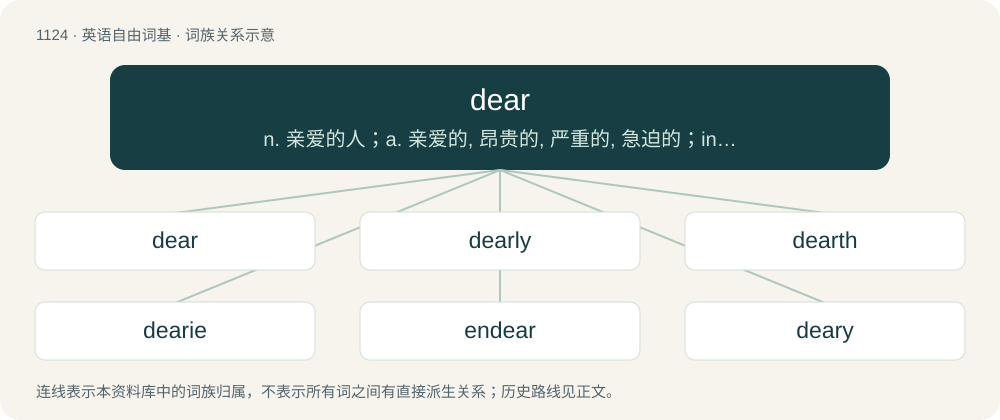

# 1204 · dear — n. 亲爱的人；a. 亲爱的, 昂贵的, 严重的, 急迫的；interj. 啊

[总目录](../00_总目录_按常用程度.md)

**类型**：英语自由词基　｜　**来源语言**：见词源记录

## 核心含义与来源

- 核心含义：n. 亲爱的人；a. 亲爱的, 昂贵的, 严重的, 急迫的；interj. 啊
- 英文含义：High in price; expensive.
- 词形：dear

**多个词源／构词路径**：同一拼写可能有不同来源；以下按词性和含义分别列出。

**来源记录 1**（形容词；High in price; expensive.）

From Middle English dere, from Old English dēore, dīere, dīore, dȳre (“of great value or excellence, expensive, beloved”), from Proto-West Germanic \*diurī, from Proto-Germanic \*diurijaz (“dear, precious; expensive”), probably from Proto-Indo-European \*dʰegʷʰ- (“to burn; hot, warm”). Cognates Cognate with Yola dear (“dear”), Saterland Frisian djuur (“precious, dear, costly, expensive”), Alemannic German tüür (“expensive”), Dutch dier, duur (“expensive”), German teuer (“expensive”), Vilamovian taojer, tojer (“dear”), West Flemish diere (“expensive”), Yiddish טײַער (tayer, “expensive”), Danish, Norwegian Bokmål, Norwegian Nynorsk, and Swedish dyr (“expensive”), Faroese dýrur (“expensive”), Icelandic dýr (“expensive”), Finnish tyyris (“expensive”), Livonian tõurõz (“dear”), Northern Sami divrras (“expensive”).

**来源记录 2**（形容词；Severe, or severely affected; sore.）

From Middle English dere (“fierce, severe, hard, deadly”), from Old English dēor, dȳr (“brave, bold; severe, dire, vehement”), from Proto-Germanic \*deuzaz. Cognate with the above.

## 词族图

## 单词速览（常用到不常用）

| 单词 | 音标 | 释义 |
|---|---|---|
| [dear](#w-1) | 英 /dɪə/；美 /dɪɹ/ | n. 亲爱的人；a. 亲爱的, 昂贵的, 严重的, 急迫的；interj. 啊 |
| [dearly](#w-2) | 英 /ˈdɪəli/；美 /ˈdɪɹli/ | adv. 深深地, 昂贵地 |
| [dearth](#w-3) | 英 /dɜːθ/；美 /dɝθ/ | n. 缺乏, 粮食不足, 饥馑 |
| [dearie](#w-4) | 英 /ˈdɪəɹi/；美 /ˈdɪɚi/ | n. 可爱的小宝贝, 亲亲 |
| [endear](#w-5) | 英 /ɪnˈdɪə(ɹ)/；美 /ɪnˈdɪɚ/ | vt. 使受喜爱, 使受钟爱 |
| [deary](#w-6) | 英 /ˈdɪəɹi/；美 /ˈdɪɚi/ | n. 亲爱的人 |

## 逐词详解

### 1. dear

**词性**：形容词　｜　**音标**：英 /dɪə/；美 /dɪɹ/

**中文释义**：n. 亲爱的人；a. 亲爱的, 昂贵的, 严重的, 急迫的；interj. 啊

**英文义项**：High in price; expensive. / Loved; lovable.

**词源与演化**：

From Middle English dere, from Old English dēore, dīere, dīore, dȳre (“of great value or excellence, expensive, beloved”), from Proto-West Germanic \*diurī, from Proto-Germanic \*diurijaz (“dear, precious; expensive”), probably from Proto-Indo-European \*dʰegʷʰ- (“to burn; hot, warm”). Cognates Cognate with Yola dear (“dear”), Saterland Frisian djuur (“precious, dear, costly, expensive”), Alemannic German tüür (“expensive”), Dutch dier, duur (“expensive”), German teuer (“expensive”), Vilamovian taojer, tojer (“dear”), West Flemish diere (“expensive”), Yiddish טײַער (tayer, “expensive”), Danish, Norwegian Bokmål, Norwegian Nynorsk, and Swedish dyr (“expensive”), Faroese dýrur (“expensive”), Icelandic dýr (“expensive”), Finnish tyyris (“expensive”), Livonian tõurõz (“dear”), Northern Sami divrras (“expensive”).

**例句**：

> Dear Sir/Madam/Miss, please notice our offices will be closed during the following bank holidays:\[…\].

该用例对应义项：A formal way to start (possibly after my) addressing somebody at the beginning of a letter, memo etc.

### 2. dearly

**词性**：副词　｜　**音标**：英 /ˈdɪəli/；美 /ˈdɪɹli/

**中文释义**：adv. 深深地, 昂贵地

**英文义项**：In a dear or precious manner. / In a dear or expensive manner.

**构词拆分**：dear + -ly

**词源与演化**：

From Middle English derely, deorliche, from Old English dēorlīċe (“worthily, richly”), equivalent to dear + -ly.

**例句**：

> He paid dearly for his mistake.

该用例对应义项：At great expense; dear.

### 3. dearth

**词性**：名词　｜　**音标**：英 /dɜːθ/；美 /dɝθ/

**中文释义**：n. 缺乏, 粮食不足, 饥馑

**英文义项**：A period or condition when food is rare and hence expensive; famine. / Scarcity; a lack or short supply.

**构词拆分**：dear + -th (abstract nominal suffix)

**词源与演化**：

First attested at least as early as the late 1300s, and appearing in Tyndale’s Pentateuch (1530) as well as the Coverdale Bible (1535). From Middle English derth, derthe, derþe, probably from Old English \*dīerþ, \*dīerþu, from Proto-West Germanic \*diuriþu, from Proto-Germanic \*diuriþō (“costliness, preciousness, honour”); corresponding to dear + -th (abstract nominal suffix). Cognate with Old Saxon diuriða (“glory, honour; preciousness”), West Frisian djoerte (“love, dearness, value, worth”), Dutch duurte (“dearness; scarcity, dearth”), Icelandic dýrð (“honour, glory”).

**例句**：

> There is a dearth of sentences involving the word "dearth" on Tatoeba.

### 4. dearie

**词性**：名词　｜　**音标**：英 /ˈdɪəɹi/；美 /ˈdɪɚi/

**中文释义**：n. 可爱的小宝贝, 亲亲

**英文义项**：A person who is dear; sweetie.

**构词拆分**：From dear + -ie.

**词源与演化**：

From dear + -ie.

### 5. endear

**词性**：动词　｜　**音标**：英 /ɪnˈdɪə(ɹ)/；美 /ɪnˈdɪɚ/

**中文释义**：vt. 使受喜爱, 使受钟爱

**英文义项**：To make (someone) dear or precious.

**构词拆分**：en- + dear

**词源与演化**：

From en- + dear.

**例句**：

> By giving candy to the children the man tried to endear himself to them.

该用例对应义项：To make (someone) dear or precious.

### 6. deary

**词性**：名词　｜　**音标**：英 /ˈdɪəɹi/；美 /ˈdɪɚi/

**中文释义**：n. 亲爱的人

**英文义项**：A dear; a darling. / A term of address for a female.

**构词拆分**：From dear + -y.

**词源与演化**：

From dear + -y.

**例句**：

> Listen, deary: I'd appreciate your not talking about my son like that.

该用例对应义项：A term of address for a female.
