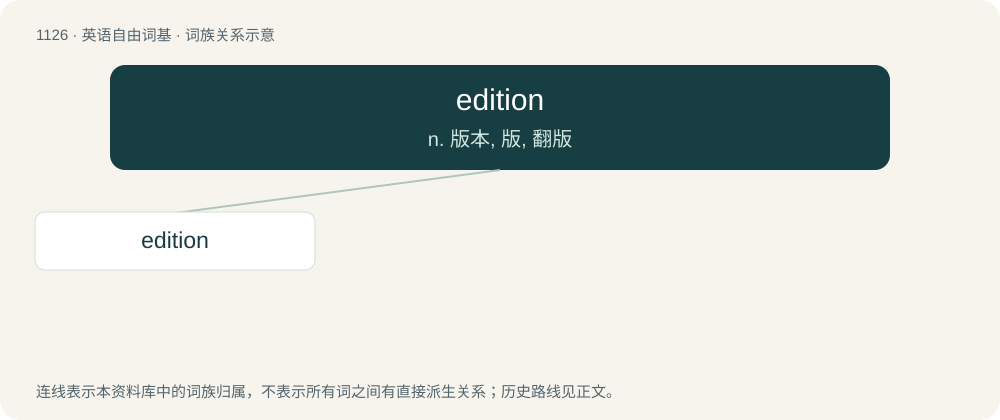

# 1205 · edition — n. 版本, 版, 翻版

[总目录](../00_总目录_按常用程度.md)

**类型**：英语自由词基　｜　**来源语言**：见词源记录

## 核心含义与来源

- 核心含义：n. 版本, 版, 翻版
- 英文含义：A written work edited and published, as by a certain editor or in a certain manner, or at a certain time.
- 词形：edition

**来源记录 1**（名词；A written work edited and published, as by a certain editor or in a certain manner, or at a certain time.）

From French édition, from Latin ēditiō, from ēdere (“to publish”).

## 词族图

## 单词速览（常用到不常用）

| 单词 | 音标 | 释义 |
|---|---|---|
| [edition](#w-1) | 英 /ɪˈdɪʃ(ə)n/ | n. 版本, 版, 翻版 |

## 逐词详解

### 1. edition

**词性**：名词　｜　**音标**：英 /ɪˈdɪʃ(ə)n/

**中文释义**：n. 版本, 版, 翻版

**英文义项**：A written work edited and published, as by a certain editor or in a certain manner, or at a certain time. / The whole number of copies of a work printed and published at one time.

**词源与演化**：

From French édition, from Latin ēditiō, from ēdere (“to publish”).

**例句**：

> The 2014 edition of the Tour de France started in Leeds, Yorkshire.

该用例对应义项：A particular instance of an event.
