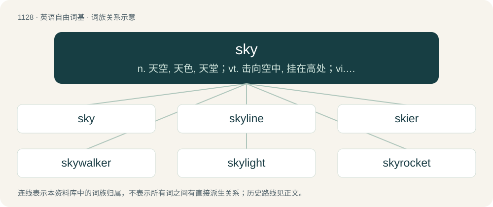

# 1208 · sky — n. 天空, 天色, 天堂；vt. 击向空中, 挂在高处；vi. 高涨

[总目录](../00_总目录_按常用程度.md)

**类型**：英语自由词基　｜　**来源语言**：见词源记录

## 核心含义与来源

- 核心含义：n. 天空, 天色, 天堂；vt. 击向空中, 挂在高处；vi. 高涨
- 英文含义：The atmosphere above a given point, especially as visible from the surface of the Earth as the place where the sun, moon, stars, and clouds are seen.
- 词形：sky

**来源记录 1**（名词；The atmosphere above a given point, especially as visible from the surface of the Earth as the place where the sun, moon, stars, and clouds are seen.）

The noun is derived from Middle English sky (“sky; cloud; mist”), also spelled ski, skie, \[and other forms\], from Old Norse ský (“cloud”), from Proto-Germanic \*skiwją (“cloud; sky”), from \*skiwô (“cloud; cloud cover, haze; sky”) (whence Old English sċēo (“cloud”) and Middle English skew (“air; sky; (rare) cloud”)), from Proto-Indo-European \*(s)kewH- (“to cover; to conceal, hide”). Partly displaced Old English heofon, which survives in the reflex heaven, still sometimes used in the sense of sky, but usually in high or poetic register. The verb is derived from the noun. Cognates The English word is cognate with Old English scēo (“cloud”), Old Saxon scio, skio, skeo (“light cloud cover”), Danish, Swedish and Norwegian Bokmål sky (“cloud”), Old Irish ceo (“mist, fog”), Irish ceo (“mist, fog”). It is also related to Old English scūa (“shadow, darkness”), Latin obscūrus (“dark, shadowy”), Sanskrit स्कुनाति (skunāti, “he covers”). See also hide, hose, house, hut, shoe.

## 词族图

## 单词速览（常用到不常用）

| 单词 | 音标 | 释义 |
|---|---|---|
| [sky](#w-1) | 英 /skaɪ/ | n. 天空, 天色, 天堂；vt. 击向空中, 挂在高处；vi. 高涨 |
| [skyline](#w-2) | /ˈskaɪˌlaɪn/ | n. 天涯, 地平线, 空中轮廓线 |
| [skier](#w-3) | /ˈskaɪə(ɹ)/ | 【英文】A ball hit high in the air, often leading to a catch. |
| [skywalker](#w-4) | 英 /ˈskaɪwɔːkə(ɹ)/；美 /ˈskaɪwɔkəɹ/ | n. 天行者（星球大战中的人物名） |
| [skylight](#w-5) | /ˈskaɪˌlaɪt/ | n. 天窗 |
| [skyrocket](#w-6) | 英 /ˈskaɪˌɹɒk.ɪt/ | vi. 飞涨, 突升；n. 焰火 |
| [skyward](#w-7) | /ˈskaiwəd/ | adv. 向着天空, 向上；a. 向着天空的, 向上的 |
| [skyfall](#w-8) |  | 【英文】An unexplained falling of objects from the sky. |
| [skydive](#w-9) | /ˈskaɪˌdaɪv/ | v. 跳伞运动员在降落伞张开前做空中造型动作 |
| [skylark](#w-10) | 英 /ˈskaɪlɑːk/；美 /ˈskaɪlɑɹk/ | n. 云雀；vi. 嘻闹, 闲荡 |
| [skyway](#w-11) | 英 /ˈskaɪ.weɪ/ | n. 航线；\[法\] 航路, 高架公路 |
| [skybox](#w-12) |  | （体育场的）贵宾看台 |
| [skydiver](#w-13) | 美 /ˈskaɪˌdaɪvɚ/ | n. 做空中造型动作的跳伞运动员 |
| [skylab](#w-14) | /ˈskailæb/ | n. 天空实验室 |
| [skywalk](#w-15) | /ˈskaiwɔːk/ | n. &lt;美&gt;(在市区大楼之间建造的通常为封闭式的)人行天桥 |
| [skydome](#w-16) |  | abbr. Skydome Stadium; Toronto 多伦多天穹大型运动场; skyjacker 空中劫机者; skyjacking 劫机 |

## 逐词详解

### 1. sky

**词性**：名词　｜　**音标**：英 /skaɪ/

**中文释义**：n. 天空, 天色, 天堂；vt. 击向空中, 挂在高处；vi. 高涨

**英文义项**：The atmosphere above a given point, especially as visible from the surface of the Earth as the place where the sun, moon, stars, and clouds are seen. / With a descriptive word: the part of the sky which can be seen from a specific place or at a specific time; its climate, condition, etc.

**词源与演化**：

The noun is derived from Middle English sky (“sky; cloud; mist”), also spelled ski, skie, \[and other forms\], from Old Norse ský (“cloud”), from Proto-Germanic \*skiwją (“cloud; sky”), from \*skiwô (“cloud; cloud cover, haze; sky”) (whence Old English sċēo (“cloud”) and Middle English skew (“air; sky; (rare) cloud”)), from Proto-Indo-European \*(s)kewH- (“to cover; to conceal, hide”). Partly displaced Old English heofon, which survives in the reflex heaven, still sometimes used in the sense of sky, but usually in high or poetic register. The verb is derived from the noun. Cognates The English word is cognate with Old English scēo (“cloud”), Old Saxon scio, skio, skeo (“light cloud cover”), Danish, Swedish and Norwegian Bokmål sky (“cloud”), Old Irish ceo (“mist, fog”), Irish ceo (“mist, fog”). It is also related to Old English scūa (“shadow, darkness”), Latin obscūrus (“dark, shadowy”), Sanskrit स्कुनाति (skunāti, “he covers”). See also hide, hose, house, hut, shoe.

**例句**：

> That year, a meteor fell from the sky.

该用例对应义项：The atmosphere above a given point, especially as visible from the surface of the Earth as the place where the sun, moon, stars, and clouds are seen.

### 2. skyline

**词性**：名词　｜　**音标**：/ˈskaɪˌlaɪn/

**中文释义**：n. 天涯, 地平线, 空中轮廓线

**英文义项**：The line that seems to be the boundary of the sky and the ground; the horizon. / The horizontal silhouette of a city or building against the sky.

**构词拆分**：From sky + line.

**词源与演化**：

From sky + line.

**例句**：

> The Florida skyline is lined with beautiful palm trees.

### 3. skier

**词性**：名词　｜　**音标**：/ˈskaɪə(ɹ)/

**英文义项**：A ball hit high in the air, often leading to a catch.

**构词拆分**：sky + -er

**词源与演化**：

From sky + -er.

### 4. skywalker

**词性**：名词　｜　**音标**：英 /ˈskaɪwɔːkə(ɹ)/；美 /ˈskaɪwɔkəɹ/

**中文释义**：n. 天行者（星球大战中的人物名）

**英文义项**：A member of the Mohawk group of Native Americans; especially one who is or was involved in steelworking on tall buildings in New York City. / Any ironworker working at a height.

**构词拆分**：sky + walker

**词源与演化**：

From sky + walker.

**例句**：

> According to my headcanon, Luke Skywalker is a gay ace.

### 5. skylight

**词性**：名词　｜　**音标**：/ˈskaɪˌlaɪt/

**中文释义**：n. 天窗

**英文义项**：A window, dome, or opening in the roof or ceiling, to admit natural light. / Diffuse sky radiation—solar radiation reaching the earth's surface after having been scattered from the direct solar beam by molecules or suspensoids in the atmosphere.

**构词拆分**：sky + light

**词源与演化**：

From sky + light.

**例句**：

> I like the house with its skylight on the roof.

### 6. skyrocket

**词性**：动词　｜　**音标**：英 /ˈskaɪˌɹɒk.ɪt/

**中文释义**：vi. 飞涨, 突升；n. 焰火

**英文义项**：To rise or increase suddenly and extremely; to shoot up; to surge or spike. / To cause to increase suddenly and extremely.

**构词拆分**：sky + rocket

**词源与演化**：

From sky + rocket.

**例句**：

> The shortage caused prices to skyrocket.

该用例对应义项：To rise or increase suddenly and extremely; to shoot up; to surge or spike.

### 7. skyward

**词性**：副词　｜　**音标**：/ˈskaiwəd/

**中文释义**：adv. 向着天空, 向上；a. 向着天空的, 向上的

**英文义项**：At or toward the sky.

**构词拆分**：sky + -ward

**词源与演化**：

From sky + -ward.

**例句**：

> The rocket shot skyward and exploded in a burst of glittering stars.

该用例对应义项：At or toward the sky.

### 8. skyfall

**词性**：名词

**英文义项**：An unexplained falling of objects from the sky.

**构词拆分**：sky + fall

**词源与演化**：

sky + fall

### 9. skydive

**词性**：名词　｜　**音标**：/ˈskaɪˌdaɪv/

**中文释义**：v. 跳伞运动员在降落伞张开前做空中造型动作

**英文义项**：An instance of skydiving.

**构词拆分**：sky + dive

**词源与演化**：

From sky + dive.

**例句**：

> Tom wanted to skydive on his 30th birthday.

### 10. skylark

**词性**：名词　｜　**音标**：英 /ˈskaɪlɑːk/；美 /ˈskaɪlɑɹk/

**中文释义**：n. 云雀；vi. 嘻闹, 闲荡

**英文义项**：A small brown passerine bird, Alauda arvensis, that sings as it flies high into the air.

**构词拆分**：sky + lark

**词源与演化**：

From sky + lark. Verb sense 1809, originally nautical, possibly influenced by northern English dialectal term lake/laik (“to play”) (from Old Norse leika (“to play (as opposed to work)”)); see lark for details.

**例句**：

> The Eurasian skylark is a migratory bird.

### 11. skyway

**词性**：名词　｜　**音标**：英 /ˈskaɪ.weɪ/

**中文释义**：n. 航线；\[法\] 航路, 高架公路

**英文义项**：An aeroplane route. / An elevated road.

**构词拆分**：sky + way

**词源与演化**：

From sky + way.

### 12. skybox

**词性**：名词

**中文释义**：（体育场的）贵宾看台

**英文义项**：A seating area for VIPs in a stadium. / A cube with textures on its inner faces, used to simulate the sky or similar backdrop around a three-dimensional playfield.

**构词拆分**：sky + box

**词源与演化**：

From sky + box.

### 13. skydiver

**词性**：名词　｜　**音标**：美 /ˈskaɪˌdaɪvɚ/

**中文释义**：n. 做空中造型动作的跳伞运动员

**英文义项**：Someone who skydives.

**构词拆分**：skydive + -er；sky + diver

**词源与演化**：

From skydive + -er or sky + diver.

**例句**：

> An American skydiver has survived a 7,600-meter jump from an airplane, although he did not use a parachute.

### 14. skylab

**词性**：名词　｜　**音标**：/ˈskailæb/

**中文释义**：n. 天空实验室

**英文义项**：An outer space laboratory.

**构词拆分**：sky + lab

**词源与演化**：

From sky + lab.

**例句**：

> On May 14, 1973, a two-staged Saturn V rocket propelled the 90 metric ton unmanned Skylab space station into an orbit above Earth.

### 15. skywalk

**词性**：名词　｜　**音标**：/ˈskaiwɔːk/

**中文释义**：n. &lt;美&gt;(在市区大楼之间建造的通常为封闭式的)人行天桥

**英文义项**：Synonym of skybridge and skyway. / A type of observation deck.

**构词拆分**：sky + walk

**词源与演化**：

From sky + walk.

### 16. skydome

**词性**：名词

**中文释义**：abbr. Skydome Stadium; Toronto 多伦多天穹大型运动场; skyjacker 空中劫机者; skyjacking 劫机

**英文义项**：A sphere or hemisphere with a texture on its inner face, used to simulate the sky or similar backdrop around a three-dimensional playfield.

**构词拆分**：sky + dome

**词源与演化**：

From sky + dome.
