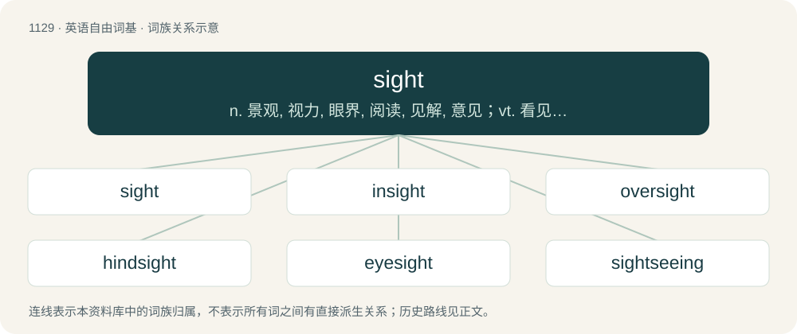

# 1211 · sight — n. 景观, 视力, 眼界, 阅读, 见解, 意见；vt. 看见, 瞄准；vi. 瞄准, 观看

[总目录](../00_总目录_按常用程度.md)

**类型**：英语自由词基　｜　**来源语言**：见词源记录

## 核心含义与来源

- 核心含义：n. 景观, 视力, 眼界, 阅读, 见解, 意见；vt. 看见, 瞄准；vi. 瞄准, 观看
- 英文含义：The sense or faculty by which objects are perceived through the agency of light; the sense by which we see.
- 词形：sight

**来源记录 1**（名词；The sense or faculty by which objects are perceived through the agency of light; the sense by which we see.）

From Middle English sighte, from Old English sihþ (“something seen; vision”), from Proto-West Germanic \*sihti (“seeing, sight”), equivalent to see + -t. Cognates Cognate with Cimbrian gazicht (“sight, vision; pupil”), Dutch gezicht (“face; sight, vision”), zicht (“sight, vision”), German Gesicht (“face; sight, vision”), Sicht (“view; sight; visibility”), Luxembourgish Gesiicht (“face”), Siicht (“view; sight”), Yiddish געזיכט (gezikht, “face”), Danish sigt (“sight; visibility”), Norwegian Bokmål and Norwegian Nynorsk sikt (“visibility”), Swedish sikt (“visibility”), sikte (“sight”).

## 词族图

## 单词速览（常用到不常用）

| 单词 | 音标 | 释义 |
|---|---|---|
| [sight](#w-1) | /saɪt/ | n. 景观, 视力, 眼界, 阅读, 见解, 意见；vt. 看见, 瞄准；vi. 瞄准, 观看 |
| [insight](#w-2) | 英 /ˈɪnsaɪ̯t/；美 /ˈɪnsaɪ̯t/ | n. 察看, 洞察力, 见识；\[医\] 自知力, 洞察, 顿悟 |
| [oversight](#w-3) | 英 /ˈəʊvəˌsaɪt/；美 /ˈoʊvɚˌsaɪt/ | n. 勘漏, 失察, 失败, 照料；\[经\] 监督权 |
| [hindsight](#w-4) | /ˈhaɪn(d)saɪt/ | n. 枪的表尺, 事后聪明 |
| [eyesight](#w-5) | 美 /ˈaɪˌsaɪt/ | n. 视力, 目力 |
| [sightseeing](#w-6) | /ˈsaitsiːiŋ/ | n. 观光, 游览；a. 观光的, 游览的 |

## 逐词详解

### 1. sight

**词性**：名词　｜　**音标**：/saɪt/

**中文释义**：n. 景观, 视力, 眼界, 阅读, 见解, 意见；vt. 看见, 瞄准；vi. 瞄准, 观看

**英文义项**：The sense or faculty by which objects are perceived through the agency of light; the sense by which we see. / An act, instance, opportunity or possibility of seeing; the perception of objects by the eye; view (see also idiomatic expressions such as in sight, out of sight, catch sight of, etc.)

**构词拆分**：see + -t

**词源与演化**：

From Middle English sighte, from Old English sihþ (“something seen; vision”), from Proto-West Germanic \*sihti (“seeing, sight”), equivalent to see + -t. Cognates Cognate with Cimbrian gazicht (“sight, vision; pupil”), Dutch gezicht (“face; sight, vision”), zicht (“sight, vision”), German Gesicht (“face; sight, vision”), Sicht (“view; sight; visibility”), Luxembourgish Gesiicht (“face”), Siicht (“view; sight”), Yiddish געזיכט (gezikht, “face”), Danish sigt (“sight; visibility”), Norwegian Bokmål and Norwegian Nynorsk sikt (“visibility”), Swedish sikt (“visibility”), sikte (“sight”).

**例句**：

> We went to London and saw all the sights – Buckingham Palace, Tower Bridge, and so on.

该用例对应义项：Something worth seeing; a spectacle, either good or bad.

### 2. insight

**词性**：名词　｜　**音标**：英 /ˈɪnsaɪ̯t/；美 /ˈɪnsaɪ̯t/

**中文释义**：n. 察看, 洞察力, 见识；\[医\] 自知力, 洞察, 顿悟

**英文义项**：A sight or view of the interior of anything; a deep inspection or view; introspection; frequently used with into. / Power of acute observation and deduction.

**构词拆分**：in- + sight

**词源与演化**：

From Middle English insight, insiht (“insight, mental vision, intelligence, understanding”), equivalent to in- + sight. Perhaps continuing Old English insiht (“narrative, argument, account”), from Proto-Germanic \*insahtiz (“account, narrative, argument”). Compare West Frisian ynsjoch (“insight”), Dutch inzicht (“insight, awareness, view, opinion”), German Low German Insicht (“insight”), German Einsicht (“insight, knowledge, perception, understanding”), Danish indsigt (“insight”), Swedish insikt (“insight”), Icelandic innsýn (“insight”).

**例句**：

> Lately I read the book that changed my insight into many things.

### 3. oversight

**词性**：名词　｜　**音标**：英 /ˈəʊvəˌsaɪt/；美 /ˈoʊvɚˌsaɪt/

**中文释义**：n. 勘漏, 失察, 失败, 照料；\[经\] 监督权

**英文义项**：An omission; something that is left out, missed, or forgotten. / Supervision or management.

**构词拆分**：over- + sight

**词源与演化**：

From over- + sight. Verb sense 2 is a semantic loan from German Aufsicht.

**例句**：

> A small oversight at this stage can lead to big problems later.

该用例对应义项：An omission; something that is left out, missed, or forgotten.

### 4. hindsight

**词性**：名词　｜　**音标**：/ˈhaɪn(d)saɪt/

**中文释义**：n. 枪的表尺, 事后聪明

**英文义项**：Realization or understanding of the significance and nature of events after they have occurred. / The rear sight of a firearm.

**构词拆分**：hind + sight

**词源与演化**：

From hind + sight, 19th c. Compare Latinate retrospect.

**例句**：

> In hindsight, I realize that I should have studied harder for the exam.

该用例对应义项：Realization or understanding of the significance and nature of events after they have occurred.

### 5. eyesight

**词性**：名词　｜　**音标**：美 /ˈaɪˌsaɪt/

**中文释义**：n. 视力, 目力

**英文义项**：Vision or the faculty of sight. / View or the range of vision.

**构词拆分**：eye + sight

**词源与演化**：

From Middle English eiȝesiht, ieȝesihte, ehsihthe, eihsihthe, eȝhesihthe, equivalent to eye + sight.

**例句**：

> His eyesight began to fail with age.

该用例对应义项：Vision or the faculty of sight.

### 6. sightseeing

**词性**：名词　｜　**音标**：/ˈsaitsiːiŋ/

**中文释义**：n. 观光, 游览；a. 观光的, 游览的

**英文义项**：The activity of going out looking at things; tourism.

**构词拆分**：sight + seeing

**词源与演化**：

From sight + seeing.

**例句**：

> Sightseeing is a frequent reason to visit San Francisco.

该用例对应义项：The activity of going out looking at things; tourism.
