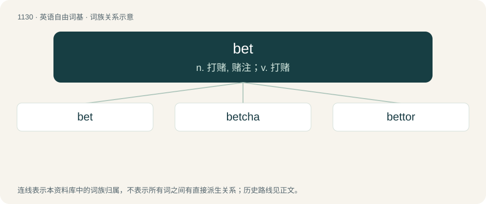

# 1212 · bet — n. 打赌, 赌注；v. 打赌

[总目录](../00_总目录_按常用程度.md)

**类型**：英语自由词基　｜　**来源语言**：见词源记录

## 核心含义与来源

- 核心含义：n. 打赌, 赌注；v. 打赌
- 英文含义：A wager, an agreement between two parties that a stake (usually money) will be paid by the loser to the winner (the winner being the one who correctly forecast the outcome of an event).
- 词形：bet

**多个词源／构词路径**：同一拼写可能有不同来源；以下按词性和含义分别列出。

**来源记录 1**（名词；A wager, an agreement between two parties that a stake (usually money) will be paid by the loser to the winner (the winner being the one who correctly forecast the outcome of an event).）

From 16th-century criminal slang, perhaps from Middle English bet (“something better, advantage, luck”), from Old English bet, bett (“better”, adverb); or, alternatively from abet, from Middle English abet, abette, from Old French abet (“incitement to evil”), from Old French abeter (“to entice”), from a- (“to”) + beter (“hound on, urge, to bait”); ultimately from Proto-West Germanic \*baitijan (“to bait, entice”), related to Old English bǣtan (“to bait”). More at abet.

**来源记录 2**（介词；between）

Abbreviation.

## 词族图

## 单词速览（常用到不常用）

| 单词 | 音标 | 释义 |
|---|---|---|
| [bet](#w-1) | /bɛt/ | n. 打赌, 赌注；v. 打赌 |
| [betcha](#w-2) | /ˈbɛt͡ʃə/ | &lt;口&gt; = bet you |
| [bettor](#w-3) | 英 /ˈbɛtə/；美 /ˈbɛtɚ/ | n. 打赌者；\[法\] 赌徒, 打赌者 |

## 逐词详解

### 1. bet

**词性**：名词　｜　**音标**：/bɛt/

**中文释义**：n. 打赌, 赌注；v. 打赌

**英文义项**：A wager, an agreement between two parties that a stake (usually money) will be paid by the loser to the winner (the winner being the one who correctly forecast the outcome of an event). / A candidate (for elections and pageants) or competitor (in multinational sports).

**词源与演化**：

From 16th-century criminal slang, perhaps from Middle English bet (“something better, advantage, luck”), from Old English bet, bett (“better”, adverb); or, alternatively from abet, from Middle English abet, abette, from Old French abet (“incitement to evil”), from Old French abeter (“to entice”), from a- (“to”) + beter (“hound on, urge, to bait”); ultimately from Proto-West Germanic \*baitijan (“to bait, entice”), related to Old English bǣtan (“to bait”). More at abet.

**例句**：

> There's a decent bet that we'll be able to reach the top of that hill in an hour.

该用例对应义项：Indicating a degree of certainty, or that something can be relied upon.

### 2. betcha

**词性**：contraction　｜　**音标**：/ˈbɛt͡ʃə/

**中文释义**：&lt;口&gt; = bet you

**英文义项**：Can be sure of it.

**构词拆分**：bet + -cha

**词源与演化**：

From bet + -cha. Second sense possibly from bet your rather than bet you.

**例句**：

> Do I want to take that shiny new car off your hands? You betcha!

### 3. bettor

**词性**：名词　｜　**音标**：英 /ˈbɛtə/；美 /ˈbɛtɚ/

**中文释义**：n. 打赌者；\[法\] 赌徒, 打赌者

**英文义项**：A person who makes a bet, such as a wager on the outcome of a game of chance or a sporting event.

**构词拆分**：bet + -or

**词源与演化**：

From bet + -or.
