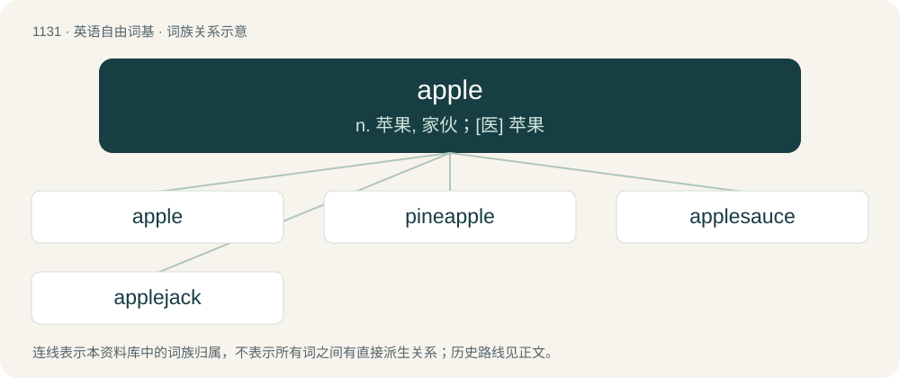

# 1213 · apple — n. 苹果, 家伙；\[医\] 苹果

[总目录](../00_总目录_按常用程度.md)

**类型**：英语自由词基　｜　**来源语言**：见词源记录

## 核心含义与来源

- 核心含义：n. 苹果, 家伙；\[医\] 苹果
- 英文含义：The fruit of the tree Malus domestica, chiefly with a green, red, or yellow skin, cultivated in temperate climates for cidermaking, cooking, and eating.
- 词形：apple

**来源记录 1**（名词；The fruit of the tree Malus domestica, chiefly with a green, red, or yellow skin, cultivated in temperate climates for cidermaking, cooking, and eating.）

Possibly also Latin Abella (town in Campania; compare Virgil Aeneid 7.740 maliferae ... moenia Abellae 'the walls of apple-bearing Abella').

## 词族图

## 单词速览（常用到不常用）

| 单词 | 音标 | 释义 |
|---|---|---|
| [apple](#w-1) | 英 /ˈæpəl/ | n. 苹果, 家伙；\[医\] 苹果 |
| [pineapple](#w-2) | 美 /ˈpaɪnəpəl/；/ˈpaɪnˌæpəl/ | n. 凤梨, 菠萝, 失业救济金；\[医\] 凤梨, 波萝 |
| [applesauce](#w-3) | /.æplˈsɒːs/ | n. 苹果沙司, 胡说 |
| [applejack](#w-4) | /ˈæpldʒæk/ | n. 苹果白兰地 |

## 逐词详解

### 1. apple

**词性**：名词　｜　**音标**：英 /ˈæpəl/

**中文释义**：n. 苹果, 家伙；\[医\] 苹果

**英文义项**：The fruit of the tree Malus domestica, chiefly with a green, red, or yellow skin, cultivated in temperate climates for cidermaking, cooking, and eating. / Often with a qualifying word: any fruit or vegetable, or any other thing (such as a cone or gall) produced by a plant, especially if from a tree and similar to the fruit of Malus domestica (noun sense 1.1).

**词源与演化**：

Possibly also Latin Abella (town in Campania; compare Virgil Aeneid 7.740 maliferae ... moenia Abellae 'the walls of apple-bearing Abella').

**用法示例／搭配（非完整句）**：

> He's only three apples tall

该用例对应义项：An imaginary diminutive unit of height.

### 2. pineapple

**词性**：名词　｜　**音标**：美 /ˈpaɪnəpəl/；/ˈpaɪnˌæpəl/

**中文释义**：n. 凤梨, 菠萝, 失业救济金；\[医\] 凤梨, 波萝

**英文义项**：A tropical plant, Ananas comosus, native to South America, having thirty or more long, spined and pointed leaves surrounding a thick stem. / The ovoid fruit of the pineapple plant, which has very sweet white or yellow flesh, a tough, spiky shell and a tough, fibrous core.

**构词拆分**：By surface analysis, pine + apple

**词源与演化**：

From Middle English pinappel (“pinecone”, literally “pine-apple/pine-fruit”), from Proto-West Germanic \*pīnapplu. Later applied to the fruit of the pineapple plant due to its resemblance to a pinecone. Compare the Middle Dutch and Dutch pijnappel (“pinecone", formerly also "pineapple”), Afrikaans pynappel (“pineapple”), Middle Low German pinappel, Old High German pīnapful, Middle High German pīnaphel, and early Modern German pinapfel — all in the sense of “pine cone”. Compare also the post-Classical Latin pomum pini, the Old French pume de pin, the Middle French and French pomme de pin and Spanish piña. By surface analysis, pine + apple. Sense "An Australian fifty dollar note": From the yellow colour of a $50 banknote in the first, second, and third series of rice Australian dollar notes. Compare with lobster for a $20 Australian banknote, and watermelon for a $100 Australian banknote.

**例句**：

> This fruit is shaped like an orange and tastes like a pineapple.

### 3. applesauce

**词性**：名词　｜　**音标**：/.æplˈsɒːs/

**中文释义**：n. 苹果沙司, 胡说

**英文义项**：Nonsense, balderdash, bunk, piffle.

**构词拆分**：apple + sauce

**词源与演化**：

From apple + sauce.

**例句**：

> Bletted medlars taste like applesauce with a cinnamon flavor to it.

### 4. applejack

**词性**：名词　｜　**音标**：/ˈæpldʒæk/

**中文释义**：n. 苹果白兰地

**英文义项**：An alcoholic drink similar to apple brandy and calvados, made by freeze-distilling ("jacking") apple cider.

**构词拆分**：apple + jack

**词源与演化**：

From apple + jack, referring to the increase in alcohol concentration due to freeze distillation.
