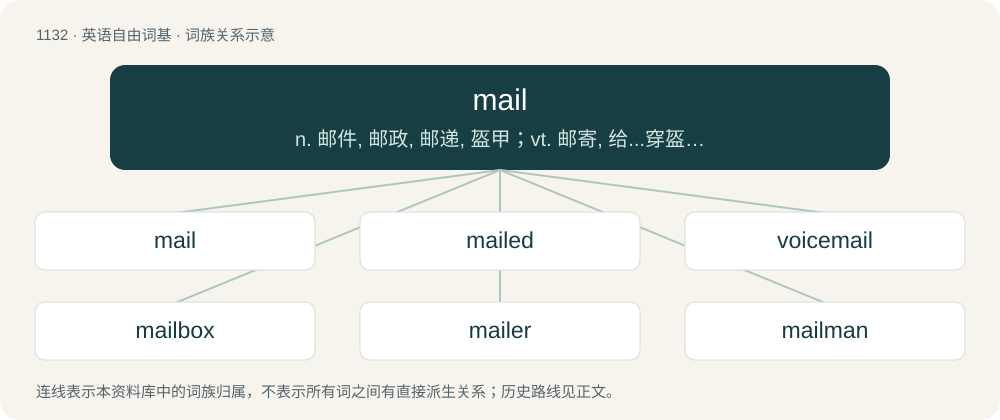

# 1214 · mail — n. 邮件, 邮政, 邮递, 盔甲；vt. 邮寄, 给...穿盔甲；\[计\] 邮件

[总目录](../00_总目录_按常用程度.md)

**类型**：英语自由词基　｜　**来源语言**：见词源记录

## 核心含义与来源

- 核心含义：n. 邮件, 邮政, 邮递, 盔甲；vt. 邮寄, 给...穿盔甲；\[计\] 邮件
- 英文含义：A bag or wallet.
- 词形：mail

**多个词源／构词路径**：同一拼写可能有不同来源；以下按词性和含义分别列出。

**来源记录 1**（名词；A bag or wallet.）

From Middle English male, from Anglo-Norman male, Old French male (“bag, wallet”), from Frankish \*malha (“bag”), from Proto-Germanic \*malhō (“bag, pouch”), from Proto-Indo-European \*molko- (“leather pouch”). Compare Dutch maal.

**来源记录 2**（名词；Armour consisting of metal rings linked together.）

From Middle English mayle (“mail armor”), borrowed from Old French maille (“loop, stitch”), from Vulgar Latin \*macla, from Latin macula (“blemish, mesh”), probably from Proto-Indo-European \*smh₁-tleh₂, from \*smeh₁- (“smear, rub”). Compare maillot.

**来源记录 3**（名词；A monetary payment or tribute.）

From Middle English mal, male from Old English māl (“speech, contract, agreement”) from Old Norse mál (“agreement, speech, lawsuit”). Akin to Old English mǣl (“speech”). Related to Old English mǣlan (mell), maþelian (“to speak out, declare”). From \*maþlą (“meeting-place”), possibly from Proto-Indo-European \*meh₂d- (“to encounter, come”), if so, related to meet, and moot.

## 词族图

## 单词速览（常用到不常用）

| 单词 | 音标 | 释义 |
|---|---|---|
| [mail](#w-1) | 英 /meɪl/ | n. 邮件, 邮政, 邮递, 盔甲；vt. 邮寄, 给...穿盔甲；\[计\] 邮件 |
| [mailed](#w-2) | /meɪld/ | a. 披甲的, 装甲的 |
| [voicemail](#w-3) | /ˈvɔɪsmeɪl/ | n. 语音信箱 |
| [mailbox](#w-4) | /ˈmeɪl.bɑks/ | n. 邮筒, 邮箱；\[计\] 邮箱, 电子邮箱 |
| [mailer](#w-5) | 英 /ˈmeɪlə/；美 /ˈmeɪlɚ/ | n. 邮寄者, 邮船, 包装邮件的东西 |
| [mailman](#w-6) | 美 /ˈmeɪl.mæn/；/ˈmeɪl.mɛən/ | n. 邮递员 |
| [airmail](#w-7) | /ˈɛəɹ(ˌ)meɪl/ | n. 航空邮件 |
| [mailroom](#w-8) | /ˈmeɪlruːm/ | 邮件收发室 |
| [mailbag](#w-9) | 美 /ˈmeɪlˌbæɡ/ | n. 邮袋 |

## 逐词详解

### 1. mail

**词性**：名词　｜　**音标**：英 /meɪl/

**中文释义**：n. 邮件, 邮政, 邮递, 盔甲；vt. 邮寄, 给...穿盔甲；\[计\] 邮件

**英文义项**：A bag or wallet. / A bag containing letters to be delivered by post.

**词源与演化**：

From Middle English male, from Anglo-Norman male, Old French male (“bag, wallet”), from Frankish \*malha (“bag”), from Proto-Germanic \*malhō (“bag, pouch”), from Proto-Indo-European \*molko- (“leather pouch”). Compare Dutch maal.

**例句**：

> Please look through those mails and confirm whether you received the one about scheduling.

该用例对应义项：An email message.

### 2. mailed

**词性**：形容词　｜　**音标**：/meɪld/

**中文释义**：a. 披甲的, 装甲的

**英文义项**：Armoured in, protected by, or made of mail. / Resembling the scales of armor.

**构词拆分**：mail (“chainmail; spot on a bird's feather”) + -ed

**词源与演化**：

From Middle English mayled; equivalent to mail (“chainmail; spot on a bird's feather”) + -ed.

**例句**：

> I forgot to put on the stamp before I mailed the letter.

### 3. voicemail

**词性**：名词　｜　**音标**：/ˈvɔɪsmeɪl/

**中文释义**：n. 语音信箱

**英文义项**：A computerized interactive system for storing, processing and reproducing verbal messages left through a conventional telephone network. / An individual message on such a system.

**构词拆分**：voice + mail

**词源与演化**：

From voice + mail, genericized trademark.

**例句**：

> Tom listened to the message that Mary had left on his voicemail.

### 4. mailbox

**词性**：名词　｜　**音标**：/ˈmeɪl.bɑks/

**中文释义**：n. 邮筒, 邮箱；\[计\] 邮箱, 电子邮箱

**英文义项**：A collection point for mail intended for onward delivery, a secure box or receptacle for this purpose. / A delivery point for mail, a box, compartment or slot for this purpose.

**构词拆分**：mail + box

**词源与演化**：

From mail + box.

**例句**：

> Put this stamp on the postcard and drop it in the mailbox.

### 5. mailer

**词性**：名词　｜　**音标**：英 /ˈmeɪlə/；美 /ˈmeɪlɚ/

**中文释义**：n. 邮寄者, 邮船, 包装邮件的东西

**英文义项**：One who sends mail. / A computer program that sends electronic mail.

**构词拆分**：mail + -er

**词源与演化**：

From mail + -er.

**例句**：

> The cassette came in a brown paper mailer.

该用例对应义项：A packet or container designed for postal use.

### 6. mailman

**词性**：名词　｜　**音标**：美 /ˈmeɪl.mæn/；/ˈmeɪl.mɛən/

**中文释义**：n. 邮递员

**英文义项**：Someone who delivers mail to, and/or collects mail from, residential or commercial addresses, or from public mailboxes.

**构词拆分**：mail + man

**词源与演化**：

From mail + man.

**例句**：

> The second the mailman comes, he rushes out to pick up his mail.

### 7. airmail

**词性**：名词　｜　**音标**：/ˈɛəɹ(ˌ)meɪl/

**中文释义**：n. 航空邮件

**英文义项**：The system of conveying mail using aircraft. / The items of mail so carried.

**构词拆分**：air + mail

**词源与演化**：

From air + mail.

**用法示例／搭配（非完整句）**：

> to send a letter by airmail

该用例对应义项：The system of conveying mail using aircraft.

### 8. mailroom

**词性**：名词　｜　**音标**：/ˈmeɪlruːm/

**中文释义**：邮件收发室

**英文义项**：A room used for receiving and (usually) sending mail.

**构词拆分**：mail + room

**词源与演化**：

From mail + room.

**例句**：

> Tom started as a mailroom clerk.

### 9. mailbag

**词性**：名词　｜　**音标**：美 /ˈmeɪlˌbæɡ/

**中文释义**：n. 邮袋

**英文义项**：A strong canvas bag used for the transportation of mail. / A smaller bag, slung from the shoulder, used by a mail carrier during the delivery of mail.

**构词拆分**：mail + bag

**词源与演化**：

From mail + bag.

**例句**：

> In our mailbag this month, we've got no less than 12 letters from those of you who think that Jones should not have been benched.

该用例对应义项：The correspondence received by a publishing entity such as a magazine or website.
