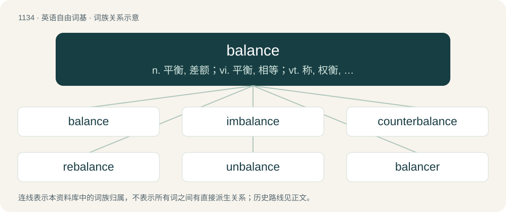

# 1215 · balance — n. 平衡, 差额；vi. 平衡, 相等；vt. 称, 权衡, 比较, 使平衡, 结算, 抵消

[总目录](../00_总目录_按常用程度.md)

**类型**：英语自由词基　｜　**来源语言**：见词源记录

## 核心含义与来源

- 核心含义：n. 平衡, 差额；vi. 平衡, 相等；vt. 称, 权衡, 比较, 使平衡, 结算, 抵消
- 英文含义：A state in which opposing forces harmonise; equilibrium.
- 词形：balance

**来源记录 1**（名词；A state in which opposing forces harmonise; equilibrium.）

From Middle English balaunce, from Old French balance, from Late Latin \*bilancia, from (accusative form of) Latin bilanx (“two-scaled”), from bi- + lanx (“plate, scale”). Displaced the word — Old English wǣġ akin to Modern English: wey from Proto-West Germanic \*wāgu (“scales; weight”).

## 词族图

## 单词速览（常用到不常用）

| 单词 | 音标 | 释义 |
|---|---|---|
| [balance](#w-1) | /ˈbæləns/ | n. 平衡, 差额；vi. 平衡, 相等；vt. 称, 权衡, 比较, 使平衡, 结算, 抵消 |
| [imbalance](#w-2) | /imˈbæləns/ | n. 不平衡, 不均衡；\[医\] 不平衡, 失调 |
| [counterbalance](#w-3) | 英 /ˌkaʊntəˈbæləns/；美 /ˌkaʊntɚˈbæləns/ | vt. 使平均, 使平衡, 使弥补；n. 平衡量, 平衡力, 势均力敌 |
| [rebalance](#w-4) | /reˈbæləns/ | 再平衡 |
| [unbalance](#w-5) | /ʌnˈbæləns/ | n. 失衡, 精神错乱；vt. 使失去平衡, 使错乱 |
| [balancer](#w-6) | /ˈbæ.lən.sɚ/ | n. 起平衡作用的人, 平衡器, 走钢丝者；\[化\] 平衡器; 均衡器 |

## 逐词详解

### 1. balance

**词性**：名词　｜　**音标**：/ˈbæləns/

**中文释义**：n. 平衡, 差额；vi. 平衡, 相等；vt. 称, 权衡, 比较, 使平衡, 结算, 抵消

**英文义项**：A state in which opposing forces harmonise; equilibrium. / Mental equilibrium; mental health; calmness, a state of remaining clear-headed and unperturbed.

**词源与演化**：

From Middle English balaunce, from Old French balance, from Late Latin \*bilancia, from (accusative form of) Latin bilanx (“two-scaled”), from bi- + lanx (“plate, scale”). Displaced the word — Old English wǣġ akin to Modern English: wey from Proto-West Germanic \*wāgu (“scales; weight”).

**例句**：

> I think the balance of opinion is that we should get out while we're ahead.

该用例对应义项：The overall result of conflicting forces, opinions etc.; the influence which ultimately "weighs" more than others.

### 2. imbalance

**词性**：名词　｜　**音标**：/imˈbæləns/

**中文释义**：n. 不平衡, 不均衡；\[医\] 不平衡, 失调

**英文义项**：The property of not being in balance.

**构词拆分**：in- + balance

**词源与演化**：

From im- + balance.

**例句**：

> The growing imbalances between the rich and poor first lead to more crime.

该用例对应义项：The property of not being in balance.

### 3. counterbalance

**词性**：动词　｜　**音标**：英 /ˌkaʊntəˈbæləns/；美 /ˌkaʊntɚˈbæləns/

**中文释义**：vt. 使平均, 使平衡, 使弥补；n. 平衡量, 平衡力, 势均力敌

**英文义项**：To apply weight in order to balance an opposing weight. / To match or equal in effect when applying opposing force.

**构词拆分**：counter- + balance

**词源与演化**：

From counter- + balance.

**例句**：

> The defenders' knowledge of the terrain roughly counterbalances the attackers' superior equipment.

该用例对应义项：To match or equal in effect when applying opposing force.

### 4. rebalance

**词性**：动词　｜　**音标**：/reˈbæləns/

**中文释义**：再平衡

**英文义项**：To balance again.

**构词拆分**：re- + balance

**词源与演化**：

From re- + balance.

**例句**：

> India needs to rebalance its workforce.

### 5. unbalance

**词性**：动词　｜　**音标**：/ʌnˈbæləns/

**中文释义**：n. 失衡, 精神错乱；vt. 使失去平衡, 使错乱

**英文义项**：To cause to be out of balance.

**构词拆分**：un- + balance

**词源与演化**：

From un- + balance.

**例句**：

> If you put that weight on the edge of the tray, it will unbalance it and dump all of the dishes on the floor.

该用例对应义项：To cause to be out of balance.

### 6. balancer

**词性**：名词　｜　**音标**：/ˈbæ.lən.sɚ/

**中文释义**：n. 起平衡作用的人, 平衡器, 走钢丝者；\[化\] 平衡器; 均衡器

**英文义项**：One who, or that which, balances. / An acrobat.

**构词拆分**：balance + -er

**词源与演化**：

From balance + -er.
