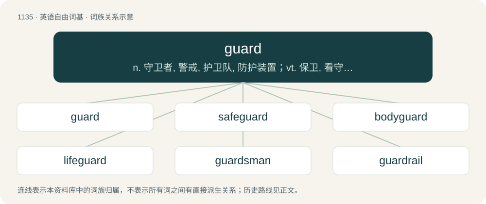

# 1216 · guard — n. 守卫者, 警戒, 护卫队, 防护装置；vt. 保卫, 看守, 当心；vi. 防止, 警惕, 警卫, 看守

[总目录](../00_总目录_按常用程度.md)

**类型**：英语自由词基　｜　**来源语言**：见词源记录

## 核心含义与来源

- 核心含义：n. 守卫者, 警戒, 护卫队, 防护装置；vt. 保卫, 看守, 当心；vi. 防止, 警惕, 警卫, 看守
- 英文含义：A person who, or thing that, protects or watches over something.
- 词形：guard

**多个词源／构词路径**：同一拼写可能有不同来源；以下按词性和含义分别列出。

**来源记录 1**（名词；A person who, or thing that, protects or watches over something.）

From Middle English garde, from early Middle French or late Old French guarde (“a guardian, warden, keeper”) (whence modern French garde), from the verb guarder. Doublet of garda, which is from Irish.

**来源记录 2**（动词；To protect from danger; to secure against surprise, attack, or injury; to keep in safety; to defend.）

From early Middle French garder or late Old French (circa 14th cent) guarder (“to keep, ward, guard, save, preserve, etc.”), from Early Medieval Latin wardo, from Frankish \*wardēn, from Proto-Germanic \*wardāną (“to guard, protect”). Cognate with French garder, Old English weardian (whence also the English inherited doublet ward). See also English regard.

## 词族图

## 单词速览（常用到不常用）

| 单词 | 音标 | 释义 |
|---|---|---|
| [guard](#w-1) | 英 /ɡɑːd/；美 /ɡɑɹd/ | n. 守卫者, 警戒, 护卫队, 防护装置；vt. 保卫, 看守, 当心；vi. 防止, 警惕, 警卫, 看守 |
| [safeguard](#w-2) | 英 /ˈseɪfɡɑːd/；美 /ˈseɪfɡɑɹd/ | n. 保卫, 保护措施, 防护设施；vt. 保卫, 保护 |
| [bodyguard](#w-3) | 英 /ˈbɒdiɡɑːd/；美 /ˈbɑːdiɡɑːɹd/ | n. 保镖, 护卫 |
| [lifeguard](#w-4) | 美 /ˈlaɪfˌɡɑɹd/ | n. 卫兵, 禁卫军, 救生员 |
| [guardsman](#w-5) | /ˈgɑːdzmən/ | n. 卫兵, (英)近卫兵, (美)国民警卫队士兵 |
| [guardrail](#w-6) | 美 /ˈɡɑɹdˌɹeɪl/ | n. 护栏, 护轨 |
| [guardhouse](#w-7) | 美 /ˈɡɑɹdˌhaʊs/ | n. 警卫队队部, 禁闭室 |
| [blackguard](#w-8) | 英 /ˈblæɡəd/；美 /ˈblæɡɚd/ | n. 无赖, 流氓；vt. 辱骂, 耍无赖；a. 无赖的, 滥骂的 |
| [mouthguard](#w-9) |  | = gumshield |

## 逐词详解

### 1. guard

**词性**：名词　｜　**音标**：英 /ɡɑːd/；美 /ɡɑɹd/

**中文释义**：n. 守卫者, 警戒, 护卫队, 防护装置；vt. 保卫, 看守, 当心；vi. 防止, 警惕, 警卫, 看守

**英文义项**：A person who, or thing that, protects or watches over something. / A garda; a police officer.

**词源与演化**：

From Middle English garde, from early Middle French or late Old French guarde (“a guardian, warden, keeper”) (whence modern French garde), from the verb guarder. Doublet of garda, which is from Irish.

**例句**：

> The prison guard unlocked the door of the cell. After completing the repairs, he replaced the sump guard.

该用例对应义项：A person who, or thing that, protects or watches over something.

### 2. safeguard

**词性**：名词　｜　**音标**：英 /ˈseɪfɡɑːd/；美 /ˈseɪfɡɑɹd/

**中文释义**：n. 保卫, 保护措施, 防护设施；vt. 保卫, 保护

**英文义项**：Something that serves as a guard or protection; a defense. / One who, or that which, defends or protects; defence; protection.

**构词拆分**：safe + guard

**词源与演化**：

From Middle English savegard, from Middle French sauvegarde, from Old French salve garde, sauve garde, reconstructed as safe + guard.

**例句**：

> Getting a flu shot is a good safeguard against illness.

该用例对应义项：Something that serves as a guard or protection; a defense.

### 3. bodyguard

**词性**：名词　｜　**音标**：英 /ˈbɒdiɡɑːd/；美 /ˈbɑːdiɡɑːɹd/

**中文释义**：n. 保镖, 护卫

**英文义项**：A person or group of persons, often armed, responsible for protecting someone.

**构词拆分**：body + guard

**词源与演化**：

From body + guard.

**例句**：

> I was the one who suggested that Tom hire a bodyguard.

### 4. lifeguard

**词性**：名词　｜　**音标**：美 /ˈlaɪfˌɡɑɹd/

**中文释义**：n. 卫兵, 禁卫军, 救生员

**英文义项**：A lifesaver: a rescuer, usually an expert swimmer, employed to save swimmers in trouble or near drowning at a body of water. / A bodyguard or unit of bodyguards, a guard of someone's (especially a king's) life or person.

**构词拆分**：life + guard

**词源与演化**：

From life + guard, calque of Dutch lijfgarde, where life has the sense of Dutch lijf (“body”) (hence literally “bodyguard”). Compare German Leibgarde (“bodyguard”), Danish livgarde (“bodyguard”), Swedish livgarde (“bodyguard”). Compare also Old English līfweard (“guardian of life”).

**例句**：

> I applied for a job as a lifeguard at the community pool.

### 5. guardsman

**词性**：名词　｜　**音标**：/ˈgɑːdzmən/

**中文释义**：n. 卫兵, (英)近卫兵, (美)国民警卫队士兵

**英文义项**：A person, especially a soldier, who is on guard; especially, a masculine one. / A member of the National Guard; especially, a masculine one.

**构词拆分**：From guard + -s- + -man.

**词源与演化**：

From guard + -s- + -man.

**例句**：

> The guardsman was assaulted by a robber.

### 6. guardrail

**词性**：名词　｜　**音标**：美 /ˈɡɑɹdˌɹeɪl/

**中文释义**：n. 护栏, 护轨

**英文义项**：A rail set alongside a dangerous place as a barrier, to improve safety. / A strengthened barrier installed on the sides of a (usually major) road to keep vehicles on the highway and reduce the risk and/or impact of crashes.

**构词拆分**：guard + rail

**词源与演化**：

From guard + rail.

**例句**：

> Tom lost control of his vehicle and hit the guardrail.

### 7. guardhouse

**词性**：名词　｜　**音标**：美 /ˈɡɑɹdˌhaʊs/

**中文释义**：n. 警卫队队部, 禁闭室

**英文义项**：A station for guards, especially at the entrance of a town, castle, etc. / Synonym of military prison.

**构词拆分**：guard + house

**词源与演化**：

From guard + house.

### 8. blackguard

**词性**：名词　｜　**音标**：英 /ˈblæɡəd/；美 /ˈblæɡɚd/

**中文释义**：n. 无赖, 流氓；vt. 辱骂, 耍无赖；a. 无赖的, 滥骂的

**英文义项**：An unprincipled, contemptible person; an untrustworthy person.

**构词拆分**：black + guard

**词源与演化**：

From black + guard, thought to have referred originally to the scullions and lower menials of a court, or of a nobleman's household, who wore black liveries or blacked shoes and boots, or were often stained with soot.

**例句**：

> If I were not such a blackguard myself, I'd call you one, for your treatment of your wife.

### 9. mouthguard

**词性**：名词

**中文释义**：= gumshield

**英文义项**：A device that fits into the mouth over one or both arches of the teeth and usually made of plastic. Such devices may protect against injury during sport or fighting or may serve a medical purpose.

**构词拆分**：mouth + guard

**词源与演化**：

From mouth + guard.
