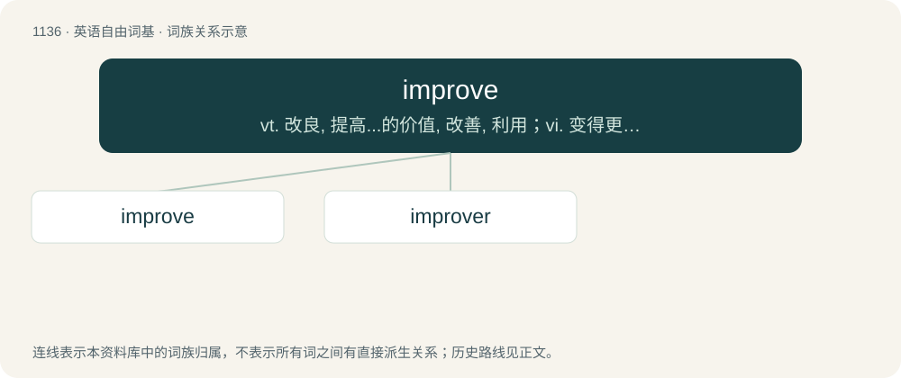

# 1217 · improve — vt. 改良, 提高...的价值, 改善, 利用；vi. 变得更好, 增加

[总目录](../00_总目录_按常用程度.md)

**类型**：英语自由词基　｜　**来源语言**：见词源记录

## 核心含义与来源

- 核心含义：vt. 改良, 提高...的价值, 改善, 利用；vi. 变得更好, 增加
- 英文含义：To make (something) better; to increase the value or productivity (of something).
- 词形：improve

**来源记录 1**（动词；To make (something) better; to increase the value or productivity (of something).）

From Anglo-Norman emprouwer, from Old French en- + prou (“profit”), from Vulgar Latin prode (“advantageous, profitable”).

## 词族图

## 单词速览（常用到不常用）

| 单词 | 音标 | 释义 |
|---|---|---|
| [improve](#w-1) | /ɪmˈpɹuːv/ | vt. 改良, 提高...的价值, 改善, 利用；vi. 变得更好, 增加 |
| [improver](#w-2) | 英 /ɪmˈpɹuːvə/；美 /ɪmˈpɹuːvɚ/ | n. 改良者, 改善者；\[化\] 改进剂; 助发剂; 助白剂 |

## 逐词详解

### 1. improve

**词性**：动词　｜　**音标**：/ɪmˈpɹuːv/

**中文释义**：vt. 改良, 提高...的价值, 改善, 利用；vi. 变得更好, 增加

**英文义项**：To make (something) better; to increase the value or productivity (of something). / To become better.

**词源与演化**：

From Anglo-Norman emprouwer, from Old French en- + prou (“profit”), from Vulgar Latin prode (“advantageous, profitable”).

**例句**：

> Painting the woodwork will improve this house.

该用例对应义项：To make (something) better; to increase the value or productivity (of something).

### 2. improver

**词性**：名词　｜　**音标**：英 /ɪmˈpɹuːvə/；美 /ɪmˈpɹuːvɚ/

**中文释义**：n. 改良者, 改善者；\[化\] 改进剂; 助发剂; 助白剂

**英文义项**：Something that, or someone who, improves something. / One who improves his or her performance, one who shows improvement (of individuals or groups).

**构词拆分**：improve + -er

**词源与演化**：

From improve + -er.
