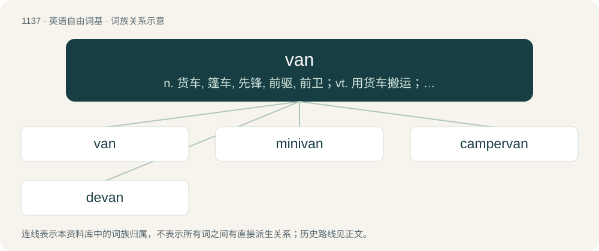

# 1218 · van — n. 货车, 篷车, 先锋, 前驱, 前卫；vt. 用货车搬运；\[计\] 增值网

[总目录](../00_总目录_按常用程度.md)

**类型**：英语自由词基　｜　**来源语言**：见词源记录

## 核心含义与来源

- 核心含义：n. 货车, 篷车, 先锋, 前驱, 前卫；vt. 用货车搬运；\[计\] 增值网
- 英文含义：A covered motor vehicle used to carry goods or (normally less than ten) persons, usually roughly cuboid in shape, Depending on the type of van, it can be bigger or smaller than a pickup truck and SUV, and longer and higher than a car but relatively smaller than a truck/lorry or a bus.
- 词形：van

**多个词源／构词路径**：同一拼写可能有不同来源；以下按词性和含义分别列出。

**来源记录 1**（名词；A covered motor vehicle used to carry goods or (normally less than ten) persons, usually roughly cuboid in shape, Depending on the type of van, it can be bigger or smaller than a pickup truck and SUV, and longer and higher than a car but relatively smaller than a truck/lorry or a bus.）

Short for caravan.

**来源记录 2**（名词；A shovel used in cleansing ore.）

From Cornish.

**来源记录 3**（名词；A fan or other contrivance, such as a sieve, for winnowing grain.）

From Latin vannus (“a van, or fan for winnowing grain”): compare French van and English fan, winnow. Doublet of fan.

## 词族图

## 单词速览（常用到不常用）

| 单词 | 音标 | 释义 |
|---|---|---|
| [van](#w-1) | 英 /væn/ | n. 货车, 篷车, 先锋, 前驱, 前卫；vt. 用货车搬运；\[计\] 增值网 |
| [minivan](#w-2) | /ˈminivæn/ | n. 小型货车 |
| [campervan](#w-3) |  | 【英文】A vehicle that provides both transport and sleeping accommodation. |
| [devan](#w-4) |  | \[人名\] 德文 |

## 逐词详解

### 1. van

**词性**：名词　｜　**音标**：英 /væn/

**中文释义**：n. 货车, 篷车, 先锋, 前驱, 前卫；vt. 用货车搬运；\[计\] 增值网

**英文义项**：A covered motor vehicle used to carry goods or (normally less than ten) persons, usually roughly cuboid in shape, Depending on the type of van, it can be bigger or smaller than a pickup truck and SUV, and longer and higher than a car but relatively smaller than a truck/lorry or a bus. / An enclosed railway vehicle for transport of goods, such as a boxcar/box van.

**词源与演化**：

Short for caravan.

**例句**：

> In the parking lot, Fadil noticed a van belonging to his boss.

### 2. minivan

**词性**：名词　｜　**音标**：/ˈminivæn/

**中文释义**：n. 小型货车

**英文义项**：A small van, especially (Canada, US, Australia, New Zealand, Philippines) one primarily used for family transport.

**构词拆分**：mini- + van

**词源与演化**：

From mini- + van. First widely used in the 1980s, when this class of vehicles became widely popular as an alternative to station wagons (estate cars). Attested earlier in technical usage, usually as mini-van.

**例句**：

> Sami's minivan was found with a flat tire in a parking lot.

### 3. campervan

**词性**：名词

**英文义项**：A vehicle that provides both transport and sleeping accommodation.

**构词拆分**：camper + van

**词源与演化**：

From camper + van.

### 4. devan

**词性**：动词

**中文释义**：\[人名\] 德文

**英文义项**：To unload (goods) from a container.

**构词拆分**：de- + van

**词源与演化**：

From de- + van?
