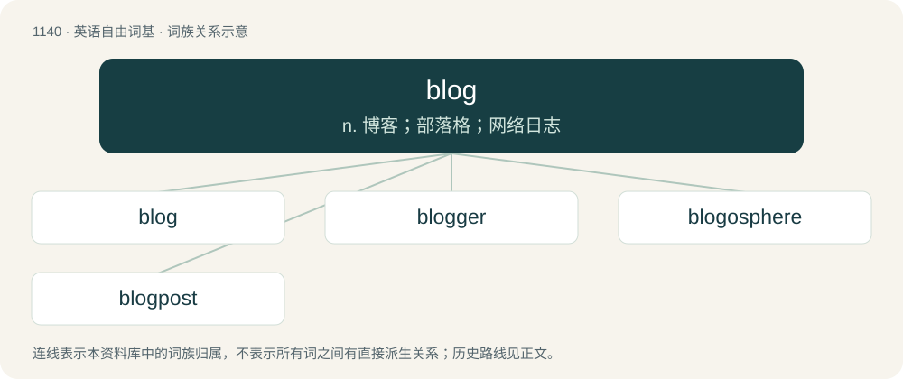

# 1220 · blog — n. 博客；部落格；网络日志

[总目录](../00_总目录_按常用程度.md)

**类型**：英语自由词基　｜　**来源语言**：见词源记录

## 核心含义与来源

- 核心含义：n. 博客；部落格；网络日志
- 英文含义：To blag, to steal something; to acquire something illegally.
- 词形：blog

**来源记录 1**（动词；To blag, to steal something; to acquire something illegally.）

(This etymology is missing or incomplete. Please add to it, or discuss it at the Etymology scriptorium. )

## 词族图

## 单词速览（常用到不常用）

| 单词 | 音标 | 释义 |
|---|---|---|
| [blog](#w-1) | 英 /blɒɡ/；美 /blɑɡ/ | n. 博客；部落格；网络日志 |
| [blogger](#w-2) | 英 /ˈblɒ.ɡə/；美 /ˈblɔ.ɡəɹ/ | n. 写博客的人；博客使用者 |
| [blogosphere](#w-3) | /ˈblɒɡ.əʊˌsfɪɚ/ | 博客世界 |
| [blogpost](#w-4) |  | 【英文】An entry posted to a blog. |

## 逐词详解

### 1. blog

**词性**：动词　｜　**音标**：英 /blɒɡ/；美 /blɑɡ/

**中文释义**：n. 博客；部落格；网络日志

**英文义项**：To blag, to steal something; to acquire something illegally.

**词源与演化**：

(This etymology is missing or incomplete. Please add to it, or discuss it at the Etymology scriptorium. )

**例句**：

> I can't figure out how to post a comment to this blog.

### 2. blogger

**词性**：名词　｜　**音标**：英 /ˈblɒ.ɡə/；美 /ˈblɔ.ɡəɹ/

**中文释义**：n. 写博客的人；博客使用者

**英文义项**：A contributor to a blog (from weblog) or online journal.

**构词拆分**：blog + -er

**词源与演化**：

From blog + -er.

**例句**：

> For his birthday, Boldi invited his favorite blogger, a journalist named Martha.

### 3. blogosphere

**词性**：名词　｜　**音标**：/ˈblɒɡ.əʊˌsfɪɚ/

**中文释义**：博客世界

**英文义项**：The totality of blogs, especially the unique jargon, cultures and shared interests created by their interconnection.

**构词拆分**：blog + -o- + -sphere

**词源与演化**：

From blog + -o- + -sphere. Possibly under the influence of biosphere, atmosphere, etc.

**例句**：

> Mary studies social psychology, and is currently researching the evolution of the European blogosphere.

### 4. blogpost

**词性**：名词

**英文义项**：An entry posted to a blog.

**构词拆分**：blog + post

**词源与演化**：

From blog + post.
