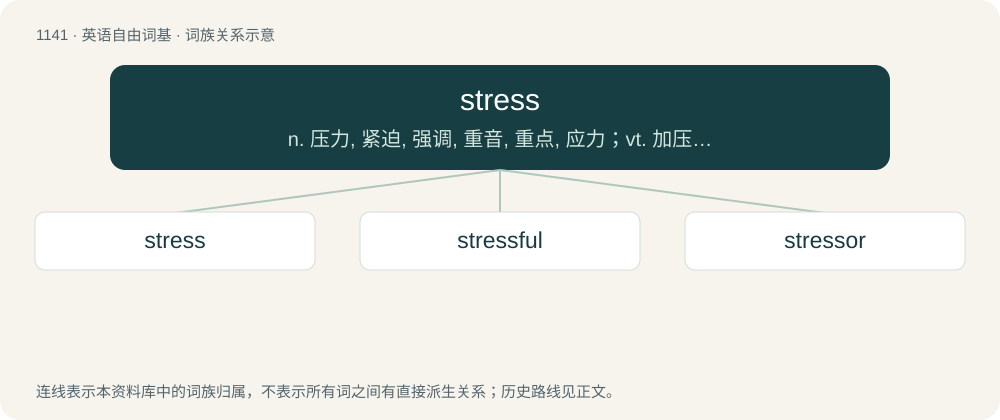

# 1221 · stress — n. 压力, 紧迫, 强调, 重音, 重点, 应力；vt. 加压力于, 着重, 重读

[总目录](../00_总目录_按常用程度.md)

**类型**：英语自由词基　｜　**来源语言**：见词源记录

## 核心含义与来源

- 核心含义：n. 压力, 紧迫, 强调, 重音, 重点, 应力；vt. 加压力于, 着重, 重读
- 英文含义：A physical, chemical, infective agent aggressing an organism.
- 词形：stress

**来源记录 1**（名词；A physical, chemical, infective agent aggressing an organism.）

From a shortening of Middle English destresse, borrowed from Old French destrecier, from Latin distringō (“to stretch out”). This form probably coalesced with Middle English stresse, from Old French estrece (“narrowness”), from Vulgar Latin \*strictia, from Latin strictus (“narrow”). Displaced native Old English swēġ (“accent, stress”), though strictly in the grammatical sense. In the sense of "mental strain" or “disruption”, used occasionally in the 1920s and 1930s by psychologists, including Walter Cannon (1934); in “biological threat”, used by endocrinologist Hans Selye, by metaphor with stress in physics (force on an object) in the 1930s, and popularized by same in the 1950s.

## 词族图

## 单词速览（常用到不常用）

| 单词 | 音标 | 释义 |
|---|---|---|
| [stress](#w-1) | 英 /ˈstɹɛs/；美 /stɹɛs/ | n. 压力, 紧迫, 强调, 重音, 重点, 应力；vt. 加压力于, 着重, 重读 |
| [stressful](#w-2) | /ˈstɹɛsfəl/ | a. 着重, 强调, 重读, 使受应力 |
| [stressor](#w-3) | /ˈstresə/ | \[医\] 紧张性刺激; 应激物 |

## 逐词详解

### 1. stress

**词性**：名词　｜　**音标**：英 /ˈstɹɛs/；美 /stɹɛs/

**中文释义**：n. 压力, 紧迫, 强调, 重音, 重点, 应力；vt. 加压力于, 着重, 重读

**英文义项**：A physical, chemical, infective agent aggressing an organism. / Aggression toward an organism resulting in a response in an attempt to restore previous conditions.

**词源与演化**：

From a shortening of Middle English destresse, borrowed from Old French destrecier, from Latin distringō (“to stretch out”). This form probably coalesced with Middle English stresse, from Old French estrece (“narrowness”), from Vulgar Latin \*strictia, from Latin strictus (“narrow”). Displaced native Old English swēġ (“accent, stress”), though strictly in the grammatical sense. In the sense of "mental strain" or “disruption”, used occasionally in the 1920s and 1930s by psychologists, including Walter Cannon (1934); in “biological threat”, used by endocrinologist Hans Selye, by metaphor with stress in physics (force on an object) in the 1930s, and popularized by same in the 1950s.

**例句**：

> Some people put the stress on the first syllable of “controversy”; others put it on the second.

该用例对应义项：A suprasegmental feature of a language having additional attention raised to a sound, word or word group by means of of loudness, duration or pitch; phonological prominence.

### 2. stressful

**词性**：形容词　｜　**音标**：/ˈstɹɛsfəl/

**中文释义**：a. 着重, 强调, 重读, 使受应力

**英文义项**：Irritating; causing stress. / Mentally taxing.

**构词拆分**：stress + -ful

**词源与演化**：

From stress + -ful.

**例句**：

> The stressful days before a war.

该用例对应义项：extremely irritating to the nerves

### 3. stressor

**词性**：名词　｜　**音标**：/ˈstresə/

**中文释义**：\[医\] 紧张性刺激; 应激物

**英文义项**：An environmental condition or influence that stresses (i.e. causes stress for) an organism.

**构词拆分**：stress + -or

**词源与演化**：

From stress + -or.
