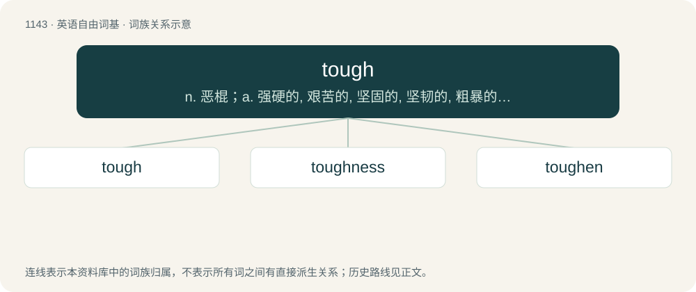

# 1223 · tough — n. 恶棍；a. 强硬的, 艰苦的, 坚固的, 坚韧的, 粗暴的, 咬不动的

[总目录](../00_总目录_按常用程度.md)

**类型**：英语自由词基　｜　**来源语言**：见词源记录

## 核心含义与来源

- 核心含义：n. 恶棍；a. 强硬的, 艰苦的, 坚固的, 坚韧的, 粗暴的, 咬不动的
- 英文含义：Of a material, strong and resilient; sturdy.
- 词形：tough

**来源记录 1**（形容词；Of a material, strong and resilient; sturdy.）

From Middle English tough, towgh, tou, toȝ, from Old English tōh (“tough, tenacious, holding fast together; pliant; sticky, glutinous, clammy”), from Proto-West Germanic \*tą̄h(ī), from Proto-Germanic \*tanhuz (“fitting; clinging; tenacious; tough”), from \*tinganą (“to press upon, throng”), from Proto-Indo-European \*denḱ- (“to bite”). Cognates Cognate with Saterland Frisian toai (“tough”), Bavarian zaach, zach (“tough”), Dutch taai (“tough”), German zäh, zähe (“tough”), Limburgish tiee (“tough”), Luxembourgish zéi (“tough”); also Ancient Greek δάκνω (dáknō, “to bite”), Albanian danë, darë (“tongs; pincers; pliers”), Sanskrit दशति (daśati, “to bite”).

## 词族图

## 单词速览（常用到不常用）

| 单词 | 音标 | 释义 |
|---|---|---|
| [tough](#w-1) | 英 /tʌf/ | n. 恶棍；a. 强硬的, 艰苦的, 坚固的, 坚韧的, 粗暴的, 咬不动的 |
| [toughness](#w-2) | /ˈtʌfnis/ | n. 有粘性, 强硬, 强健；\[化\] 韧性 |
| [toughen](#w-3) | /ˈtʌfən/ | v. (使)变坚韧, (使)变顽强 |

## 逐词详解

### 1. tough

**词性**：形容词　｜　**音标**：英 /tʌf/

**中文释义**：n. 恶棍；a. 强硬的, 艰苦的, 坚固的, 坚韧的, 粗暴的, 咬不动的

**英文义项**：Of a material, strong and resilient; sturdy. / Of food, difficult to cut or chew.

**词源与演化**：

From Middle English tough, towgh, tou, toȝ, from Old English tōh (“tough, tenacious, holding fast together; pliant; sticky, glutinous, clammy”), from Proto-West Germanic \*tą̄h(ī), from Proto-Germanic \*tanhuz (“fitting; clinging; tenacious; tough”), from \*tinganą (“to press upon, throng”), from Proto-Indo-European \*denḱ- (“to bite”). Cognates Cognate with Saterland Frisian toai (“tough”), Bavarian zaach, zach (“tough”), Dutch taai (“tough”), German zäh, zähe (“tough”), Limburgish tiee (“tough”), Luxembourgish zéi (“tough”); also Ancient Greek δάκνω (dáknō, “to bite”), Albanian danë, darë (“tongs; pincers; pliers”), Sanskrit दशति (daśati, “to bite”).

**例句**：

> To soften a tough cut of meat, the recipe suggested simmering it for hours.

该用例对应义项：Of food, difficult to cut or chew.

### 2. toughness

**词性**：名词　｜　**音标**：/ˈtʌfnis/

**中文释义**：n. 有粘性, 强硬, 强健；\[化\] 韧性

**英文义项**：Resistance to fracture when stressed, or the degree of such resistance. / Fortitude; hardiness; mettle.

**构词拆分**：tough + -ness

**词源与演化**：

From Middle English toughnesse, towghnesse, towghenesse, equivalent to tough + -ness.

**例句**：

> I still remember staring with fear at his face marked with candor and toughness.

### 3. toughen

**词性**：动词　｜　**音标**：/ˈtʌfən/

**中文释义**：v. (使)变坚韧, (使)变顽强

**英文义项**：To make tough. / To become tough.

**构词拆分**：From tough + -en.

**词源与演化**：

From tough + -en.

**例句**：

> The new training program is designed to toughen the athletes.

该用例对应义项：To make tough.
