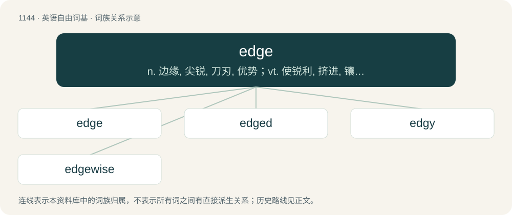

# 1224 · edge — n. 边缘, 尖锐, 刀刃, 优势；vt. 使锐利, 挤进, 镶边；vi. 缓缓移动

[总目录](../00_总目录_按常用程度.md)

**类型**：英语自由词基　｜　**来源语言**：见词源记录

## 核心含义与来源

- 核心含义：n. 边缘, 尖锐, 刀刃, 优势；vt. 使锐利, 挤进, 镶边；vi. 缓缓移动
- 英文含义：The boundary line of a surface.
- 词形：edge

**来源记录 1**（名词；The boundary line of a surface.）

From Middle English egge, from Old English eċġ, from Proto-West Germanic \*aggju, from Proto-Germanic \*agjō, from Proto-Indo-European \*h₂eḱ- (“sharp”). See also Dutch egge, German Ecke, Danish æg, Norwegian Bokmål, Norwegian Nynorsk, and Swedish egg; also Welsh hogi (“to sharpen, hone”), Latin aciēs (“sharp”), acus (“needle”), Latvian ašs, ass (“sharp”), Ancient Greek ἀκίς (akís, “needle”), ἀκμή (akmḗ, “point”), and Persian آس (âs, “grinding stone”)).

## 词族图

## 单词速览（常用到不常用）

| 单词 | 音标 | 释义 |
|---|---|---|
| [edge](#w-1) | 英 /ɛd͡ʒ/ | n. 边缘, 尖锐, 刀刃, 优势；vt. 使锐利, 挤进, 镶边；vi. 缓缓移动 |
| [edged](#w-2) | /ɛd͡ʒd/ | a. 有某种或几种刃的 |
| [edgy](#w-3) | 英 /ˈɛd͡ʒi/ | a. 刀口锐利的, 尖利的, 急躁的 |
| [edgewise](#w-4) | 英 /ˈɛdʒwaɪz/；美 /ˈɛd͡ʒwaɪz/ | adv. 把刀口朝前地; 沿边 |

## 逐词详解

### 1. edge

**词性**：名词　｜　**音标**：英 /ɛd͡ʒ/

**中文释义**：n. 边缘, 尖锐, 刀刃, 优势；vt. 使锐利, 挤进, 镶边；vi. 缓缓移动

**英文义项**：The boundary line of a surface. / A one-dimensional face of a polytope. In particular, the joining line between two vertices of a polygon; the place where two faces of a polyhedron meet.

**词源与演化**：

From Middle English egge, from Old English eċġ, from Proto-West Germanic \*aggju, from Proto-Germanic \*agjō, from Proto-Indo-European \*h₂eḱ- (“sharp”). See also Dutch egge, German Ecke, Danish æg, Norwegian Bokmål, Norwegian Nynorsk, and Swedish egg; also Welsh hogi (“to sharpen, hone”), Latin aciēs (“sharp”), acus (“needle”), Latvian ašs, ass (“sharp”), Ancient Greek ἀκίς (akís, “needle”), ἀκμή (akmḗ, “point”), and Persian آس (âs, “grinding stone”)).

**例句**：

> After the timeout there was a new edge to the team's play.

该用例对应义项：Sharpness; readiness or fitness to cut; keenness; intenseness of desire.

### 2. edged

**词性**：形容词　｜　**音标**：/ɛd͡ʒd/

**中文释义**：a. 有某种或几种刃的

**英文义项**：That has a sharp planar surface. / Having an edging of a certain material, color, and so on.

**构词拆分**：edge + -ed

**词源与演化**：

From Middle English egged, from Old English ecged; equivalent to edge + -ed.

**例句**：

> The monks were forbidden to carry edged weapons such as swords and axes.

该用例对应义项：That has a sharp planar surface.

### 3. edgy

**词性**：形容词　｜　**音标**：英 /ˈɛd͡ʒi/

**中文释义**：a. 刀口锐利的, 尖利的, 急躁的

**英文义项**：Nervous, apprehensive. / Creatively challenging; cutting edge; leading edge.

**构词拆分**：edge + -y

**词源与演化**：

From edge + -y. Compare German eckig (“angular, edgy”).

**用法示例／搭配（非完整句）**：

> an edgy temper

该用例对应义项：Irritable.

### 4. edgewise

**词性**：副词　｜　**音标**：英 /ˈɛdʒwaɪz/；美 /ˈɛd͡ʒwaɪz/

**中文释义**：adv. 把刀口朝前地; 沿边

**英文义项**：Edgeways. / As if by an edge.

**构词拆分**：edge + -wise

**词源与演化**：

From edge + -wise. Compare English edgeling (“edgeways”) and edgelong.

**例句**：

> Once his boss got started, Jim just couldn’t get a word in edgewise.

该用例对应义项：As if by an edge.
