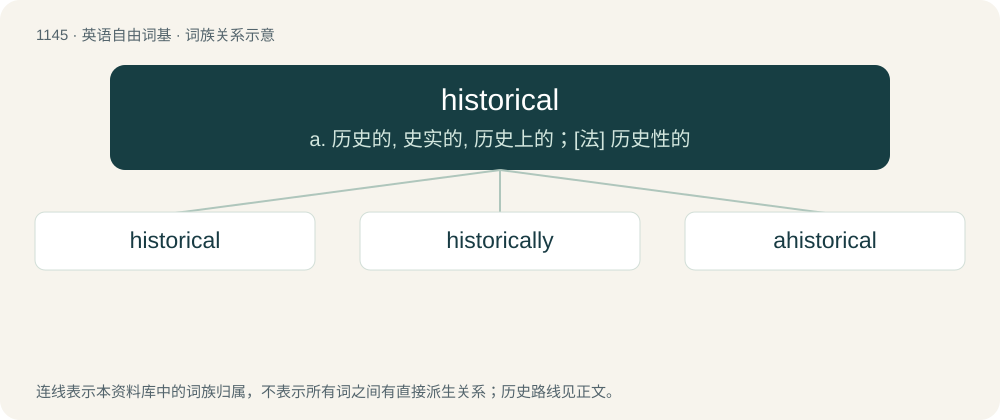

# 1225 · historical — a. 历史的, 史实的, 历史上的；\[法\] 历史性的

[总目录](../00_总目录_按常用程度.md)

**类型**：英语自由词基　｜　**来源语言**：见词源记录

## 核心含义与来源

- 核心含义：a. 历史的, 史实的, 历史上的；\[法\] 历史性的
- 英文含义：Of, concerning, or in accordance with recorded history, (particularly) as opposed to legends, myths, and fictions.
- 词形：historical

**来源记录 1**（形容词；Of, concerning, or in accordance with recorded history, (particularly) as opposed to legends, myths, and fictions.）

From Latin historicus (“historical”) + -al (forming adjectives denoting of or relating to). By surface analysis, history + -ical.

## 词族图

## 单词速览（常用到不常用）

| 单词 | 音标 | 释义 |
|---|---|---|
| [historical](#w-1) | 英 /hɪˈstɒɹɪkəl/；美 /hɪˈstɔɹɪkəl/ | a. 历史的, 史实的, 历史上的；\[法\] 历史性的 |
| [historically](#w-2) | 英 /hɪˈstɒɹɪkli/；美 /hɪˈstɔɹɪkli/ | adv. 历史上地；从历史观点上说 |
| [ahistorical](#w-3) | 美 /ˌeɪhɪˈstɔɹɪkəl/ | a. (与)历史无关的, (无)历史记载的 |

## 逐词详解

### 1. historical

**词性**：形容词　｜　**音标**：英 /hɪˈstɒɹɪkəl/；美 /hɪˈstɔɹɪkəl/

**中文释义**：a. 历史的, 史实的, 历史上的；\[法\] 历史性的

**英文义项**：Of, concerning, or in accordance with recorded history, (particularly) as opposed to legends, myths, and fictions. / About history; depicting persons or events from history.

**构词拆分**：Latin historicus (“historical”) + -al (forming adjectives denoting of or relating to)

**词源与演化**：

From Latin historicus (“historical”) + -al (forming adjectives denoting of or relating to). By surface analysis, history + -ical.

**例句**：

> The historical works of Lord Macaulay and Edward Gibbon are in and of themselves historic.

该用例对应义项：Of, concerning, or in accordance with recorded history, (particularly) as opposed to legends, myths, and fictions.

### 2. historically

**词性**：副词　｜　**音标**：英 /hɪˈstɒɹɪkli/；美 /hɪˈstɔɹɪkli/

**中文释义**：adv. 历史上地；从历史观点上说

**英文义项**：In a historic manner; with reference to history or the historical record. / According to history: formerly, in the past, traditionally.

**构词拆分**：historical + -ly；historic + -ally

**词源与演化**：

From historical + -ly or historic + -ally.

**例句**：

> Historically speaking, this company has always collected payment before starting work.

该用例对应义项：In a historic manner; with reference to history or the historical record.

### 3. ahistorical

**词性**：形容词　｜　**音标**：美 /ˌeɪhɪˈstɔɹɪkəl/

**中文释义**：a. (与)历史无关的, (无)历史记载的

**英文义项**：Lacking historical perspective or context. / Not historically true or accurate; unsupported by historical evidence.

**构词拆分**：a- + historical；ahistoric + -al

**词源与演化**：

From a- + historical or ahistoric + -al.
