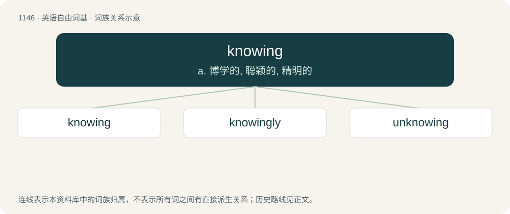

# 1226 · knowing — a. 博学的, 聪颖的, 精明的

[总目录](../00_总目录_按常用程度.md)

**类型**：英语自由词基　｜　**来源语言**：见词源记录

## 核心含义与来源

- 核心含义：a. 博学的, 聪颖的, 精明的
- 英文含义：Possessing knowledge or understanding; knowledgeable, intelligent.
- 词形：knowing

**来源记录 1**（形容词；Possessing knowledge or understanding; knowledgeable, intelligent.）

From know + -ing.

## 词族图

## 单词速览（常用到不常用）

| 单词 | 音标 | 释义 |
|---|---|---|
| [knowing](#w-1) | 英 /ˈnəʊɪŋ/；美 /ˈnoʊɪŋ/ | a. 博学的, 聪颖的, 精明的 |
| [knowingly](#w-2) | /ˈnəjiŋli/ | adv. 会意地, 心照不宣地, 故意地, 有意地, 老练地；\[法\] 心照不宣地, 故意地, 有意地 |
| [unknowing](#w-3) | /ʌnˈnəuiŋ/ | a. 无知的, 不知道的, 没察觉的 |

## 逐词详解

### 1. knowing

**词性**：形容词　｜　**音标**：英 /ˈnəʊɪŋ/；美 /ˈnoʊɪŋ/

**中文释义**：a. 博学的, 聪颖的, 精明的

**英文义项**：Possessing knowledge or understanding; knowledgeable, intelligent. / Deliberate, wilful.

**构词拆分**：From know + -ing.

**词源与演化**：

From know + -ing.

**用法示例／搭配（非完整句）**：

> a knowing rascal

该用例对应义项：Shrewd or showing clever awareness; discerning.

### 2. knowingly

**词性**：副词　｜　**音标**：/ˈnəjiŋli/

**中文释义**：adv. 会意地, 心照不宣地, 故意地, 有意地, 老练地；\[法\] 心照不宣地, 故意地, 有意地

**英文义项**：In the manner of one who knows. / With knowledge of all relevant facts.

**构词拆分**：By surface analysis, knowing + -ly

**词源与演化**：

From Middle English knawyngly, knowyngly. By surface analysis, knowing + -ly.

**例句**：

> She would never knowingly pour any pollutant down the drain.

该用例对应义项：With knowledge of all relevant facts.

### 3. unknowing

**词性**：形容词　｜　**音标**：/ʌnˈnəuiŋ/

**中文释义**：a. 无知的, 不知道的, 没察觉的

**英文义项**：Without knowing; ignorant.

**构词拆分**：un- + knowing

**词源与演化**：

From un- + knowing.
