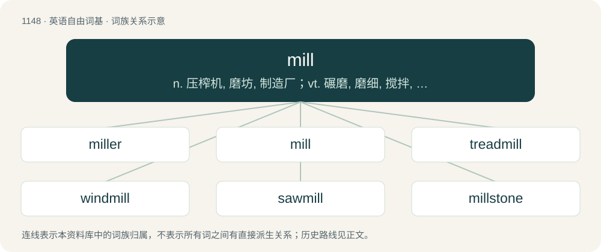

# 1227 · mill — n. 压榨机, 磨坊, 制造厂；vt. 碾磨, 磨细, 搅拌, 使乱转；vi. 乱转, 被碾磨

[总目录](../00_总目录_按常用程度.md)

**类型**：英语自由词基　｜　**来源语言**：见词源记录

## 核心含义与来源

- 核心含义：n. 压榨机, 磨坊, 制造厂；vt. 碾磨, 磨细, 搅拌, 使乱转；vi. 乱转, 被碾磨
- 英文含义：A grinding apparatus for substances such as grains, seeds, etc. (Some are small and simple, and some are large and complex.)
- 词形：mill

**多个词源／构词路径**：同一拼写可能有不同来源；以下按词性和含义分别列出。

**来源记录 1**（名词；A grinding apparatus for substances such as grains, seeds, etc. (Some are small and simple, and some are large and complex.)）

From Middle English mylne, mille, from Old English mylen, from Proto-West Germanic \*mulīnu (“mill”), from Late Latin molīna, molīnum, molīnus (“mill”), from Latin molō (“grind, mill”, verb), closely allied to Proto-Germanic \*muljaną (“to crush, grind”) (see English millstone). Perhaps cognate with Milne (a surname). Doublet of moline, moulin, and blin.

**来源记录 2**（名词；One thousandth of a US dollar, one-hundredth of a dime or one-tenth of a cent.）

Ultimately from Latin millesimum. The clipping comes by way of the clipped word, millimetre.

**来源记录 3**（动词；To move (a card) from a deck to the discard pile.）

Back-formation from millstone, name of a Magic: The Gathering card with this effect (first printed 1994).

## 词族图

## 单词速览（常用到不常用）

| 单词 | 音标 | 释义 |
|---|---|---|
| [miller](#w-1) | 英 /ˈmɪləː/；美 /ˈmɪlɚ/ | n. 厂主, 蛾；\[机\] 铣床 |
| [mill](#w-2) | /mɪl/ | n. 压榨机, 磨坊, 制造厂；vt. 碾磨, 磨细, 搅拌, 使乱转；vi. 乱转, 被碾磨 |
| [treadmill](#w-3) | /ˈtɹɛd.mɪl/ | n. 踏车, 令人厌倦的工作；\[法\] 踏车 |
| [windmill](#w-4) | 英 /ˈwɪn(d).mɪl/ | n. 风车 |
| [sawmill](#w-5) | /ˈsɒːmil/ | n. 锯木厂, 锯木机 |
| [millstone](#w-6) | 英 /ˈmɪlstəʊn/；美 /ˈmɪlˌstoʊn/ | n. 磨石, 磨难, 重担 |
| [millman](#w-7) | /ˈmilmən/ | 炼胶工 |
| [millwork](#w-8) | /ˈmilwəːk/ | \[化\] 工厂机械的安装及操作 |
| [millwright](#w-9) | /ˈmilrait/ | n. 磨粉厂的设计者, 机器安装工；\[化\] 设计师; 磨粉厂设计师; 机器安装工; 工厂的机器安装工 |

## 逐词详解

### 1. miller

**词性**：名词　｜　**音标**：英 /ˈmɪləː/；美 /ˈmɪlɚ/

**中文释义**：n. 厂主, 蛾；\[机\] 铣床

**英文义项**：A person who owns or operates a mill, especially a flourmill. / A milling machine.

**构词拆分**：mill + -er

**词源与演化**：

From Middle English myllere, mellere, from earlier mylnere, possibly from an Old English \*mylnere, from Proto-West Germanic \*mulīnārī (“miller”), equivalent to mill + -er; cf. also Late Latin molīnārius (“miller”). Cognate with Saterland Frisian Muller, Dutch mulder, molenaar, German Low German Möller, German Müller, Müllner, Danish møller, Norwegian Bokmål møller, Norwegian Nynorsk mylnar, møllar, Swedish mjölnare, Icelandic mylnari. Compare also Middle English milward, mulward (“miller”), from Old English mylenweard (“miller”, literally “mill-keeper”) (&gt; English Millward (surname)).

**例句**：

> Two policemen arrested a burglar. They caught him sneaking into Mrs. Miller's.

### 2. mill

**词性**：名词　｜　**音标**：/mɪl/

**中文释义**：n. 压榨机, 磨坊, 制造厂；vt. 碾磨, 磨细, 搅拌, 使乱转；vi. 乱转, 被碾磨

**英文义项**：A grinding apparatus for substances such as grains, seeds, etc. (Some are small and simple, and some are large and complex.) / The building housing such a grinding apparatus; also, any similar building that houses a similarly material activity (such as weaving, fulling, dying, etc.); the place of business comprising such a building and its outbuildings and grounds.

**词源与演化**：

From Middle English mylne, mille, from Old English mylen, from Proto-West Germanic \*mulīnu (“mill”), from Late Latin molīna, molīnum, molīnus (“mill”), from Latin molō (“grind, mill”, verb), closely allied to Proto-Germanic \*muljaną (“to crush, grind”) (see English millstone). Perhaps cognate with Milne (a surname). Doublet of moline, moulin, and blin.

**例句**：

> After the drilling and tapping operations, we come in with a mill and do some contouring.

该用例对应义项：A milling cutter used on such a machine.

### 3. treadmill

**词性**：名词　｜　**音标**：/ˈtɹɛd.mɪl/

**中文释义**：n. 踏车, 令人厌倦的工作；\[法\] 踏车

**英文义项**：A piece of indoor sporting equipment used to allow for the motions of running or walking while staying in one place. / A mill worked by horses, dogs, etc., treading an endless belt.

**构词拆分**：tread + mill

**词源与演化**：

From tread + mill. Its figurative senses refer to the idea that running on a treadmill requires continued effort and motion to remain in the same place.

**例句**：

> Tom was sweating profusely after a half an hour on the treadmill.

### 4. windmill

**词性**：名词　｜　**音标**：英 /ˈwɪn(d).mɪl/

**中文释义**：n. 风车

**英文义项**：A machine which translates linear motion of wind to rotational motion by means of adjustable vanes called sails. / The building or structure containing such machinery.

**构词拆分**：wind + mill

**词源与演化**：

From Middle English wyndmylne, wyndmylle, equivalent to wind + mill. Cognate with Scots wyndmyln, wyndmyl, Saterland Frisian Wíendmäälne, West Frisian wynmûne, Dutch windmolen, Afrikaans windmeul, Dutch Low Saxon windmölle (Achterhooks), wiendmeule (Drents, Veluws), German Low German Windmöhl, German Windmühle, Danish vindmølle, Norwegian Bokmål vindmølle, Norwegian Nynorsk vindmølle, vindmylne, Swedish vindmölla, Icelandic vindmylla. (imaginary enemy): A reference to Don Quixote tilting at windmills.

**用法示例／搭配（非完整句）**：

> to fight windmills

该用例对应义项：An imaginary enemy, but presented as real.

### 5. sawmill

**词性**：名词　｜　**音标**：/ˈsɒːmil/

**中文释义**：n. 锯木厂, 锯木机

**英文义项**：A machine, building, or company used for cutting (milling) lumber or (rarely) other hard materials such as stone.

**构词拆分**：saw + mill

**词源与演化**：

From saw + mill.

**例句**：

> He brought his portable sawmill and turned the old beams into interesting flooring.

该用例对应义项：A machine, building, or company used for cutting (milling) lumber or (rarely) other hard materials such as stone.

### 6. millstone

**词性**：名词　｜　**音标**：英 /ˈmɪlstəʊn/；美 /ˈmɪlˌstoʊn/

**中文释义**：n. 磨石, 磨难, 重担

**英文义项**：A large round stone used for grinding grain. / A coarse-grained sandstone used for making such stones; millstone grit.

**构词拆分**：mill + stone

**词源与演化**：

From Middle English mylneston, milneston, from Old English mylenstān (“millstone”), from Proto-West Germanic \*mulīnu + \*stain; equivalent to mill + stone; cognate with Danish møllesten, Middle Dutch molensteen (modern Dutch molensteen), West Frisian molestien, Norwegian Bokmål møllestein, Old Saxon mulinstēn (Middle Low German mȫlenstēn), Old High German mulinstein, mülstein (Middle High German mülstein, modern German Mühlstein).

**例句**：

> The millstone's grooves wore down with use.

### 7. millman

**词性**：名词　｜　**音标**：/ˈmilmən/

**中文释义**：炼胶工

**英文义项**：A male worker in a mill.

**构词拆分**：mill + -man

**词源与演化**：

From mill + -man.

### 8. millwork

**词性**：名词　｜　**音标**：/ˈmilwəːk/

**中文释义**：\[化\] 工厂机械的安装及操作

**英文义项**：Components for buildings, produced by milling, such as doors and windows (especially prehung ones) and wood or woodlike trim with decorative cross-sections involving curves, beads, grooves, etc. / Any wooden object manufactured at a lumbermill (sawmill).

**构词拆分**：mill + work

**词源与演化**：

From mill + work.

### 9. millwright

**词性**：名词　｜　**音标**：/ˈmilrait/

**中文释义**：n. 磨粉厂的设计者, 机器安装工；\[化\] 设计师; 磨粉厂设计师; 机器安装工; 工厂的机器安装工

**英文义项**：A tradesperson engaged in the erection of machinery.

**构词拆分**：mill + wright

**词源与演化**：

From Middle English mylle wryte; equivalent to mill + wright.
