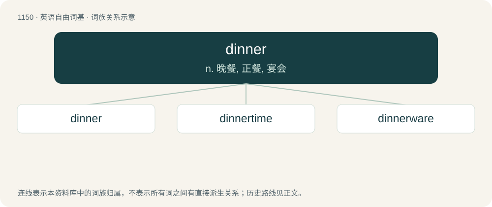

# 1228 · dinner — n. 晚餐, 正餐, 宴会

[总目录](../00_总目录_按常用程度.md)

**类型**：英语自由词基　｜　**来源语言**：见词源记录

## 核心含义与来源

- 核心含义：n. 晚餐, 正餐, 宴会
- 英文含义：The main meal of the day, often eaten in the evening.
- 词形：dinner

**来源记录 1**（名词；The main meal of the day, often eaten in the evening.）

From Middle English dyner, from Old French disner (“lunch”, but originally “breakfast”), (modern French dîner), from Vulgar Latin \*disiūnō, \*disiūnāre from Latin dis- + iēiūnō (“to break the fast”).

## 词族图

## 单词速览（常用到不常用）

| 单词 | 音标 | 释义 |
|---|---|---|
| [dinner](#w-1) | 英 /ˈdɪnə/；美 /ˈdɪnɚ/ | n. 晚餐, 正餐, 宴会 |
| [dinnertime](#w-2) | /ˈdɪnərtaɪm/ | n. 正餐时间 |
| [dinnerware](#w-3) | /ˈdinəwєə/ | n. 整套餐具 |

## 逐词详解

### 1. dinner

**词性**：名词　｜　**音标**：英 /ˈdɪnə/；美 /ˈdɪnɚ/

**中文释义**：n. 晚餐, 正餐, 宴会

**英文义项**：The main meal of the day, often eaten in the evening. / An evening meal.

**词源与演化**：

From Middle English dyner, from Old French disner (“lunch”, but originally “breakfast”), (modern French dîner), from Vulgar Latin \*disiūnō, \*disiūnāre from Latin dis- + iēiūnō (“to break the fast”).

**例句**：

> My family gathers twice a year, namely at Christmas and Thanksgiving dinners.

该用例对应义项：A formal meal for many people eaten for a special occasion.

### 2. dinnertime

**词性**：名词　｜　**音标**：/ˈdɪnərtaɪm/

**中文释义**：n. 正餐时间

**英文义项**：The time when dinner takes place, as / The midday mealtime as the main one: lunchtime.

**构词拆分**：dinner + time

**词源与演化**：

From dinner + time.

**例句**：

> She cried all morning and was still weepy at dinnertime.

### 3. dinnerware

**词性**：名词　｜　**音标**：/ˈdinəwєə/

**中文释义**：n. 整套餐具

**英文义项**：The dishes used for serving dinner.

**构词拆分**：dinner + -ware

**词源与演化**：

From dinner + -ware.

**例句**：

> Has the future bride chosen her dinnerware pattern?
