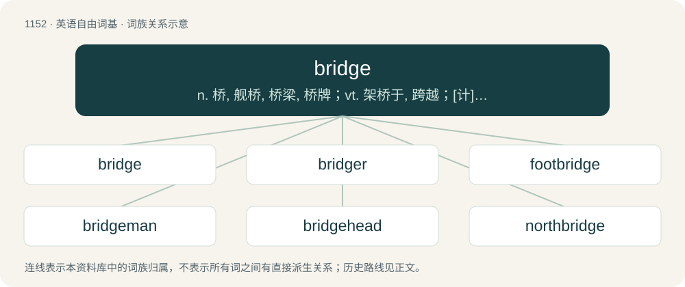

# 1229 · bridge — n. 桥, 舰桥, 桥梁, 桥牌；vt. 架桥于, 跨越；\[计\] 桥, 网桥, 桥接器

[总目录](../00_总目录_按常用程度.md)

**类型**：英语自由词基　｜　**来源语言**：见词源记录

## 核心含义与来源

- 核心含义：n. 桥, 舰桥, 桥梁, 桥牌；vt. 架桥于, 跨越；\[计\] 桥, 网桥, 桥接器
- 英文含义：A construction spanning a waterway, ravine, or valley from a height, allowing for the passage of vehicles, pedestrians, trains, etc.
- 词形：bridge

**多个词源／构词路径**：同一拼写可能有不同来源；以下按词性和含义分别列出。

**来源记录 1**（名词；A construction spanning a waterway, ravine, or valley from a height, allowing for the passage of vehicles, pedestrians, trains, etc.）

From Middle English brigge, from Old English brycġ (“bridge”), from Proto-West Germanic \*bruggju, from Proto-Germanic \*brugjō, \*brugjǭ (“bridge”), from Proto-Indo-European \*bʰerw-, \*bʰrēw- (“wooden flooring, decking, bridge”). Cognates Cognate with Scots brig, brigg (“bridge”), Yola burge (“bridge”), North Frisian brag, Bröch (“bridge”), Saterland Frisian Brääch, Brääg (“bridge”), West Frisian brêge (“bridge”), Dutch brug (“bridge”), German Brücke (“bridge”), Limburgish brögk (“bridge”), Luxembourgish Bréck (“bridge”), Vilamovian bryk (“bridge”), Yiddish בריק (brik, “bridge”), Danish, Norwegian Bokmål brygge (“jetty, pier, wharf”), Faroese, Icelandic bryggja (“pier”), Norwegian Nynorsk brygge, bryggje (“jetty, pier, wharf”), Swedish brygga (“bridge; pier”). The verb is from Middle English briggen, from Old English brycġian (“to bridge, make a causeway, pave”), derived from the noun. Cognate with Dutch bruggen (“to bridge”), Middle Low German bruggen (“to bridge”), Old High German bruccōn (“to bridge”) (whence Modern German brücken). The sense of a part of a stringed instrument is a semantic loan from German Steg, from Old High German steg.

**来源记录 2**（名词；Any of a certain family of trick-taking card games.）

From the earlier game biritch, probably from Russian бирю́ч (birjúč) or бири́ч (biríč); else from Turkish bir-üç (“one-three”).

## 词族图

## 单词速览（常用到不常用）

| 单词 | 音标 | 释义 |
|---|---|---|
| [bridge](#w-1) | /bɹɪd͡ʒ/ | n. 桥, 舰桥, 桥梁, 桥牌；vt. 架桥于, 跨越；\[计\] 桥, 网桥, 桥接器 |
| [bridger](#w-2) |  | 布里杰（男子名） |
| [footbridge](#w-3) | /ˈfʊtˌbɹɪd͡ʒ/ | n. 人行桥 |
| [bridgeman](#w-4) |  | 【英文】A worker who operates a moving bridge. |
| [bridgehead](#w-5) | /ˈbɹɪd͡ʒhɛd/ | n. 桥头堡 |
| [northbridge](#w-6) |  | \[地名\] \[美国\] 诺斯布里奇 |
| [southbridge](#w-7) |  | \[地名\] \[美国、新西兰\] 绍斯布里奇 |

## 逐词详解

### 1. bridge

**词性**：名词　｜　**音标**：/bɹɪd͡ʒ/

**中文释义**：n. 桥, 舰桥, 桥梁, 桥牌；vt. 架桥于, 跨越；\[计\] 桥, 网桥, 桥接器

**英文义项**：A construction spanning a waterway, ravine, or valley from a height, allowing for the passage of vehicles, pedestrians, trains, etc. / The upper bony ridge of the human nose.

**词源与演化**：

From Middle English brigge, from Old English brycġ (“bridge”), from Proto-West Germanic \*bruggju, from Proto-Germanic \*brugjō, \*brugjǭ (“bridge”), from Proto-Indo-European \*bʰerw-, \*bʰrēw- (“wooden flooring, decking, bridge”). Cognates Cognate with Scots brig, brigg (“bridge”), Yola burge (“bridge”), North Frisian brag, Bröch (“bridge”), Saterland Frisian Brääch, Brääg (“bridge”), West Frisian brêge (“bridge”), Dutch brug (“bridge”), German Brücke (“bridge”), Limburgish brögk (“bridge”), Luxembourgish Bréck (“bridge”), Vilamovian bryk (“bridge”), Yiddish בריק (brik, “bridge”), Danish, Norwegian Bokmål brygge (“jetty, pier, wharf”), Faroese, Icelandic bryggja (“pier”), Norwegian Nynorsk brygge, bryggje (“jetty, pier, wharf”), Swedish brygga (“bridge; pier”). The verb is from Middle English briggen, from Old English brycġian (“to bridge, make a causeway, pave”), derived from the noun. Cognate with Dutch bruggen (“to bridge”), Middle Low German bruggen (“to bridge”), Old High German bruccōn (“to bridge”) (whence Modern German brücken). The sense of a part of a stringed instrument is a semantic loan from German Steg, from Old High German steg.

**例句**：

> In the bridge of his 2011 song "It Will Rain", Bruno Mars begs his lover not to "say goodbye."

该用例对应义项：A contrasting section within a song that prepares for the return of the original material section.

### 2. bridger

**词性**：名词

**中文释义**：布里杰（男子名）

**英文义项**：One who builds bridges / One who bridges, or connects two previously separate things.

**构词拆分**：bridge + -er (occupational suffix)

**词源与演化**：

From Middle English briggere, equivalent to bridge + -er (occupational suffix) or + -er (agent noun suffix).

### 3. footbridge

**词性**：名词　｜　**音标**：/ˈfʊtˌbɹɪd͡ʒ/

**中文释义**：n. 人行桥

**英文义项**：A bridge over a road, railway, river, etc for pedestrians.

**构词拆分**：foot + bridge

**词源与演化**：

From Middle English fot-brigge, equivalent to foot + bridge.

**例句**：

> Elias walked over the footbridge and made his way into the tunnel.

### 4. bridgeman

**词性**：名词

**英文义项**：A worker who operates a moving bridge.

**构词拆分**：bridge + -man

**词源与演化**：

From bridge + -man.

### 5. bridgehead

**词性**：名词　｜　**音标**：/ˈbɹɪd͡ʒhɛd/

**中文释义**：n. 桥头堡

**英文义项**：An area around the end of a bridge. / A fortification around the end of a bridge.

**构词拆分**：bridge + head

**词源与演化**：

Calque of French tête de pont, equivalent to bridge + head.

**例句**：

> An attempt to secure a bridgehead behind enemy lines.

该用例对应义项：an area in hostile territory that has been captured and is held awaiting further troops and supplies

### 6. northbridge

**词性**：名词

**中文释义**：\[地名\] \[美国\] 诺斯布里奇

**英文义项**：A microchip connected directly to the CPU (unlike the southbridge) and thus responsible for tasks that require the highest performance.

**构词拆分**：north + bridge

**词源与演化**：

From north + bridge.

### 7. southbridge

**词性**：名词

**中文释义**：\[地名\] \[美国、新西兰\] 绍斯布里奇

**英文义项**：A secondary microchip connected to the CPU only through the northbridge.

**构词拆分**：south + bridge

**词源与演化**：

From south + bridge.
