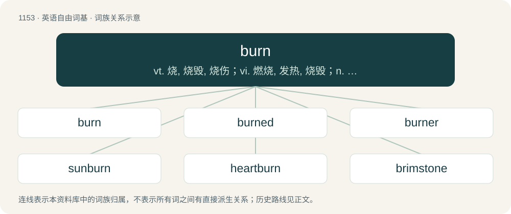

# 1230 · burn — vt. 烧, 烧毁, 烧伤；vi. 燃烧, 发热, 烧毁；n. 烧伤, 烙印

[总目录](../00_总目录_按常用程度.md)

**类型**：英语自由词基　｜　**来源语言**：见词源记录

## 核心含义与来源

- 核心含义：vt. 烧, 烧毁, 烧伤；vi. 燃烧, 发热, 烧毁；n. 烧伤, 烙印
- 英文含义：A physical injury caused by heat, cold, electricity, radiation or caustic chemicals.
- 词形：burn

**多个词源／构词路径**：同一拼写可能有不同来源；以下按词性和含义分别列出。

**来源记录 1**（名词；A physical injury caused by heat, cold, electricity, radiation or caustic chemicals.）

From late Middle English burne, birne, metathetic form of brinne, brynne, a variant of brennen, from Old Norse brinna, brenna (“to burn”), from Proto-Germanic \*brinnaną (“to burn”), from Proto-Indo-European \*bʰrenw-, present stem from \*bʰrewh₁- (“to boil”). Doublet of brew. The late metathesis of East Midland brin- to birn- (and subsequently burn-) parallels the phonological development of bird and dirt from brid and drit. As this metathetic form became the Chancery Standard, it displaced the semantic functions and weak conjugation paradigm of the native Old English bærnan (weak), alongside the surviving remnants of byrnan (strong). Cognates Cognate with Cimbrian prönnan (“to burn”), Dutch barnen, branden (“to burn”), German brinnen (“to burn”), Luxembourgish brennen (“to burn”), Vilamovian brīn (“to burn”), Yiddish ברענען (brenen, “to burn”), Danish brænde (“to burn”), Faroese and Icelandic brenna (“to burn”), Norwegian Bokmål brenne (“to burn”), Norwegian Nynorsk brenna, brenne (“to burn”), Swedish brinna (“to burn”), Gothic 𐌱𐍂𐌹𐌽𐌽𐌰𐌽 (brinnan, “to burn”); also Cornish bros (“blazing, boiling”), Irish bruth (“heat; eruption; surf”), Welsh brwd (“eager, keen; passionate, zealous”), Latin defrutum (“grape must reduced by boiling”), Ancient Greek πορφύρω (porphúrō, “to boil, heave”), Albanian burth (“Cyclamen hederifolium; mouth burning”), Armenian աղբյուր (aġbyur, “fountain, spring”), Sanskrit भुर्वन् (bhurvan, “runnel, spring”). More at brew.

**来源记录 2**（名词；A large stream.）

From Northern Middle English burn, from Old English burne, burna (“spring, fountain”), Proto-West Germanic \*brunnō, from Proto-Germanic \*brunnô, \*brunō. Cognate with Scots burn (“stream”), Cimbrian, Mòcheno prunn (“well, spring”), Dutch bron (“well”), German Bronnen, Brun, Brunnen (“well”), Luxembourgish Buer, Bur (“well”), Yiddish ברונעם (brunem, “well”), Danish brønd (“well”), Faroese brunnur, bruður (“well”), Icelandic brunnur (“well”), Norwegian Bokmål, Scanian brønn (“well”), Norwegian Nynorsk brunn, brønn (“well”), Swedish brunn (“well”), Gothic 𐌱𐍂𐌿𐌽𐌽𐌰 (brunna, “source, wellspring”), Crimean Gothic brunna (“spring, fountain, source”). Also Albanian burim (“spring, fountain”), Ancient Greek φρέαρ (phréar, “well, reservoir”), Old Armenian աղբիւր (ałbiwr, “fount”). Doublet of bourn. More at brew.

## 词族图

## 单词速览（常用到不常用）

| 单词 | 音标 | 释义 |
|---|---|---|
| [burn](#w-1) | 英 /bɜːn/；美 /bɝn/ | vt. 烧, 烧毁, 烧伤；vi. 燃烧, 发热, 烧毁；n. 烧伤, 烙印 |
| [burned](#w-2) | 英 /ˈbɜːnd/；美 /ˈbɝnd/ | burn的过去式和过去分词；\[机\] 焦化 |
| [burner](#w-3) | 英 /ˈbɜːnə/；美 /ˈbɝnɚ/ | n. 火炉, 烧火的人；\[化\] 灯; 灯头; 烧嘴炉; 燃烧器; 燃烧炉 |
| [sunburn](#w-4) | 英 /ˈsʌnˌbɜːn/；美 /ˈsʌnˌbɝn/ | n. 日炙, 晒斑, 晒焦, 晒黑；vt.vi. (使)晒黑, (使)晒得退色, (使)晒焦 |
| [heartburn](#w-5) | 英 /ˈhɑːtˌbɜːn/；美 /ˈhɑɹtˌbɝn/ | n. 胃灼热, 心痛, 妒忌；\[医\] 胃灼热 |
| [brimstone](#w-6) | 英 /ˈbɹɪmstəʊn/；美 /ˈbɹɪmstoʊn/ | n. 硫磺；\[化\] 硫黄 |
| [burnie](#w-7) | /ˈbəːni/ | \[苏\]小溪 |

## 逐词详解

### 1. burn

**词性**：名词　｜　**音标**：英 /bɜːn/；美 /bɝn/

**中文释义**：vt. 烧, 烧毁, 烧伤；vi. 燃烧, 发热, 烧毁；n. 烧伤, 烙印

**英文义项**：A physical injury caused by heat, cold, electricity, radiation or caustic chemicals. / A mark left behind by a burn; a scorch or scar caused by a burn.

**词源与演化**：

From late Middle English burne, birne, metathetic form of brinne, brynne, a variant of brennen, from Old Norse brinna, brenna (“to burn”), from Proto-Germanic \*brinnaną (“to burn”), from Proto-Indo-European \*bʰrenw-, present stem from \*bʰrewh₁- (“to boil”). Doublet of brew. The late metathesis of East Midland brin- to birn- (and subsequently burn-) parallels the phonological development of bird and dirt from brid and drit. As this metathetic form became the Chancery Standard, it displaced the semantic functions and weak conjugation paradigm of the native Old English bærnan (weak), alongside the surviving remnants of byrnan (strong). Cognates Cognate with Cimbrian prönnan (“to burn”), Dutch barnen, branden (“to burn”), German brinnen (“to burn”), Luxembourgish brennen (“to burn”), Vilamovian brīn (“to burn”), Yiddish ברענען (brenen, “to burn”), Danish brænde (“to burn”), Faroese and Icelandic brenna (“to burn”), Norwegian Bokmål brenne (“to burn”), Norwegian Nynorsk brenna, brenne (“to burn”), Swedish brinna (“to burn”), Gothic 𐌱𐍂𐌹𐌽𐌽𐌰𐌽 (brinnan, “to burn”); also Cornish bros (“blazing, boiling”), Irish bruth (“heat; eruption; surf”), Welsh brwd (“eager, keen; passionate, zealous”), Latin defrutum (“grape must reduced by boiling”), Ancient Greek πορφύρω (porphúrō, “to boil, heave”), Albanian burth (“Cyclamen hederifolium; mouth burning”), Armenian աղբյուր (aġbyur, “fountain, spring”), Sanskrit भुर्वन् (bhurvan, “runnel, spring”). More at brew.

**例句**：

> I dread the burn of the disinfectant where it enters an open wound.

该用例对应义项：A sensation resembling an injury from heat or an analogous force; the quality or nature of a burning sensation caused by capsaicin.

### 2. burned

**词性**：形容词　｜　**音标**：英 /ˈbɜːnd/；美 /ˈbɝnd/

**中文释义**：burn的过去式和过去分词；\[机\] 焦化

**英文义项**：Damaged or consumed by heat, fire, oxidation, or similar process.

**构词拆分**：burn + -ed

**词源与演化**：

The past tense is inherited from Middle English burnede. The past participle (from which the adjective is also derived) is inherited from Middle English burned. Synchronically, both forms are equivalent to burn + -ed.

**例句**：

> A row of burned houses.

该用例对应义项：destroyed or badly damaged by fire

### 3. burner

**词性**：名词　｜　**音标**：英 /ˈbɜːnə/；美 /ˈbɝnɚ/

**中文释义**：n. 火炉, 烧火的人；\[化\] 灯; 灯头; 烧嘴炉; 燃烧器; 燃烧炉

**英文义项**：An element on a kitchen stove, hob, or cooktop that generates localized heat for cooking. / A device that generates localized heat for experiments; a Bunsen burner.

**构词拆分**：burn + -er

**词源与演化**：

From burn + -er. Merged with and eclipsed related Middle English brennar, brennere (“an incendiary, incinerator”). Compare German Brenner (“burner”), Swedish brännare (“burner”).

**例句**：

> The electric range had one large burner and three smaller one.

该用例对应义项：the heating elements of a stove or range on which pots and pans are placed for cooking

### 4. sunburn

**词性**：名词　｜　**音标**：英 /ˈsʌnˌbɜːn/；美 /ˈsʌnˌbɝn/

**中文释义**：n. 日炙, 晒斑, 晒焦, 晒黑；vt.vi. (使)晒黑, (使)晒得退色, (使)晒焦

**英文义项**：A burn on the skin caused by excess exposure to the sun's rays. / A burn on the tissue of crop plants or their fruits (especially if they are rich in water like tomatoes, grapes, apples, gooseberries) caused by excess exposure to the sun's rays.

**构词拆分**：sun + burn

**词源与演化**：

From Middle English \*sunne burnen, \*sonne brennen, \*sunne brennen (suggested by derivatives sonne brennynge, sunne brennynge (“sunburn”, literally “sun-burning”) and sunne brente (“sunburnt”), equivalent to sun + burn. Compare West Frisian sinnebrân (“sunburn”), Dutch zonnebrand (“sunburn”), German Sonnenbrand (“sunburn”), Swedish solbränna (“sunburn”), and Icelandic sólbruni (“sunburn”), as well as Old English sunbryne (“sunburn”).

**例句**：

> Tom didn't protect himself against the sun properly and got a sunburn.

### 5. heartburn

**词性**：名词　｜　**音标**：英 /ˈhɑːtˌbɜːn/；美 /ˈhɑɹtˌbɝn/

**中文释义**：n. 胃灼热, 心痛, 妒忌；\[医\] 胃灼热

**英文义项**：A burning pain in the chest that is caused by stomach acid entering the gullet. / annoyance, heartache, or similar feelings.

**构词拆分**：heart + burn

**词源与演化**：

From Middle English hertbryne, herte-bren (“lust", also "heartburn”, literally “heart burn”), equivalent to heart + burn. Compare also Middle English herte-brennyng (“anger, bitterness, heartburn”, literally “burning of/in the heart, heart-burning”). Compare also Ancient Greek καρδιαλγία (kardialgía), from καρδία (kardía, “heart”) + ἄλγος (álgos, “pain”). From being a burning sensation near the location of the heart in the chest.

**例句**：

> Tom gets indigestion and heartburn when he eats too much rich food.

### 6. brimstone

**词性**：名词　｜　**音标**：英 /ˈbɹɪmstəʊn/；美 /ˈbɹɪmstoʊn/

**中文释义**：n. 硫磺；\[化\] 硫黄

**英文义项**：The sulfur of hell; hell, damnation. / The butterfly Gonepteryx rhamni of the Pieridae family.

**构词拆分**：burn + stone

**词源与演化**：

From Middle English brymston, brimston, bremston, forms of brinston, brenston, bernston, from Old English brynstān (“brimstone”, literally “burn-stone”), equivalent to burn + stone. Cognate with Scots brunstane (“brimstone”), Icelandic brennisteinn (“sulfur / sulphur, brimstone”), German Bernstein (“amber”). Compare also brimfire. More at burn, stone. Although once a synonym for sulfur, the word is now largely restricted to poetic and Biblical usage.

**例句**：

> The preacher warned the crowd of brimstone and eternal fire.

### 7. burnie

**词性**：名词　｜　**音标**：/ˈbəːni/

**中文释义**：\[苏\]小溪

**英文义项**：A small brook.

**构词拆分**：burn + -ie

**词源与演化**：

From burn + -ie.
