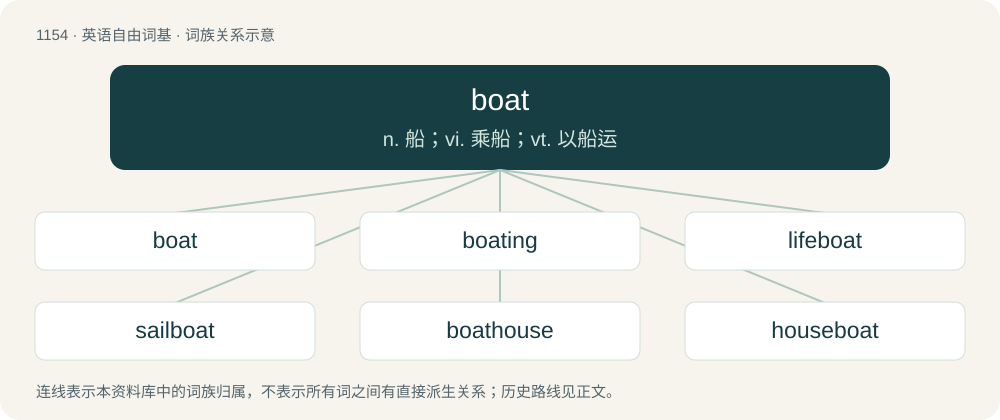

# 1231 · boat — n. 船；vi. 乘船；vt. 以船运

[总目录](../00_总目录_按常用程度.md)

**类型**：英语自由词基　｜　**来源语言**：见词源记录

## 核心含义与来源

- 核心含义：n. 船；vi. 乘船；vt. 以船运
- 英文含义：A small, usually open craft used for travelling over water, propelled by oars, motor or wind. Usually contrasted with "ship".
- 词形：boat

**来源记录 1**（名词；A small, usually open craft used for travelling over water, propelled by oars, motor or wind. Usually contrasted with "ship".）

From Middle English bot, boot, boet, boyt (“boat”), from Old English bāt (“boat”), from Proto-West Germanic \*bait, from Proto-Germanic \*baitaz, \*baitą (“boat, small ship”), from Proto-Indo-European \*bʰeyd- (“to break, split”) (whence also fissure via Latin). Cognate with Old Norse beit (“boat”), Middle Dutch beitel (“little boat”). Old Norse bátr (whence Faroese and Icelandic bátur, Norwegian Bokmål, Norwegian Nynorsk, and Swedish båt, Danish båd), Dutch boot, German Boot, Occitan batèl and French bateau are all ultimately borrowings from the Old English word. Compare typologically ship &lt;&lt; Proto-Indo-European \*skey-; Russian долблёнка (dolbljónka) (&lt; долби́ть (dolbítʹ)), Russian чёлн (čoln) (akin to коло́ть (kolótʹ)). False cognate of Sanskrit बेडा (beḍā).

## 词族图

## 单词速览（常用到不常用）

| 单词 | 音标 | 释义 |
|---|---|---|
| [boat](#w-1) | 英 /bəʊ̯t/；美 /boʊ̯t/ | n. 船；vi. 乘船；vt. 以船运 |
| [boating](#w-2) | 英 /ˈbəʊtɪŋ/；美 /ˈboʊtɪŋ/ | n. 划船 |
| [lifeboat](#w-3) | 英 /ˈlaɪfˌbəʊt/；美 /ˈlaɪfˌboʊt/ | n. 救生艇 |
| [sailboat](#w-4) | 英 /ˈseɪlˌbəʊt/；美 /ˈseɪlˌboʊt/ | n. 帆船 |
| [boathouse](#w-5) | 美 /ˈboʊtˌhaʊs/ | n. 船库, 艇库 |
| [houseboat](#w-6) | 美 /ˈhaʊsˌboʊt/ | n. 居住船, 游艇 |
| [tugboat](#w-7) | 英 /ˈtʌɡbəʊt/；美 /ˈtʌɡboʊt/ | n. 拖船；\[化\] 拖轮 |
| [speedboat](#w-8) | 美 /ˈspidˌboʊt/ | n. 高速游艇 |
| [boatman](#w-9) | /ˈbəʊt.mən/ | n. 出租船者, 船夫 |
| [motorboat](#w-10) | 英 /ˈməʊtəˌbəʊt/；美 /ˈmoʊtəˌboʊt/ | n. 汽船 |
| [boatload](#w-11) | 英 /ˈbəʊtˌləʊd/；美 /ˈboʊtˌloʊd/ | n. 船的载货量, 一条船的货物 |
| [riverboat](#w-12) | 美 /ˈɹɪvɚˌboʊt/ | n. 江河中行驶的船 |
| [gunboat](#w-13) | 美 /ˈɡʌnˌboʊt/ | n. 炮舰, 炮艇 |
| [rowboat](#w-14) | /ˈɹəʊbəʊt/ | n. 划艇 |
| [showboat](#w-15) | 美 /ˈʃoʊˌboʊt/ | n. 演戏船 |
| [boatswain](#w-16) | 英 /ˈbəʊ.sən/；美 /ˈboʊ.sən/ | n. 水手长 |
| [longboat](#w-17) | /ˈlɒŋbəut/ | n. (商船附载的)大艇 |
| [powerboat](#w-18) | /ˈpauəbəut/ | n. 机动艇 |
| [boatyard](#w-19) | /ˈbəut.jɑːd/ | n. 船坞；造船厂 |
| [boater](#w-20) | 英 /ˈbəʊt.ə/；美 /ˈboʊ.tɚ/ | n. 船工, 硬草帽 |
| [dreamboat](#w-21) | 英 /ˈdɹiːmbəʊt/；美 /ˈdɹimˌboʊt/ | n. 梦中人 |
| [ferryboat](#w-22) | 英 /ˈfɛɹiˌbəʊt/；美 /ˈfɛɹiˌboʊt/ | n. 渡船 |

## 逐词详解

### 1. boat

**词性**：名词　｜　**音标**：英 /bəʊ̯t/；美 /boʊ̯t/

**中文释义**：n. 船；vi. 乘船；vt. 以船运

**英文义项**：A small, usually open craft used for travelling over water, propelled by oars, motor or wind. Usually contrasted with "ship". / A submarine.

**词源与演化**：

From Middle English bot, boot, boet, boyt (“boat”), from Old English bāt (“boat”), from Proto-West Germanic \*bait, from Proto-Germanic \*baitaz, \*baitą (“boat, small ship”), from Proto-Indo-European \*bʰeyd- (“to break, split”) (whence also fissure via Latin). Cognate with Old Norse beit (“boat”), Middle Dutch beitel (“little boat”). Old Norse bátr (whence Faroese and Icelandic bátur, Norwegian Bokmål, Norwegian Nynorsk, and Swedish båt, Danish båd), Dutch boot, German Boot, Occitan batèl and French bateau are all ultimately borrowings from the Old English word. Compare typologically ship &lt;&lt; Proto-Indo-European \*skey-; Russian долблёнка (dolbljónka) (&lt; долби́ть (dolbítʹ)), Russian чёлн (čoln) (akin to коло́ть (kolótʹ)). False cognate of Sanskrit बेडा (beḍā).

**例句**：

> We can't get everything in the boat. We'll leave this stuff behind.

该用例对应义项：A small, usually open craft used for travelling over water, propelled by oars, motor or wind. Usually contrasted with "ship".

### 2. boating

**词性**：名词　｜　**音标**：英 /ˈbəʊtɪŋ/；美 /ˈboʊtɪŋ/

**中文释义**：n. 划船

**英文义项**：The activity of going out onto a body of water in a boat.

**构词拆分**：boat + -ing

**词源与演化**：

From boat + -ing.

**例句**：

> We were boating on the Gulf of Mexico and saw bottlenose dolphins.

### 3. lifeboat

**词性**：名词　｜　**音标**：英 /ˈlaɪfˌbəʊt/；美 /ˈlaɪfˌboʊt/

**中文释义**：n. 救生艇

**英文义项**：A boat especially designed for saving the lives of shipwrecked people or people in distress at sea (either launched from the shore with a crew, or else carried on board a larger ship). / An emergency vehicle carried aboard a spaceship.

**构词拆分**：life + boat

**词源与演化**：

From life + boat.

**例句**：

> Tom spent the night in the lifeboat and was rescued the next morning.

### 4. sailboat

**词性**：名词　｜　**音标**：英 /ˈseɪlˌbəʊt/；美 /ˈseɪlˌboʊt/

**中文释义**：n. 帆船

**英文义项**：A boat propelled by a sail. / A playing card with the rank of four.

**构词拆分**：sail + boat

**词源与演化**：

From sail + boat.

**例句**：

> The sun glittered on the water in front of the old sailboat.

### 5. boathouse

**词性**：名词　｜　**音标**：美 /ˈboʊtˌhaʊs/

**中文释义**：n. 船库, 艇库

**英文义项**：A building at the edge of a river, lake or other body of water in which boats are kept.

**构词拆分**：boat + house

**词源与演化**：

From boat + house.

**例句**：

> Martino was standing by the boathouse.

### 6. houseboat

**词性**：名词　｜　**音标**：美 /ˈhaʊsˌboʊt/

**中文释义**：n. 居住船, 游艇

**英文义项**：A vessel, such as a barge, used as a dwelling.

**构词拆分**：house + boat

**词源与演化**：

From house + boat.

**例句**：

> Tom and Mary spent a relaxing week on a houseboat.

### 7. tugboat

**词性**：名词　｜　**音标**：英 /ˈtʌɡbəʊt/；美 /ˈtʌɡboʊt/

**中文释义**：n. 拖船；\[化\] 拖轮

**英文义项**：A small, powerful boat used to push or pull barges or to help maneuver larger vessels. / A Social Security Disability Insurance payment; monthly tugboat

**构词拆分**：tug + boat

**词源与演化**：

From tug + boat. Sense 2 from monthly tugboat, a reference to the saying "our ship has come in," here referring to a small, "reliable" "tugboat" instead of a large windfall.

**例句**：

> The tugboat guided the ship into the Algiers port.

### 8. speedboat

**词性**：名词　｜　**音标**：美 /ˈspidˌboʊt/

**中文释义**：n. 高速游艇

**英文义项**：A fast boat, usually small (for 1-8 people). / A boat designed and built for racing.

**构词拆分**：speed + boat

**词源与演化**：

From speed + boat.

**例句**：

> Benedito will ride the speedboat on the river.

### 9. boatman

**词性**：名词　｜　**音标**：/ˈbəʊt.mən/

**中文释义**：n. 出租船者, 船夫

**英文义项**：A sailor on a small vessel (boat), particularly its captain.

**构词拆分**：boat + -man

**词源与演化**：

From Middle English boteman, botman, bateman. Equivalent to boat + -man.

**例句**：

> When there are no tourists, the Lao boatman just fishes in the area to feed his family.

### 10. motorboat

**词性**：名词　｜　**音标**：英 /ˈməʊtəˌbəʊt/；美 /ˈmoʊtəˌboʊt/

**中文释义**：n. 汽船

**英文义项**：Any vessel driven by an engine (either inboard or outboard), but especially a small one.

**构词拆分**：motor + boat

**词源与演化**：

From motor + boat.

**例句**：

> Tom wants to buy a boat, either a sailboat or a motorboat.

### 11. boatload

**词性**：名词　｜　**音标**：英 /ˈbəʊtˌləʊd/；美 /ˈboʊtˌloʊd/

**中文释义**：n. 船的载货量, 一条船的货物

**英文义项**：Cargo or passengers that fill a boat. / A large quantity.

**构词拆分**：boat + load

**词源与演化**：

From boat + load. The figurative sense is extended from the literal sense.

**例句**：

> He showed up an hour later with a whole boatload of hamburgers, chips, cookies, and assorted other munchies, not to mention sodas and beer, and we all fell in and stuffed ourselves silly.

该用例对应义项：A large quantity.

### 12. riverboat

**词性**：名词　｜　**音标**：美 /ˈɹɪvɚˌboʊt/

**中文释义**：n. 江河中行驶的船

**英文义项**：A watercraft designed for operating on rivers.

**构词拆分**：river + boat

**词源与演化**：

From river + boat.

**例句**：

> He's a labourer on a riverboat.

### 13. gunboat

**词性**：名词　｜　**音标**：美 /ˈɡʌnˌboʊt/

**中文释义**：n. 炮舰, 炮艇

**英文义项**：Any of the various types of small armed vessels.

**构词拆分**：gun + boat

**词源与演化**：

From gun + boat.

**例句**：

> They have made, and will make, use of gunboat diplomacy.

### 14. rowboat

**词性**：名词　｜　**音标**：/ˈɹəʊbəʊt/

**中文释义**：n. 划艇

**英文义项**：A small open boat propelled by oars (by rowing).

**构词拆分**：row + boat

**词源与演化**：

From row + boat.

**例句**：

> I need to buy a new a pair of oars for my rowboat.

### 15. showboat

**词性**：名词　｜　**音标**：美 /ˈʃoʊˌboʊt/

**中文释义**：n. 演戏船

**英文义项**：A river steamboat having a resident theatre. / A person, often an athlete or performer, who behaves in an ostentatious, flashy manner to attract attention or admiration; a showoff.

**构词拆分**：show + boat

**词源与演化**：

From show + boat.

### 16. boatswain

**词性**：名词　｜　**音标**：英 /ˈbəʊ.sən/；美 /ˈboʊ.sən/

**中文释义**：n. 水手长

**英文义项**：The officer (or warrant officer) in charge of sails, rigging, anchors, cables etc. and all work on deck of a sailing ship. / The petty officer of a merchant ship who controls the work of other seamen.

**构词拆分**：boat + swain (“boy, servant”)

**词源与演化**：

From Middle English botswain, botswein, bote-swayn, from late Old English bātsweġen, from bāt (“boat”) + sweġen (“swain”), the latter element a borrowing from Old Norse sveinn (“boy”); equivalent to boat + swain (“boy, servant”).

### 17. longboat

**词性**：名词　｜　**音标**：/ˈlɒŋbəut/

**中文释义**：n. (商船附载的)大艇

**英文义项**：The largest and thus the most capable of boats carried on a ship.

**构词拆分**：long + boat

**词源与演化**：

From long + boat.

### 18. powerboat

**词性**：名词　｜　**音标**：/ˈpauəbəut/

**中文释义**：n. 机动艇

**英文义项**：A small, fast motorboat.

**构词拆分**：power + boat

**词源与演化**：

From power + boat.

### 19. boatyard

**词性**：名词　｜　**音标**：/ˈbəut.jɑːd/

**中文释义**：n. 船坞；造船厂

**英文义项**：A place where boats are built and repaired. / A shipyard.

**构词拆分**：boat + yard

**词源与演化**：

From boat + yard.

**例句**：

> Her dad took his rowing boat to the boatyard to be mended.

### 20. boater

**词性**：名词　｜　**音标**：英 /ˈbəʊt.ə/；美 /ˈboʊ.tɚ/

**中文释义**：n. 船工, 硬草帽

**英文义项**：Someone who travels by boat. / Synonym of boatman, particularly its captain.

**构词拆分**：boat + -er

**词源与演化**：

From Middle English botere; equivalent to boat + -er. The use of the term for a straw hat stems from the fact that straw hats were the preferred head covering during sunny boat trips on canals and rivers.

### 21. dreamboat

**词性**：名词　｜　**音标**：英 /ˈdɹiːmbəʊt/；美 /ˈdɹimˌboʊt/

**中文释义**：n. 梦中人

**英文义项**：An exceptionally good-looking and sexually attractive person, particularly a man.

**构词拆分**：dream + boat

**词源与演化**：

From dream + boat, probably suggesting a person “carrying” or embodying the dreams of another; the term appeared in some 1930s and 1940s love songs, referring to a metaphorical boat carrying a lover’s dreams, such as “When My Dream Boat Comes Home” (1936) written by the Canadian-American bandleader Guy Lombardo (1902–1977) and “Someone’s Rocking My Dreamboat” (1941) by the American songwriters Otis (1898–1970) and Leon René (1902–1982), and Emerson Scott.

**例句**：

> My new fella is such a dreamboat. He can dance, can sing, and is the captain of the school hockey team.

该用例对应义项：An exceptionally good-looking and sexually attractive person, particularly a man.

### 22. ferryboat

**词性**：名词　｜　**音标**：英 /ˈfɛɹiˌbəʊt/；美 /ˈfɛɹiˌboʊt/

**中文释义**：n. 渡船

**英文义项**：A boat used to ferry passengers, vehicles, or goods across open water, especially one that runs to a regular schedule

**构词拆分**：ferry + boat

**词源与演化**：

From ferry + boat.

**例句**：

> Tom loaded the cars onto the ferryboat.
