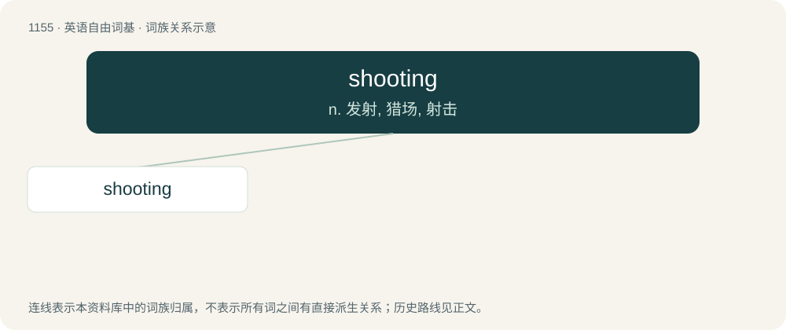

# 1232 · shooting — n. 发射, 猎场, 射击

[总目录](../00_总目录_按常用程度.md)

**类型**：英语自由词基　｜　**来源语言**：见词源记录

## 核心含义与来源

- 核心含义：n. 发射, 猎场, 射击
- 英文含义：Moving or growing quickly
- 词形：shooting

**来源记录 1**（形容词；Moving or growing quickly）

From Middle English shoting, schoting, from Old English scotung (“shooting”), from Proto-Germanic \*skutungō, equivalent to shoot + -ing. Cognate with Dutch schieting, German Erschießung (“shooting”), Swedish skjutning (“shooting”).

## 词族图

## 单词速览（常用到不常用）

| 单词 | 音标 | 释义 |
|---|---|---|
| [shooting](#w-1) | /ˈʃuːtɪŋ/ | n. 发射, 猎场, 射击 |

## 逐词详解

### 1. shooting

**词性**：形容词　｜　**音标**：/ˈʃuːtɪŋ/

**中文释义**：n. 发射, 猎场, 射击

**英文义项**：Moving or growing quickly / Of a pain, sudden and darting

**构词拆分**：shoot + -ing

**词源与演化**：

From Middle English shoting, schoting, from Old English scotung (“shooting”), from Proto-Germanic \*skutungō, equivalent to shoot + -ing. Cognate with Dutch schieting, German Erschießung (“shooting”), Swedish skjutning (“shooting”).

**例句**：

> Shooting beams of light played over the sea.

该用例对应义项：Moving or growing quickly
