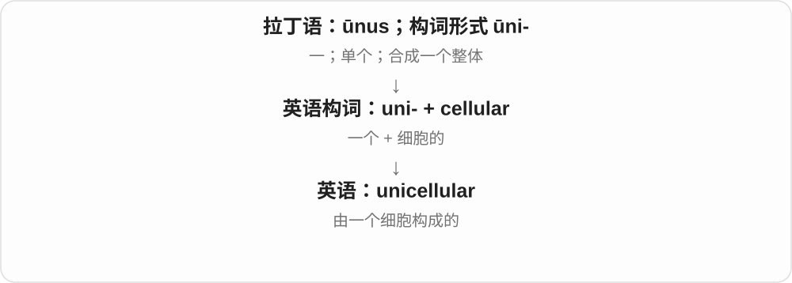

# 1233 · cellular — 细胞、小单元的形容词；数量、内外和层次分组

[逐词精讲目录](../00_逐词精讲目录.md) · [总目录](../00_总目录_按常用程度.md)

## 核心词根与来源

大量已有细胞组合词复用精讲，按意义重新组织。不把肝细胞等偏专门扩展全塞进来。

**CELLULAR：由细胞或小单元组成、与它们相关**

cell、cellular 先读；unicellular/multicellular 比数量，intracellular/extracellular/intercellular 比位置，subcellular 比层级。

- **基本形容词**：cell · cellular
- **数量**：unicellular · multicellular
- **位置与层次**：intracellular · extracellular · intercellular · subcellular

## 词形与演化规律

cellula + -āris → cellular；uni-/multi-/intra-/extra-/inter-/sub- + cellular。

## 单词速览（按词族由简到繁）

同一基础词的相关扩展放在一起，先读基础形式，再读扩展；各组之间优先读常用的。具体词源关系见各词讲解。

| 单词 | 音标 | 核心意思 |
|---|---|---|
| [cellular](#w-2) | 英 /ˈseljələ/；美 /ˈseljələr/ | 细胞的；由小单元组成的；蜂窝移动通信的 |
| [cell](#w-1) | /sel/ | 细胞；单人牢房、小室；电池单元；网络、组织的小单元 |
| [extracellular](#w-3) | 英 /ˌekstrəˈseljʊlə/；美 /ˌekstrəˈseljələr/ | 细胞外的 |
| [intracellular](#w-4) | 英 /ˌɪntrəˈseljələ/；美 /ˌɪntrəˈseljələr/ | 细胞内的 |
| [multicellular](#w-5) | 英 /ˌmʌltiˈseljʊlə/；美 /ˌmʌltiˈseljələr/ | 多细胞的 |
| [subcellular](#w-7) | 英 /ˌsʌbˈseljələ/；美 /ˌsʌbˈseljələr/ | 亚细胞的；细胞内部层次的 |
| [unicellular](#w-8) | 英 /ˌjuːnɪˈseljʊlə/；美 /ˌjuːnəˈseljələr/ | 单细胞的 |
| [intercellular](#w-9) | 英 /ˌɪntəˈseljʊlə/；美 /ˌɪntərˈseljələr/ | 细胞之间的 |

## 逐词讲解

### 1. cellular — 细胞的；由小单元组成的；蜂窝移动通信的

**音标**：英 /ˈseljələ/；美 /ˈseljələr/

**先抓住这个画面**

先看组成系统的小单元：生物里是细胞，移动通信里是分区覆盖的网络单元。

**怎么拆**

借新拉丁 cellulāris，接 cellula 小室、细胞 + -āris。与 cell 同接拉丁小室词系，但借入链有别；通信义按网络划分成 cells 命名。

**怎么变成今天的意思**

**拉丁 cella → cellula**  
小房间 → 小室的小称形式

↓

**新拉丁 cellulāris → cellular**  
细胞、小单元相关的；不是英语 cell 临时加 -ular 的唯一历史

cellular structure 细胞结构，cellular activity 细胞活动，a cellular network 蜂窝移动网络，cellular data 移动数据。

**常见搭配与例句**

cellular structure；cellular activity；a cellular network；cellular data。

> The course introduces basic cellular structures.

课程介绍基础细胞结构。

> She turned off cellular data while using Wi-Fi.

连接 Wi-Fi 时，她关闭了移动数据。

**别混淆**

cellular data 通常手机移动网络数据，不是手机里拍到的细胞照片；生物 cellular 与通信 cellular 由所指对象区分。

### 2. cell — 细胞；单人牢房、小室；电池单元；网络、组织的小单元

**音标**：/sel/

**先抓住这个画面**

先想到分出来的一个小房间，再看一个系统里分出来的小单元；身体、通信、电池各有专门用法。

**怎么拆**

接拉丁 cella 小房间、隔间，英语旧形后来又受法语影响。生物学早期借微小隔间形象命名，其他领域也各自借用，不是牢房里的东西都变成细胞。

**怎么变成今天的意思**

**拉丁 cella → 旧英语、法语等 → cell**  
小房间、隔间

↓

**现代 cell**  
牢房；细胞；电池单元；网络区域、组织小组等小单元

a prison cell 牢房，a blood cell 血细胞，a solar cell 太阳能电池单元，cell division 细胞分裂。

**常见搭配与例句**

a prison cell；a blood cell；a solar cell；cell division。

> The microscope revealed several living cells.

显微镜下可以看到几个活细胞。

> The prisoner returned to his cell.

囚犯回到了牢房。

**别混淆**

cell 单元，battery 日常电池可包含一个或多个电化学单元；cell 和 sell 卖常同音，但来源不同。

### 3. extracellular — 细胞外的

**音标**：英 /ˌekstrəˈseljʊlə/；美 /ˌekstrəˈseljələr/

**先抓住这个画面**

边界是细胞膜；膜外面的空间、液体或物质就可以叫 extracellular。

**怎么拆**

extra-“在外” + cellular“细胞的”，cellular 联系 cell；英语科学构词。

**怎么变成今天的意思**

**拉丁 exterus／extrā**  
外面的；在外面

↓

**英语 extra- + cellular**  
在细胞之外

↓

**英语 extracellular**  
描述细胞外的液体、结构或过程

它不等于“人体外”：细胞之间的液体仍在身体里，却是 extracellular。extracellular matrix 像细胞周围的一张支撑网，帮助组织维持结构。

**常见搭配与例句**

extracellular fluid；the extracellular matrix；extracellular proteins。

> The diagram shows fluid in the extracellular space.

这张图标出了细胞外间隙中的液体。

> The cells attach to proteins in the extracellular matrix.

这些细胞附着在细胞外基质的蛋白质上。

**别混淆**

intracellular 在细胞里面，extracellular 在细胞外面；先找清楚所说的边界。

### 4. intracellular — 细胞内的

**音标**：英 /ˌɪntrəˈseljələ/；美 /ˌɪntrəˈseljələr/

**先抓住这个画面**

把一个细胞想成有边界的小房间，这个词说的是房间里面发生的事。

**怎么拆**

intra- 内部 + cellular 细胞的，属于现代生物学组合词。

**怎么变成今天的意思**

**拉丁 intra**  
在里面、在某个范围之内

↓

**intra- + cellular**  
一个细胞内部

↓

**英语 intracellular**  
位于或发生在细胞内的

intracellular processes 是细胞内部的过程，intracellular fluid 是细胞内液。这个词常帮助你在复杂描述中找位置：先不管过程细节，至少知道它发生在细胞边界内。

**常见搭配与例句**

intracellular transport；intracellular signals；intracellular fluid。

> The diagram shows intracellular transport in a plant cell.

图中展示了植物细胞内部的运输过程。

> Researchers measured changes in intracellular calcium.

研究人员测量了细胞内钙的变化。

**别混淆**

intercellular 是细胞与细胞之间，extracellular 是细胞外。intra-、inter-、extra- 分别回答里面、之间、外面。

### 5. multicellular — 多细胞的

**音标**：英 /ˌmʌltiˈseljʊlə/；美 /ˌmʌltiˈseljələr/

**先抓住这个画面**

一个生物体由许多细胞一起组成，而不是只有一个细胞。

**怎么拆**

multi- + cellular“细胞的”，cellular 接 cell；是现代生物学构词，multi- 本身不说明细胞分工有多复杂。

**怎么变成今天的意思**

**拉丁 multus → 组合形式 multi-**  
多、许多；多次

↓

**英语借用 multi- 参与构词**  
与已有名词、形容词等相接，表示多个、多方面

↓

**英语 multi- + cellular → multicellular**  
由多个细胞组成的

plants and animals are multicellular 是说植物、动物由多个细胞组成；一个多细胞生物里的细胞可以承担不同任务。词义说组成，不是体积一定很大。

**常见搭配与例句**

a multicellular organism；multicellular life；multicellular structure。

> A tree is a multicellular organism.

树是一种多细胞生物。

> The lesson compares unicellular and multicellular life.

这节课比较单细胞与多细胞生命。

**别混淆**

unicellular 是单细胞；multicellular 是多细胞。微小不必等于单细胞。

### 6. subcellular — 亚细胞的；细胞内部层次的

**音标**：英 /ˌsʌbˈseljələ/；美 /ˌsʌbˈseljələr/

**先抓住这个画面**

不再把细胞当作一个小点，而是放大看其中的细胞核、线粒体等结构。

**怎么拆**

sub- + cellular“细胞的”，英语生物学构词。

**怎么变成今天的意思**

**拉丁语：sub**  
在下面；从下向上；靠近

↓

**英语前缀：sub-**  
下方；下一级；低于某个标准

↓

**英语：sub- + cellular → subcellular**  
细胞以下的结构层次

subcellular location 问的是某种分子在细胞哪个部位；不是细胞本身躺在哪个身体位置。

**常见搭配与例句**

subcellular structures；subcellular localization。

> The microscope revealed several subcellular structures.

显微镜显示了几种亚细胞结构。

> The study examined the protein’s subcellular location.

研究考察了这种蛋白质在细胞内的具体位置。

**别混淆**

intracellular 突出在细胞内；subcellular 突出细胞内部的更小结构或尺度。

### 7. unicellular — 单细胞的

**音标**：英 /ˌjuːnɪˈseljʊlə/；美 /ˌjuːnəˈseljələr/

**先抓住这个画面**

unicellular 像把一个完整生命体的基本活动都装在一个细胞里：这个个体本身只有一个细胞。

**怎么拆**

uni-（一）+ cellular（细胞的）。

**怎么变成今天的意思**

它描述个体的细胞数量，不是显微镜下只看见了一个细胞。许多单细胞个体可以同时生活在一起。

**常见搭配与例句**

a unicellular organism；unicellular life；unicellular algae。

> The diagram shows a unicellular organism.

图示展示了一个单细胞生物。

> The lesson compares unicellular and multicellular forms of life.

这节课比较了单细胞与多细胞生命形式。

**别混淆**

multicellular 是多细胞；unicellular 是单细胞。单细胞并不等于没有复杂的细胞内部活动。

### 8. intercellular — 细胞之间的

**音标**：英 /ˌɪntəˈseljʊlə/；美 /ˌɪntərˈseljələr/

**先抓住这个画面**

把细胞想成一间间小房间，这个词关注房间之间的空隙和来往消息。

**怎么拆**

inter- + cellular“细胞的”。

**怎么变成今天的意思**

**拉丁语 inter → 英语 inter-**  
在……之间；彼此

↓

**英语构词：inter- + cellular → intercellular**  
细胞与细胞之间的

可描述细胞间液体、连接或信号传递，不等于细胞内部。

**常见搭配与例句**

intercellular communication；intercellular spaces。

> The study focuses on intercellular communication in the tissue.

研究聚焦于这块组织中的细胞间通信。

> The image reveals small intercellular spaces.

图像显示出细小的细胞间隙。

**别混淆**

intracellular 是细胞内；intercellular 是细胞间，前缀差别改变位置。

## 这一组要分清什么

intra- 内、extra- 外、inter- 之间；uni-/multi- 数量；sub- 低于细胞层级。hepatocellular 专门词暂略。

## 串起来练习

The diagram contrasts intracellular structures with the extracellular space.

图示对照了细胞内结构与细胞外空间。
