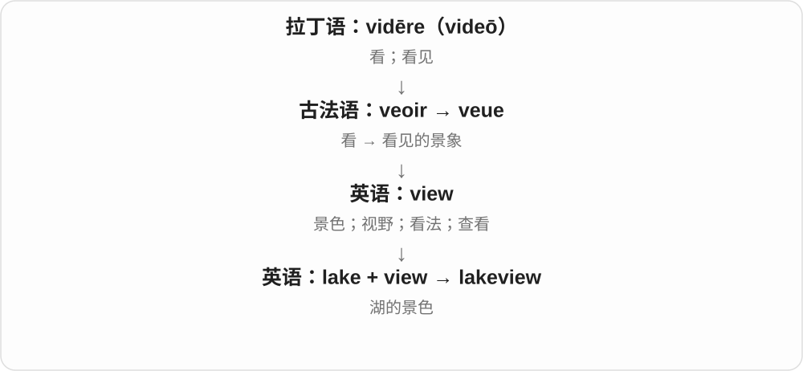

# 1234 · lake — 内陆湖泊；湖边、湖岸与多湖地区

[逐词精讲目录](../00_逐词精讲目录.md) · [总目录](../00_总目录_按常用程度.md)

## 核心词根与来源

水体义有本族与法语借词合流背景。laker 还有不同来源和专门用法，本轮先略；已有湖景、临湖精讲复用。

**LAKE：一片内陆水体，周围地点按相对位置命名**

lake → lakeside、lakeshore、lakefront、lakeview、lakeland，按边、岸、前沿、景观、地区区分。

- **水体与周边位置**：lake · lakeside · lakeshore · lakefront · lakeview
- **湖区**：lakeland
- **lake → lakes：较早英语与法语水体词的影响**：lake · lakes

## 词形与演化规律

lake + side/shore/front/view/land。

古英语 lacu 与法语 lac、拉丁 lacus 背景在中古英语中相互影响，现代湖泊义承接这些材料。

## 单词速览（按词族由简到繁）

同一基础词的相关扩展放在一起，先读基础形式，再读扩展；各组之间优先读常用的。具体词源关系见各词讲解。

| 单词 | 音标 | 核心意思 |
|---|---|---|
| [lake](#w-1) | /leɪk/ | 湖、湖泊 |
| [lakes](#w-8) | /leɪks/ | 湖泊〔lake 的复数〕 |
| [lakeside](#w-2) | /ˈleɪksaɪd/ | 湖边、湖畔；湖边的 |
| [lakeland](#w-3) | /ˈleɪklənd/ | 多湖地区、湖区 |
| [lakeshore](#w-5) | 英 /ˈleɪkʃɔː/；美 /ˈleɪkʃɔːr/ | 湖岸、湖滨 |
| [lakeview](#w-6) | /ˈleɪkvjuː/ | 湖景；能看见湖的 |
| [lakefront](#w-7) | /ˈleɪkfrʌnt/ | 滨湖地带；临湖的 |

## 逐词讲解

### 1. lake — 湖、湖泊

**音标**：/leɪk/

**先抓住这个画面**

陆地中间聚着一大片水，先抓内陆水体的画面。英语 lakeside、lakeshore 等都围绕它定位。

**怎么拆**

现代水体义涉及古英语 lacu 与法语 lac〔拉丁语 lacus〕两条背景，在中古英语阶段相互影响、合流。词典对各条贡献的表述不同，不把路线压成只有一个借词祖先。另有颜料、方言玩耍等同形词，此处暂略。

**怎么变成今天的意思**

**古英语 lacu〔溪流、水池等〕；法语 lac〔接拉丁语 lacus〕**  
本族与借入的水体名词背景

↓

**中古英语 lake、lac → lake**  
形式、意义相互影响或合流，现代常指湖

a freshwater lake 淡水湖，by the lake 在湖边，a frozen lake 冻结的湖。Lake Victoria 等名称常把 Lake 放前，the Great Lakes 则是另一种固定名称。

**常见搭配与例句**

by the lake；a freshwater lake；a frozen lake；the lakeshore。

> We walked around the lake before breakfast.

早饭前我们绕湖散了步。

> The lake was completely frozen in winter.

冬天湖面完全冻结了。

**别混淆**

lake 湖，pond 池塘通常较小，但不存在一条词义自己规定、处处通用的面积界线；river 河流更突出水沿河道流动。

### 2. lakes — 湖泊〔lake 的复数〕

**音标**：/leɪks/

**先抓住这个画面**

水聚在较集中的一片低地、盆地里，形成湖；不同的一片片湖泊合起来就是 lakes。

**怎么拆**

lake + -s，/k/ 后读 /s/。水体名 lake 有古英语 lacu 与法语 lac 的背景，法语词接拉丁 lacus；这些形式在中古英语阶段相互影响、合流，现代常指湖。

**怎么变成今天的意思**

**古英语 lacu；法语 lac、拉丁 lacus → 中古英语 lake**  
较早溪流、水池、湖等水体名称的共同影响

↓

**lake + -s → lakes**  
多个湖泊

mountain lakes 山间湖泊；freshwater lakes 淡水湖；lakes and rivers 湖泊与河流。

**常见搭配与例句**

lakes surrounded by forests；lakes in the valley。

> Several small lakes lie between the mountains.

群山之间分布着几个小湖。

> The route passes two lakes before reaching the village.

这条路线在到达村庄前会经过两个湖。

**别混淆**

湖名常见 Lake 加名称，普通复数 lakes 则说几个湖。river 强调河道中的流动，lake 强调较集中、四周有陆地围住的水体。

### 3. lakeside — 湖边、湖畔；湖边的

**音标**：/ˈleɪksaɪd/

**先抓住这个画面**

不在水中央，而在湖的边上；可以说地点，也可以形容建在那个位置的房屋。

**怎么拆**

lake 湖 + side 边，形成名词、形容词。

**怎么变成今天的意思**

**古英语 lacu〔溪流、水池等〕；法语 lac〔接拉丁语 lacus〕**  
本族与借入的水体名词背景

↓

**中古英语 lake、lac → lake**  
形式、意义相互影响或合流，现代常指湖

↓

**lake + side → lakeside**  
湖边；位于湖边的

a lakeside cottage 湖边小屋，a lakeside walk 湖畔散步，at the lakeside 在湖边。

**常见搭配与例句**

a lakeside cottage；a lakeside village；at the lakeside。

> They rented a lakeside cottage for the summer.

他们租了一间湖边小屋过夏天。

> We had lunch at a lakeside café.

我们在湖畔咖啡馆吃了午饭。

**别混淆**

lakeside 湖边位置，lakeview 强调看得见湖；一间能看见湖的房间未必紧挨岸边。

### 4. lakeland — 多湖地区、湖区

**音标**：/ˈleɪklənd/

**先抓住这个画面**

一片地方以许多湖泊为特色，就把湖和陆地合在一起叫它。

**怎么拆**

lake 湖 + land 地区，形成多湖地带的名称、描述。大写 Lakeland 还可作具体地名，不能每次都按同一城市理解。

**怎么变成今天的意思**

**古英语 lacu〔溪流、水池等〕；法语 lac〔接拉丁语 lacus〕**  
本族与借入的水体名词背景

↓

**中古英语 lake、lac → lake**  
形式、意义相互影响或合流，现代常指湖

↓

**lake + land → lakeland**  
多湖泊的地区、湖区

a lakeland landscape 湖区景观，lakeland scenery 湖区风光；英语英国语境大写用法常联系湖区，但仍须看具体上下文。

**常见搭配与例句**

lakeland scenery；a lakeland landscape；a lakeland village。

> The painting captures the quiet beauty of the lakeland landscape.

这幅画表现了湖区景色的宁静之美。

> They explored several small lakeland villages.

他们游览了几个湖区小村庄。

**别混淆**

lakeland 以湖泊为特色的地区，lakeshore 某个湖的岸；lakefront 更常说临湖前沿位置、地段。

### 5. lakeshore — 湖岸、湖滨

**音标**：英 /ˈleɪkʃɔː/；美 /ˈleɪkʃɔːr/

**先抓住这个画面**

把视线放在湖水碰到陆地的那条岸上。可以沿着它走，也可以有石头、芦苇和村镇。

**怎么拆**

lake 湖 + shore 岸，合成湖泊岸边的名词。

**怎么变成今天的意思**

**古英语 lacu〔溪流、水池等〕；法语 lac〔接拉丁语 lacus〕**  
本族与借入的水体名词背景

↓

**中古英语 lake、lac → lake**  
形式、意义相互影响或合流，现代常指湖

↓

**lake + shore → lakeshore**  
湖水与陆地相接的岸边

along the lakeshore 沿湖岸，a rocky lakeshore 多石湖岸，lakeshore development 湖滨开发。

**常见搭配与例句**

along the lakeshore；a rocky lakeshore；on the lakeshore。

> A narrow path runs along the lakeshore.

一条窄路沿湖岸延伸。

> Reeds grow near the quiet lakeshore.

宁静的湖岸附近长着芦苇。

**别混淆**

lakeshore 强调岸地带，lakeside 范围较宽地说湖边；seashore 海岸，前一成分决定水体。

### 6. lakeview — 湖景；能看见湖的

**音标**：/ˈleɪkvjuː/

**先抓住这个画面**

lakeview 是窗外或观景位置望得到湖的那种视野，常出现在住宿和房产描述里。

**怎么拆**

lake（湖）+ view（景色），可连写；也常见分开写的 lake view。

**怎么变成今天的意思**

它说的是视线能到湖面，并不保证房屋紧贴湖岸。大写 Lakeview 也可能是地名。

**常见搭配与例句**

a lakeview room；a lakeview property；a lakeview balcony。

> We booked a lakeview room for the weekend.

我们为周末订了一间湖景房。

> The lakeview balcony was her favourite part of the house.

能看到湖的阳台是她最喜欢的房屋部分。

**别混淆**

lakeview 是能看湖；lakefront 是临湖岸。广告中的两种位置条件可能很不同。

### 7. lakefront — 滨湖地带；临湖的

**音标**：/ˈleɪkfrʌnt/

**先抓住这个画面**

把 riverfront 的河换成湖，就是沿着湖边的一面和地带。

**怎么拆**

lake 湖 + front 面向的一侧，形成滨湖、临湖的位置表达。不是湖泊向前移动的边缘。

**怎么变成今天的意思**

**lake 湖；front 面向的一侧**  
并列构词部分

↓

**lakefront**  
滨湖区域、临湖位置

a lakefront cabin 湖边小屋，a lakefront path 滨湖小径；名词也可说 the lakefront 湖滨一带。

**常见搭配与例句**

a lakefront park；a lakefront cabin；along the lakefront。

> The trail follows the lakefront for several kilometres.

小径沿湖滨延伸了几公里。

> They stayed in a lakefront cabin.

他们住在一间湖边小屋里。

**别混淆**

lakefront 湖滨，riverfront 滨河，seafront 海滨；共同的 front 是面向某水域的一侧。

## 这一组要分清什么

lakeside 在湖边，lakeview 看得见湖，未必同一位置；lakeshore 湖岸；lakeland 地区不是一个湖本身。

## 串起来练习

Our lakeside room had a beautiful view of the lake.

我们的湖边房间能清楚地看见湖景。
