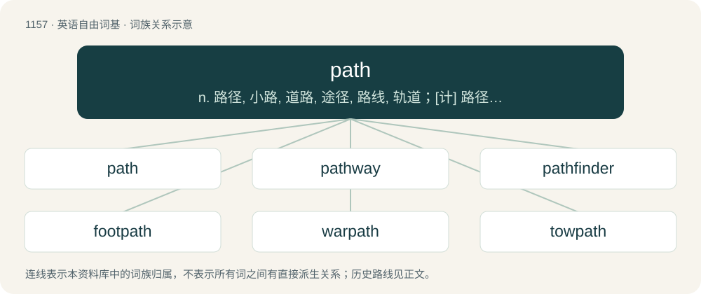

# 1235 · path — n. 路径, 小路, 道路, 途径, 路线, 轨道；\[计\] 路径; DOS内部命令:设定DOS读取程序的路径

[总目录](../00_总目录_按常用程度.md)

**类型**：英语自由词基　｜　**来源语言**：见词源记录

## 核心含义与来源

- 核心含义：n. 路径, 小路, 道路, 途径, 路线, 轨道；\[计\] 路径; DOS内部命令:设定DOS读取程序的路径
- 英文含义：A trail for the use of, or worn by, pedestrians.
- 词形：path

**多个词源／构词路径**：同一拼写可能有不同来源；以下按词性和含义分别列出。

**来源记录 1**（名词；A trail for the use of, or worn by, pedestrians.）

From Middle English path, peth, from Old English pæþ (“path, track”), from Proto-West Germanic \*paþ, from Proto-Germanic \*paþaz (“path”). The Proto-Germanic term is possibly borrowed from Iranian, from Proto-Iranian \*pántaHs, from Proto-Indo-Iranian \*pántaHs, from Proto-Indo-European \*póntoh₁s, from the root \*pent- (“to pass”), but this is disputed. Cognates Cognate with Saterland Frisian Paad, Pad (“path”), West Frisian paad (“path”), Dutch pad (“path”), German Pfad (“path”), German Low German Padd (“path”), Luxembourgish Pad (“path”). Indo-Iranian cognates could be Avestan 𐬞𐬀𐬧𐬙𐬃 (paṇtā̊, “way”), Old Persian 𐎱𐎰 (p-θ /⁠paθi⁠/), Hindi पथ (path), Sanskrit पन्था (panthā, “path”). See also English find. Doublet of panth.

**来源记录 2**（名词；Pathology.）

Shortening.

## 词族图

## 单词速览（常用到不常用）

| 单词 | 音标 | 释义 |
|---|---|---|
| [path](#w-1) | /pɑːθ/ | n. 路径, 小路, 道路, 途径, 路线, 轨道；\[计\] 路径; DOS内部命令:设定DOS读取程序的路径 |
| [pathway](#w-2) | 英 /ˈpɑːθˌweɪ/；美 /ˈpæθˌweɪ/ | n. 路径, 途径；\[医\] 路径, 道 |
| [pathfinder](#w-3) | 英 /ˈpɑːθfaɪndə/；美 /ˈpæθˌfaɪndəɹ/ | n. 探路者, 开拓者, 探索者, 导航人员, 导航飞机, 导航雷达；\[化\] 维修指南 |
| [footpath](#w-4) | 英 /ˈfʊtˌpɑːθ/；美 /ˈfʊtˌpæθ/ | n. 步道, 人行道, 小路 |
| [warpath](#w-5) | /ˈwɔːpɑːθ/ | n. 征途, 敌对行动, 敌对情绪 |
| [towpath](#w-6) | /ˈtəupæθ/ | n. 纤路 |
| [multipath](#w-7) | /ˈmʌltɪpæθ/ | 多径; 多通路; 多路 |

## 逐词详解

### 1. path

**词性**：名词　｜　**音标**：/pɑːθ/

**中文释义**：n. 路径, 小路, 道路, 途径, 路线, 轨道；\[计\] 路径; DOS内部命令:设定DOS读取程序的路径

**英文义项**：A trail for the use of, or worn by, pedestrians. / A course taken.

**词源与演化**：

From Middle English path, peth, from Old English pæþ (“path, track”), from Proto-West Germanic \*paþ, from Proto-Germanic \*paþaz (“path”). The Proto-Germanic term is possibly borrowed from Iranian, from Proto-Iranian \*pántaHs, from Proto-Indo-Iranian \*pántaHs, from Proto-Indo-European \*póntoh₁s, from the root \*pent- (“to pass”), but this is disputed. Cognates Cognate with Saterland Frisian Paad, Pad (“path”), West Frisian paad (“path”), Dutch pad (“path”), German Pfad (“path”), German Low German Padd (“path”), Luxembourgish Pad (“path”). Indo-Iranian cognates could be Avestan 𐬞𐬀𐬧𐬙𐬃 (paṇtā̊, “way”), Old Persian 𐎱𐎰 (p-θ /⁠paθi⁠/), Hindi पथ (path), Sanskrit पन्था (panthā, “path”). See also English find. Doublet of panth.

**例句**：

> Use the network path \\Marketing\Files to find the documents you need.

该用例对应义项：A human-readable specification for a location within a hierarchical or tree-like structure, such as a file system or as part of a URL.

### 2. pathway

**词性**：名词　｜　**音标**：英 /ˈpɑːθˌweɪ/；美 /ˈpæθˌweɪ/

**中文释义**：n. 路径, 途径；\[医\] 路径, 道

**英文义项**：A footpath or other path or track. / A sequence of biochemical compounds, and the reactions linking them, that describe a process in metabolism or catabolism.

**构词拆分**：path + way

**词源与演化**：

From Middle English pathwei, equivalent to path + way. Cognate with German Pfadweg, Afrikaans padweg.

**用法示例／搭配（非完整句）**：

> the pathway to success

该用例对应义项：A course of action.

### 3. pathfinder

**词性**：名词　｜　**音标**：英 /ˈpɑːθfaɪndə/；美 /ˈpæθˌfaɪndəɹ/

**中文释义**：n. 探路者, 开拓者, 探索者, 导航人员, 导航飞机, 导航雷达；\[化\] 维修指南

**英文义项**：One who discovers or makes a new path or way through an untraversed region. / One who is the first to do something in a particular field; an innovator, a pioneer.

**构词拆分**：path + finder

**词源与演化**：

From path + finder.

**例句**：

> Innovation is the difference between a pathfinder and a path follower.

### 4. footpath

**词性**：名词　｜　**音标**：英 /ˈfʊtˌpɑːθ/；美 /ˈfʊtˌpæθ/

**中文释义**：n. 步道, 人行道, 小路

**英文义项**：Any set path or trail to be used by people walking. / A paved path located at the side of a road for the use of pedestrians.

**构词拆分**：foot + path

**词源与演化**：

From Middle English foot path, footpath; equivalent to foot + path. Compare Saterland Frisian Foutpaad (“footpath”), West Frisian fuotpaad (“footpath”), Dutch voetpad (“footpath”), German Low German Footpadd (“footpath”), German Fußpfad (“footpath”).

**例句**：

> They trudged across the tussocky grass and up on to a footpath.

### 5. warpath

**词性**：名词　｜　**音标**：/ˈwɔːpɑːθ/

**中文释义**：n. 征途, 敌对行动, 敌对情绪

**英文义项**：A course of action that leads to battle or hostility.

**构词拆分**：war + path

**词源与演化**：

From war + path.

**例句**：

> The band of Indians were ready to go on the warpath at the slightest provocation.

### 6. towpath

**词性**：名词　｜　**音标**：/ˈtəupæθ/

**中文释义**：n. 纤路

**英文义项**：A path alongside a canal or river, originally for draft animals towing barges, now more often used as a footpath, nature trail, etc.

**构词拆分**：tow + path

**词源与演化**：

From tow + path.

### 7. multipath

**词性**：名词　｜　**音标**：/ˈmʌltɪpæθ/

**中文释义**：多径; 多通路; 多路

**英文义项**：A wireless propagation phenomenon that results in a signal reaching the receiving antenna by two or more paths.

**构词拆分**：multi- + path

**词源与演化**：

From multi- + path.
